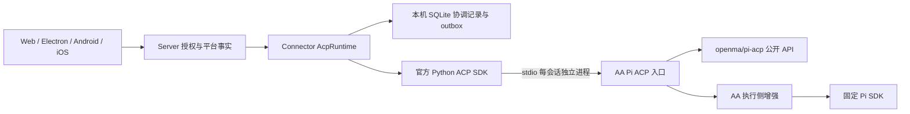

# 通用 ACP Runtime 与 Pi 接入实施约定

本方案采用 Connector ACP Client → 独立 ACP Agent 进程的结构。Pi 是首个 Profile，旧 Pi SDK Runtime 与已有会话绑定继续保留。产品、应用与构建版本不在本任务中调整。当前完成情况见 [实施记录](acp-runtime-implementation.md)，本文中的目标不等同于已经发布的能力。

## 领域与物理边界

Server 管理账号、项目、平台会话、创建工作流和 Timeline。Connector 管理执行者、准备、消息身份、交互等待、组件与有序投递。Pi Agent 管理原生会话、工具执行、原生锁及最终模型请求。客户端只保存按账号隔离的操作引用，不拥有执行状态。

`connector/connector/runtimes/acp/` 的目录约束：

| 目录或文件 | 职责 |
| --- | --- |
| `provider.py`、`runtime.py` | 实现现有 Runtime 端口，映射领域错误和能力 |
| `composition.py` | 装配 Profile、端口、存储和进程；不放业务判断 |
| `domain/definitions.py` | Profile、启动、工作区、组件引用和摘要 |
| `domain/sessions.py` | 平台与 Agent 会话绑定、执行者及连接代际 |
| `domain/preparations.py` | 有效期、单次预留及消费 |
| `domain/operations.py` | 创建与消息接纳事实，拒绝与未知分离 |
| `domain/interactions.py` | 回答版本、代际、幂等身份及有效期 |
| `domain/configuration.py` | 内容摘要与单调 revision 分离 |
| `domain/capabilities.py` | 协议宣告、适配覆盖、已核验保证与运行状态交集 |
| `domain/history.py` | 完整回放与来源替换准入 |
| `domain/installations.py` | 不可变组件身份与清单验证 |
| `application/` | 准备、创建、提交、配置、交互、恢复、同步和组件用例 |
| `infrastructure/acp/` | 官方 SDK、ACP v1 转换、回调；v2 独立关闭 |
| `infrastructure/` | SQLite、outbox、投影、进程监督、签名与产物 |
| `profiles/pi/` | Pi 保证清单、发布门禁与命名空间扩展适配 |

领域层不导入 ACP、数据库、操作系统、FastAPI 或 Pi SDK。通用应用服务通过装配传入 Profile，新增 Agent 不增加 Pi 条件分支。公共组件启动清单使用 `launcher.executable` 和 `launcher.arguments`，Node 属于 Pi 组件的具体启动选择。

## 状态、身份与事务

分别持久化 runtime、profile、平台会话、Agent 会话、组件发行、owner generation、connection generation、clientMessageId。JSON-RPC ID 只用于传输关联。

消息状态为 `not_sent → dispatching → accepted / rejected / outcome_unknown`。ACP v1 prompt 最终响应可证明接纳；连接中断不能证明未接纳。未经增强回执确认的未知操作不得自动重投。首条消息接纳、Agent 会话建立、平台会话建立分别保存。

连接状态为 detached/opening/attached/closing/recovery_required，前台执行状态独立。消息接纳不释放执行配额，实际执行收尾才释放。关闭后尚未发出的请求本地拒绝；已跨执行边界的请求按证据保留接纳或未知。

本机 SQLite 同一短事务提交会话变化、操作记录和 outbox。等待用户、ACP 响应、网络 ACK 均在事务外。嵌套用例使用 savepoint，不在网络等待期间占用写事务。事件按 outbox 序号投递，收到持久 ACK 后删除。重启先校正代际与未知事实，再通过同一通道发布回填。

## 功能数据流

1. **准备与信任**：Server 先保存操作，Connector 执行 Profile 准备策略。普通 ACP Agent 可使用会话式准备并由正式创建接管同一进程；Pi 必须使用无正式会话的增强预检，信任决定先于资源加载。基础、本次及持久信任覆盖 reload，禁止通用层模拟工具审批来替代资源信任。
2. **创建与初始化交互**：客户端先得到操作引用并持续查询；`session/new` 返回前的权限和表单归属于该操作，可回答或取消。准备只绑定一个创建操作，确定拒绝才能释放，未知结果保留原身份查询。
3. **消息**：客户端提供稳定消息 ID；Connector 保存输入摘要、发送意图和接纳证据，重复 ID 不同内容明确拒绝。Pi 增强为首条及后续消息提供早期接纳回执与重启查询。
4. **审批与表单**：Agent 真正暂停后请求权限；Connector 持久化交互并发布 Notice；Server 授权后转发回答；执行者核验请求版本、owner generation 和回答操作 ID。accept、decline、cancel、空字符串和 false 保持不同含义。认证密钥不通过普通表单收集。
5. **配置**：准备结果提供完整实际配置快照；客户端冻结提交选择。逐项修改部分成功时保存真实状态，不回报虚假的全部回滚。配置失效要求重新选择。Pi 最终请求边界还须核验模型、推理强度与端点。
6. **投影与历史**：流式追加与最终条目保持身份；工具、思考、计划、用量分别投影。历史没有稳定来源 ID 时，完整回放成功后才替换该来源，失败不删除旧投影、平台消息和其他来源。
7. **中断、关闭与删除**：独立用例；关闭先拒绝新请求、终止交互、等待执行者释放，再报告成功。删除不代替关闭。异常退出失效旧交互并收敛恢复状态。
8. **原生恢复**：保存不透明位置 token；Pi 适配层校验来源、摘要、分支、写锁和代际。旧 Pi 绑定不迁移为 ACP，不宣告接管正在运行的 TUI。
9. **附件、命令、认证、子 Agent**：仅在具备明确结构化能力与执行保证时开放。附件不能静默丢弃，steer 与普通消息分别处理；原生身份改变必须更新平台绑定；子 Agent 不从日志猜测身份。

## 组件交付与更新

首发完整组件包含固定 Node、openma 正式版本、AA 增强、固定 Pi SDK 和依赖、来源提交、协议、数据兼容、平台和摘要。SDK 1.4.0 仅为回归基线，不能据此绕过上游版本要求。

产物在开发构建环境预构建，设备不在线编译或执行 `npx @latest`。清单由 Ed25519 签名，发行身份为规范化清单摘要。更新服务只信任 AA 配置的正式发布源和内置公钥，不接受客户端传入下载地址或公钥。下载到临时位置，核验平台、架构、清单、路径、大小与摘要后原子安装；激活前再次核验。

激活只改变新会话默认组件，活跃会话和旧会话恢复固定原组件；仍被会话、安装或操作引用的版本不得清理。程序回退与共享数据恢复分开。默认共享 `~/.pi/agent`，认证不进组件；数据迁移独立审批、私有备份、确认写入者释放，不能确定外部写入者时不迁移。

macOS/Linux 使用受监督独立进程组；Windows 挂起创建、加入启用 KILL_ON_JOB_CLOSE 的 Job 后恢复，不允许分配失败后无监督运行。目标是三平台 x64/arm64，Linux glibc；每个目标均需实际产物及运行证据。

## 上游与首发门禁

只使用 openma 正式发布的公开扩展点，不维护 fork，不使用深层 import、安装后 patch 或原型改写。所需行为见 [上游扩展要求](acp-pi-upstream-hooks.md)。当前缺失时可以继续通用层、四端、受控 Agent 与组件管理，但 Pi 创建入口保持 unavailable。

统一首发须同时满足：上游扩展公开发布、六项 Pi 增强完成、六个平台架构产物、四端链路验收及受控模型验证。不能删除审批、放宽最终请求守卫或降低恢复保证来通过门禁。真实供应商认证与调用单独授权。
