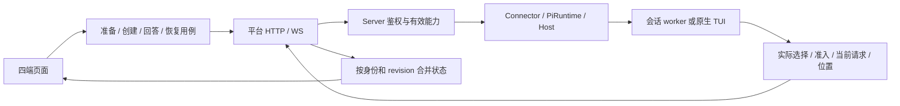
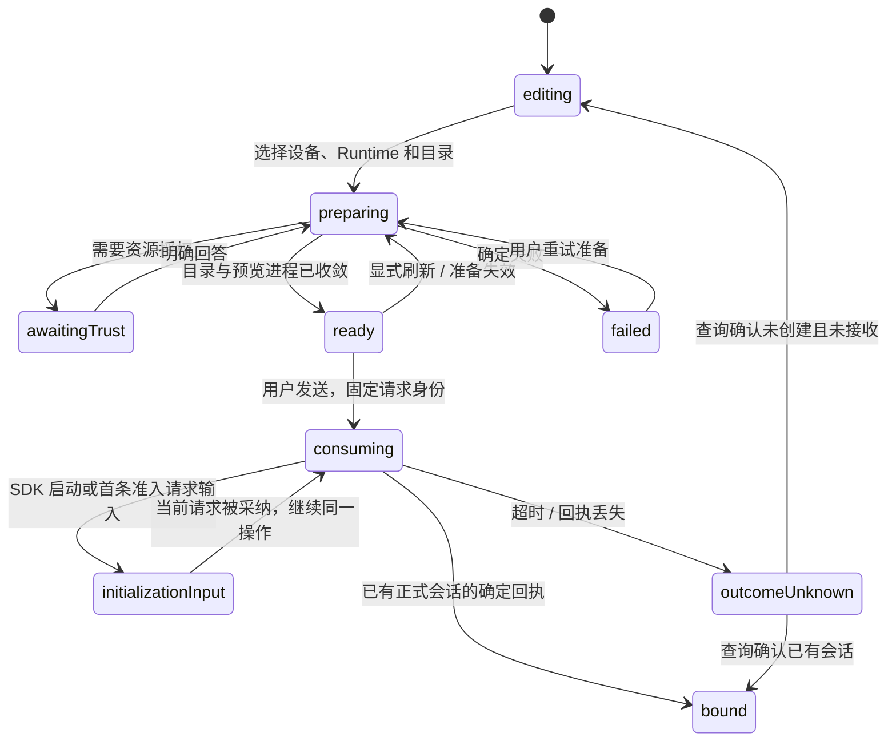
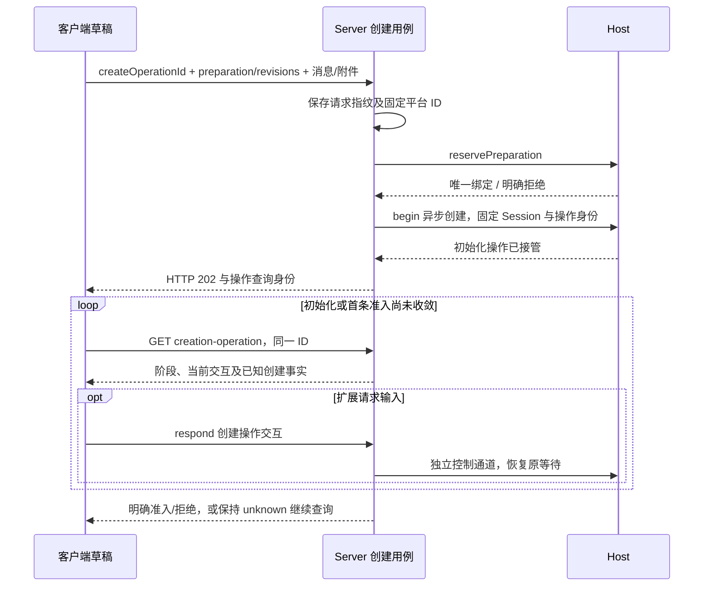

# pi Runtime 客户端补充方案：Web、Android、iOS 与 Electron

> 当前代码范围、已执行检查与未启用能力见 [实现记录](pi-runtime-implementation.md)。本方案中的后续兼容目标不等于已经发布。


> 状态：设计方案，尚未实现。本文补充 [pi Runtime 接入设计](./pi-runtime-integration-plan.md) 第 10 节；新增文件、API、能力和字段均为拟议设计，不能据此判断当前客户端已经支持 pi。
>
> 审查日期：2026-10-28，Asia/Singapore。源码基线为正式远程 `upstream/main` 的 `34f7cbf5f11d14bdea394d4c432aa9a8fb6cc14e`，本轮已重新 fetch、快进并确认 worktree HEAD 一致。pi 机制沿用主方案固定的 `v1.4.0` 证据；本文不变更产品版本。

## 1. Review 结论与本轮补充

**方案可行，但需要把客户端接入作为独立交付链路。** 现有四端已经具备 Runtime 发现、会话、实时状态、模型目录和 Notice 的基础；仍缺创建前工作区准备、按操作查询创建结果、完整输入语义、位置恢复及 Electron 的 pi 执行环境交付。接入一个 Python Provider 并不能使这些入口自动可用。

本文按「入口 → API → 领域用例 → Runtime 事实 → 回执/事件 → 客户端状态」审查，保留四端现有架构，不要求为 pi 重写聊天页。下表中的“补齐”指设计已明确；现有代码仍需按后续实施范围修改。

| 编号 | 级别 | 已核实的问题及影响 | 本文处理 |
| --- | --- | --- | --- |
| C1 | P1 | 创建页当前主要读取 Runtime 全局目录。iOS 虽有名为 Preparation 的 Service，但没有 cwd、准备身份或信任交互，不能替代 WorkspacePreparation；目录切换后沿用模型偏好也可能跨 scope | 第 3、4 节定义独立准备状态、作用域目录与创建消费；第 5—8 节逐端落位 |
| C2 | P1 | Android 创建超时后从活跃/归档会话第一页筛候选：唯一候选即视为成功、无候选可能视为确定失败。同目录另一客户端并发创建、分页遗漏和迟到落库都无法由该规则排除 | 第 4.2 节改为 createOperationId 精确查询，禁止在新流程中据列表推断结果 |
| C3 | P1 | 主方案已指出 Server 的外层成功可能包裹 Runtime 拒绝；本轮确认 Android 解析丢弃 result，iOS requireSuccess() 也只看外层 ok，四端都需要处理 | 第 3.3、4.3 节规定统一业务回执；移动端保留类型化 result 和决定状态 |
| C4 | P1 | Web/Electron、Android、iOS 的 inputRequest v1 均会裁剪自填文本并拒绝空回答；Web 卡片还会随新 form 对象重置答案。不能直接承载 pi input/editor | 第 3.4、4.3 节新增通用 dialog 组件，保留原样文本，区分请求变化和状态更新 |
| C5 | P1 | Web/Electron 事件解析和 Android reducer 固定接收 Protocol 1.0，两个 TS 生成器也固定 1.0；加入 provider 名称不能完成新协议切换 | 第 3.1、9 节明确协议选择、生成物、HTTP/WS/recovery 的一致性及旧端行为 |
| C6 | P1 | Electron 当前分发 Connector、uv、Python，没有 pi Host/worker/SDK 的独立 Node 产物和运行依赖。Electron 后端自身可用 ELECTRON_RUN_AS_NODE 启动，不等于 Connector 已有通用 Node 执行环境 | 第 6.2 节定义可由 CLI/Desktop 共用的独立运行产物与启动协议 |
| C7 | P2 | Electron 的 LocalOwnershipGate 包在 AuthProvider 外，本机安装/所有权失败会阻塞远程工作台；修复整个共用门禁不应成为 pi 首期硬前置 | 第 6.3 节要求 pi 环境失败仅影响该 Runtime；根门禁/认证/自动绑定重构独立推进 |
| C8 | P2 | 主方案已有 getSessionTree / selectExecutionPosition 用例，但四端没有明确的恢复页、选择回执和草稿处理；恢复按钮可能重新落入“先成功启动 SDK”的循环 | 第 4.4 节增加无需活跃 engine 的位置/模型恢复入口，第 5—8 节落实模块 |
| C9 | P1 | bindExtensions 等待 session_start，扩展还可能在首条 before_agent_start 请求输入；等创建返回后再展示会话无法回答这些等待 | 第 4.2.1 节采用 HTTP 202 创建操作通道，四端在正式绑定前即可读取/回答/取消初始化交互 |
| C10 | P1 | 创建后预检不能约束扩展晚换模/推理或最终 provider payload；SDK intake 也早于最终请求检查 | 第 4.4.1 节区分授权预期/实际选择、消息接收/请求放行；守卫和兼容 profile 见主方案 7.9.5 |

源码依据：

- C1：[Web 创建器](../../web-next/src/components/task-composer.tsx)、[iOS 当前准备 Service](../../ios/Agents%20Anywhere/Agents%20Anywhere/Business/V2SessionPreparationService.swift)、[Web 偏好 scope](../../web-next/src/features/dashboard/new-session-preferences.ts)。
- C2：[Android 创建及超时处理](../../android/app/src/main/java/com/agentsanywhere/app/feature/sessions/SessionsController.kt)、[候选筛选](../../android/app/src/main/java/com/agentsanywhere/app/feature/sessions/NewSessionState.kt)。筛选依据是已知会话集合、设备、项目、Runtime、标题和 cwd，没有创建操作的确证。
- C3：[Server 响应包装](../../server/agent_server/api/sessions.py)、[Android 响应解析](../../android/app/src/main/java/com/agentsanywhere/app/api/SessionsApi.kt)、[Android Notice 控制器](../../android/app/src/main/java/com/agentsanywhere/app/feature/sessiondetail/SessionDetailController.kt)、[iOS requireSuccess](../../ios/Agents%20Anywhere/Agents%20Anywhere/Domain/Runtime/V2RuntimeMessage.swift)。
- C4：[Web 输入模型](../../web-next/src/components/session/input-request.ts)、[卡片生命周期](../../web-next/src/components/session/session-approval-card.tsx)、[Android 输入模型](../../android/app/src/main/java/com/agentsanywhere/app/feature/sessiondetail/SessionRuntimeState.kt)、[iOS 输入模型](../../ios/Agents%20Anywhere/Agents%20Anywhere/Models/Chat/NoticeInputForm.swift)。iOS 已有 [通用 schema 表单](../../ios/Agents%20Anywhere/Agents%20Anywhere/Models/Chat/NoticeActionForm.swift)，可以复用标量校验，仍需明确 editor、取消和草稿规则。
- C5：[Web 事件解析](../../web-next/src/components/session-detail.tsx)、[Electron 对应解析](../../desktop-workbench/renderer/src/components/session-detail.tsx)、[Android reducer](../../android/app/src/main/java/com/agentsanywhere/app/feature/sessiondetail/SessionDetailReducer.kt)、[Web 生成器](../../web-next/scripts/generate-protocol-types.mjs)、[Electron 生成器](../../desktop-workbench/renderer/scripts/generate-protocol-types.mjs)。
- C6—C7：[Desktop 分发清单](../../desktop-workbench/package.json)、[后端进程启动](../../desktop-workbench/electron/backend-client.ts)、[根路由](../../desktop-workbench/renderer/src/components/auth/auth-router.tsx)、[本机门禁](../../desktop-workbench/renderer/src/features/desktop/local-ownership-gate.tsx)、[后端初始化](../../desktop-workbench/electron/backend/state.ts)。
- C9—C10：[上游绑定/运行准备](https://github.com/earendil-works/pi/blob/v1.4.0/packages/coding-agent/src/core/agent-session.ts)、[请求装配](https://github.com/earendil-works/pi/blob/v1.4.0/packages/coding-agent/src/core/sdk.ts)和[模型请求出口](https://github.com/earendil-works/pi/blob/v1.4.0/packages/coding-agent/src/core/model-runtime.ts)。公开接口机制探针及准确边界见主方案第 13.3 节。

## 2. 客户端的领域边界

### 2.1 职责与事实归属



| 领域 | 客户端拥有 | 服务端或 Runtime 拥有 |
| --- | --- | --- |
| 新任务草稿 | 文本、附件引用/预览、选择意图、未提交编辑 | 真实 cwd、资源装配状态、可执行的目录及信任决定 |
| 准备操作 | 页面订阅、展示阶段、当前选中项 | preparationId、期限、请求代际、消费绑定 |
| 创建操作 | 稳定操作 ID、原始请求指纹、本地临时目的地 | 固定平台 ID、是否创建、是否接收首条消息及运行事实 |
| 交互 | 表单草稿、提交状态 | 当前等待、有效动作、原子裁决与失效事实 |
| 会话恢复 | 展示差异、用户选择 | 原生树、位置校验、模型/认证预检及实际应用结果 |
| Electron 本机环境 | 展示安装/运行诊断、用户的启动意图 | Connector 环境、Host/worker 生命周期、来源锁及实际退出 |

客户端不直接连接 Pi Bridge，不读 trust.json 或 pi JSONL，不保存工具等待的回调，不把历史审批当成当前请求。Server 接管授权、项目资源信任和工具授权是三个不同动作，页面分别展示其目的和范围。

### 2.2 各端交付边界

| 端 | 需要实现 | 运行 pi 的位置 |
| --- | --- | --- |
| Web | 全部平台交互、准备/创建/恢复页、实时状态 | 用户选择的 Connector 设备 |
| Electron renderer | 与 Web 同等平台能力，增加本机环境入口 | 仍经 Server 定位目标 Connector |
| Electron main/backend | 本机 Connector 与依赖产物管理、窗口和通知；不承担工具审批领域 | 本机 Connector 启动独立 Host/worker |
| Android | 原生 Compose 页面与功能层状态、前后台恢复 | Connector 设备；手机不嵌入 pi SDK |
| iOS/iPadOS | 原生 SwiftUI 页面、账户作用域模型与 repository 恢复 | Connector 设备；手机不嵌入 pi SDK |

远程设备使用 pi 时，不要求浏览器、手机或 Electron 本机安装 pi。Electron renderer 中普通会话请求也不因为目标是本机就绕过 Server 发本机执行请求。

### 2.3 功能入口覆盖

| 用户入口 | 四端接入方式 | 必须保留的语义 |
| --- | --- | --- |
| 设备上的 Runtime 列表、添加和配置 | 复用类型发现、实例 inventory 和 schema 表单；展示 PiProvider 的单实例限制 | 一个 runtimeId 管多个会话，不因单实例限制而禁止多目录；未知 provider 有通用名称/图标兜底 |
| 新任务 | 第 4.1—4.2 节准备/消费 | 目录先确认，模型按 scope，正式会话和首条消息分别确认 |
| 会话列表与后台并发 | 复用 Server dashboard 和 session 投影，每个会话独立状态 | 切页面不切换全局 pi 上下文，不停止另一会话，不把一个会话的“等待批准”应用到全部会话 |
| 消息、工具和流式输出 | 复用 Timeline item renderer，保留主方案的 reservation/entryId 映射 | 当前原生分支、平台历史和流式临时身份分别处理；UI 合帧不丢关键完成事实 |
| 发送、排队、steer、interrupt | 按对应有效能力显示；复用各端发送与停止用例 | 不把普通输入、steer 和 slash command 混发；中断成功与运行实际结束分开 |
| 模型、推理强度和权限策略 | 复用目录选择器，增加 scope 与恢复差异 | 显示实际选择；DSH Agent preset 不直接复制为 pi 模式；权限策略不替代 ProjectTrust |
| 工具审批、普通扩展输入 | 第 3.4、4.3 节 | purpose、来源、动作范围和原样值可表达；不支持的终端组件明确说明 |
| 命令、Skills 与资源面板 | 读取 Runtime 发布的命令/资源目录，复用各端命令模型 | 没有支持就隐藏或禁用并显示原因；不能从聊天文本或旧缓存制造可执行命令 |
| 图片与普通附件 | 现有附件路径 + scope/模型能力校验 | 已上传、已暂存、已消费分开，不支持的格式有明确反馈 |
| 文件浏览、编辑和终端 | 继续使用 Connector 的 Files/Terminal 接口 | 请求绑定目标 Connector/cwd；Electron 本机文件选择不能当作远程设备路径；pi editor 弹窗不是文件编辑器 |
| 原生历史、当前位置与继续 | 现有会话阅读 + 第 4.4 节恢复 | history-only 不自动可写，阅读旧记录不改变执行位置 |
| 用量与诊断 | 复用已有 Timeline/状态展示实际可得值 | 缺失用量显示未知，不补成 0；诊断脱敏；模型/MCP 认证沿用执行设备原生流程 |

现有命令入口可以复用 Web/Electron 的 `use-runtime-commands.ts`、Android 的 `RuntimeCommandModel.kt` 和 iOS 的 `RuntimeCommandModel.swift`；新恢复用例独立于这些命令入口。任意原生 TUI custom 组件、第三方 OAuth 和资源管理界面仍按主方案的能力边界逐项适配，不能以“支持扩展”推导四端已具备对应 UI。

## 3. 四端共用的契约补充

### 3.1 协议与能力

遵循主方案的 Protocol 1.0 冻结要求。下列能力名称除已有名称外均为提案，应在新契约评审时固定，不在 1.0 schema 或生成物里直接加字段：

| 能力/声明 | scope | 客户端行为 |
| --- | --- | --- |
| workspace.prepare | Runtime | 支持且可用时进入准备流程；不支持的其他 Runtime 保持现有创建流程 |
| 异步创建操作/启动交互 profile | Runtime + 客户端协议 | 新 create 响应接受 HTTP 202 操作快照；初始化中 canRespond/canCancel 来自该操作，不能依赖 session.send_message |
| catalog.model / catalog.permission 等现有目录能力 | Runtime / Session 的现有语义 | 准备结果另带工作区 scope；会话页读取该会话目录，不拿全局目录覆盖 |
| session.interaction.approval 等现有交互能力 | Session | 是否可答取有效能力及当前请求；不按 runtimeType 判断 |
| runtimeDialog v1 的组件支持声明 | 客户端协议 profile | 匹配原样输入、选择、取消和多行语义；不能用一个审批能力推导所有表单兼容 |
| session.execution_position.read / select | Session，拟新增 | 允许无活跃 engine 时读原生树、提交恢复位置；可读不等于可写 |
| 原生 UI 来源/可回答声明 | 每个交互或会话能力 metadata | SDK、Bridge 自有/协作请求可以远程回答；未改造第三方 TUI 弹窗显示需本地处理 |
| selectionPolicy / strict_selection_enforced | 每个会话及模型/provider profile | 显示明确支持的固定选择和动态路由范围；无法核验的模型/transport 禁用，不能把受管严格保证自动套到原生 TUI |

`supported/available/allowed` 的判断结果由 Server 结合 Runtime 事实发布；客户端还要满足本地组件可表达性和当前连接新鲜度。失联时禁用回答并显示原因，不能从缓存的 open Notice 推导仍可回答。未知组件不得发送空 input 作为兜底。

新协议需要明确选择入口以及 HTTP、WS ticket、事件恢复、快照的一致 profile。若复用现有握手/票据入口，应扩展其契约；不能只在 renderer 更改一个版本常量。客户端保存选定 profile，Server 按它返回数据，恢复游标与 profile 绑定；切换 profile 时重新取得快照，不能把旧游标用于新格式。

旧端或旧 Server 没有共同支持 pi 的 profile 时，pi 的创建、恢复和交互入口显示不兼容原因。Server 同时保护写入口和序列化路径；若旧格式无法表示 pi 会话，列表/快照不能把 pi 填进旧枚举后期待客户端忽略。可通过旧端兼容的升级提示或过滤不可表达条目实现，策略须进入新契约及 fixtures。升级其他 Runtime 的客户端路径仍保留原 profile。

本轮主线新增的 Timeline orderSeq 范围与重置规则也纳入 pi：投影生成非负 int32 排序值，不用毫秒时间戳或无界原生计数直接赋值；保留 itemId，和 sourceEntryId、位置版本、事件 cursor 分开。四端已有 session.refetch_required / snapshotRequired 分支，新 profile 必须保留它们：收到重置边界后重新读取快照，不只重连旧流，也不按新的排序值复制一条消息。Server 对混合批次按索引拒绝无效通知，timeline.sync 的无效条目会导致整条同步通知拒绝，Connector 的 ACK/checkpoint 不能越过失败。参见[当前实时 API](../api/realtime.md)。

### 3.2 作用域、身份和迟到回包

所有新状态至少按以下边界隔离：

```text
账户作用域 = normalizedServer + userId + credentialGeneration
目标作用域 = 账户作用域 + connectorId + runtimeId + workspaceId
准备读取 = 目标作用域 + preparationId + preparationRevision + viewGeneration
创建读取 = 账户作用域 + connectorId + runtimeId + createOperationId
启动交互 = 创建读取 + initializationId + workerGeneration + interactionId + requestRevision
会话交互 = 账户作用域 + sessionId + ownerGeneration + interactionId + requestRevision
位置读取 = 账户作用域 + sessionId + sourceEpoch + positionRevision
```

workspaceId 由执行侧确认 canonical cwd 后返回，客户端只保留用户输入路径和展示路径，不自行用大小写、斜杠或路径 hash 判断不同设备上的目录等价。`runtimeId` 不默认替换为 `pi`。

同一 scope、同一已确认代际中的 revision 才能比较；A 工作区的 revision 10 不能压过 B 的 revision 2。Host 重启后若计数重置，由 Server 确认新的 owner/state generation 并提供替换快照，客户端清理旧代际活状态，不能比较 UUID 大小或永远保留旧的较大计数。目录和能力也要定义自己的 epoch/revision，不把 Timeline sequence 当所有状态的版本。

轮询请求使用取消句柄和 generation，切目标/登出后旧回包不改当前页面。后台创建若完成，只更新其所属操作/会话列表；只有用户仍停在对应临时目的地时才自动绑定导航。平台 noticeId 与原生 interactionId 可以不同，映射由投影/PiRuntime 保持，客户端使用平台返回的公共身份，不自行拼接或反推原生 ID。

选择偏好的 key 加入账户、设备、Runtime 实例和 workspaceId。对老偏好只做候选迁移，必须在新目录重新校验。首次新建可明确展示一个可用的推荐选择；从 stale/recovery 返回时原模型丢失则保持未选并要求重新确认，不自动换模型后重发。

### 3.3 准备与创建回执

WorkspacePreparation 的阶段和一次授权范围沿用主方案第 8.5 节，响应至少提供：

- 准备身份、scope、revision、expiresAt、serverTime，以及可查询的阶段。
- 规范化工作目录、资源信任来源、实际启用状态、诊断和允许的下一步。
- 当前交互列表及其 requestRevision；ready 时的 resourceFingerprint、catalogRevision、模型/权限目录。
- consuming/consumed 时关联的 createOperationId；不包含执行凭据或私有 IPC 信息。

补充 `GET /api/v2/connectors/{connectorId}/runtimes/{runtimeId}/preparations?clientPreparationId=...` 的精确查找入口提案。Server 在请求 Host 前持久化唯一的账号/Runtime/clientPreparationId 绑定和固定 preparationId；首次 POST 丢回包时仍能查询该绑定。输入指纹不一致返回冲突，Host 尚未确认时返回准备结果未知，不重复启动预览进程。

创建结果必须分别表达 `platformSessionCreated`、`created`（原生会话）、`messageAccepted` 和 `executionState`。`sessionId` 存在、HTTP 200 或某层 `ok=true` 都不是“首条消息已被接收”的替代条件。字段缺省/null 的语义写入 schema，不让四端各猜一套。

新 profile 的 create-and-start 先返回 HTTP 202 与 CreationOperationSnapshot，operationAccepted 只表示任务被接管。四端保留本地创建目的地并立即读操作，不能把 202 强转成现有只含 session 的同步响应。初始化中的 created/messageAccepted 允许 null 表示尚未确认，不转换成 false；不能据此开放重发或清空附件。具体阶段、异步 Runtime 端口和服务端回滚条件见主方案第 8.6 节。

在主方案 getCreationOperation 用例上补充一个独立于准备存活期的读入口提案：

```text
GET /api/v2/connectors/{connectorId}/runtimes/{runtimeId}/creation-operations/{createOperationId}
```

Server 按当前账号及持久化创建记录鉴权。准备过期、空 Session 被回滚、Runtime 暂时离线时，仍可返回已知的操作事实和 unknown 原因；查询不重新执行创建。只有在可证明根本未调度时才返回确定的 not_started，不以“当前没查到会话”替代。操作记录的保留期及幂等 tombstone 必须与客户端可重试期限配套；记录过期后拒绝盲目重放旧操作。

四端保存 createOperationId、clientMessageId 和请求指纹。内容、附件、模型或目标变化使用新操作；原操作处于未知状态时不能用改内容来绕过防重。跨进程恢复只恢复查询任务，不恢复自动发送队列。

### 3.4 通用输入组件与回答

保留 inputRequest v1 的既有问答语义。新增 `uiSchema.component="runtimeDialog", version=1`，覆盖 confirm/select/input/editor；项目资源授权单独携带 purpose 和明确的动作范围，可以复用布局但不能仅凭标题推断授权。

| 字段/语义 | 要求 |
| --- | --- |
| origin / purpose | 明确 SDK/Bridge 协作/本地处理来源，以及 general_input、tool_permission、project_trust 等目的 |
| kind | confirm、select、input、editor；不支持的 kind 有明确诊断 |
| initialValue | 预填文本/初始选项；仅在新请求或内容版本变化时初始化草稿 |
| options | 稳定 optionId 与 label 分开；重复 label 也能准确回答，不能用 label 反查身份 |
| allowEmpty / multiline / 限额 | 空字符串是否有效、多行和大小限制均显式声明；Server/执行侧仍作权威校验 |
| requestRevision | 请求内容/动作发生变化才推进；与状态投影 revision 区分 |
| responseOperationId | 一次回答的稳定身份；重试同一回答保持不变，不能把另一个动作附在同一 ID 下 |
| 取消 | 显式 cancelled；关闭 sheet、浏览器后退或应用进后台只关闭展示，不隐式代用户裁决 |

回答的 input 建议使用判别结构，具体名称在新契约冻结：

```jsonl
{"kind":"input","status":"submitted","text":""}
{"kind":"editor","status":"submitted","text":"  第一行\n第二行\n"}
{"kind":"confirm","status":"submitted","value":false}
{"kind":"select","status":"submitted","optionId":"option-2"}
{"kind":"editor","status":"cancelled"}
```

以上每一行分别表示一个完整 JSON 对象。提交不 trim、不去掉末尾换行、不做 Unicode 归一化；false、空文本、缺失字段和取消必须可区分。输入法组合期间不发送；editor 的回车默认换行，发送有独立动作。空选择不是同意默认项。

字符串 maxLength 按契约的 Unicode 码点语义校验，传输另设 UTF-8 字节上限；不能分别用 JS/Kotlin 的字符串单元数与 Swift 的字形数代替同一限制。中文、emoji、组合字符和末尾换行进入共用 fixtures。未知组件可以保留请求明确允许且不依赖该输入的取消动作，不能假定缺 input 就是取消。

交互响应携带 scope、ownerGeneration、interactionId/requestRevision、actionId 和 responseOperationId。Runtime 原子裁决后返回主方案 DecisionReceipt 的 applied/already_applied/not_pending/outcome_unknown 及当前代际/版本。状态 revision 更新不重置表单，requestRevision 或 schema 变化才使旧草稿失效。

这些上下文字段需要贯穿平台请求、Connector 的通用 respond_interaction 端口及 Pi Bridge 新 schema，不能把它们塞进用户输入字段或仅在客户端比较。现有旧 profile 的输入格式保持兼容；新 profile 缺必需上下文时明确拒绝。

补充决定回执的只读用例 getInteractionResponse：准备 scope 使用 `GET /.../preparations/{id}/interactions/{interactionId}/responses/{responseOperationId}`，会话 scope 使用 `GET /sessions/{id}/runtime/notices/{noticeId}/responses/{responseOperationId}`。当前请求关闭后仍可查询保留期内回执；查询不重新回答。执行者重启丢失可证明结果时返回 unknown/已失效的事实，不把“没找到回执”解释成可以重新批准。

创建 scope 另用 `GET /.../creation-operations/{createOperationId}/interactions/{interactionId}/responses/{responseOperationId}`；回答使用同资源下的 `/respond`。三种 dispatcher 共享表单和决定语义，scope/代际不同，不能借一个虚假 sessionId 复用 URL。

## 4. 通用用户流程和状态机

### 4.1 新建前准备



准备页展示「设备与工作目录」「项目资源」「模型与推理强度」「权限策略」及保留的草稿。不向产品页面暴露 worker、MeshCall、SDK factory 等实现信息。项目资源动作使用主方案的「继续基础能力」「本次启用」「信任此目录」「取消」，文案明确本次启用覆盖本次准备和唯一消费会话的当前执行进程生命周期。

1. 选设备/实例，读取有效能力；支持 workspace.prepare 时使用新流程。
2. 选工作区后创建 preparation；真实 scope 以 Runtime 返回为准。前端当前可先浏览目录，不要求已有模型。
3. 准备交互走 preparation API，无 Session、不打开会话 WS、不持久上传附件。准备 POST 超时也要用稳定 clientPreparationId 查询/继续同一准备，不能连续生成预览进程。
4. 用户回答后等待资源保存/装配完成及 ready，再选择该 scope 的模型。回答 accepted 不能直接标记 ready。
5. 用户发送时固定本次文本、附件内容摘要、选择和 preparationRevision；此后该操作使用不可变请求快照。
6. 普通离页只停止读订阅，不取消后台创建。切目标时使旧准备失效，并尽力取消未消费准备；进入 consuming 的操作单独保留，不能因新编辑器卸载就撤销。

本地隐藏 loading 或停止轮询不表示服务端取消成功。期限以 Server/Runtime 判定为准，客户端倒计时只作展示。ready 也可能因资源或信任变化失效，创建时再次由 Runtime 核验。

### 4.2 创建、附件与未知结果



| 确认结果 | 客户端动作 |
| --- | --- |
| 未建平台会话、未建原生会话、未接收，结果确定 | 保留草稿；按错误回准备页或展示明确重试动作 |
| 平台会话存在，原生创建或首条消息失败 | 绑定该正式会话并展示具体失败；保留未接收的消息与附件，不再新建同类会话 |
| 消息已接收、执行中或排队 | 绑定正式会话，草稿转入对应 pending/Timeline；不再发送首条消息 |
| messageAccepted=true，稍后守卫拒绝或执行失败 | 展示具体运行失败；即使 providerDispatched=false，也不能当成消息没送达而重发 |
| 结果未知 | 显示“确认创建结果”，按操作 ID 查询；禁用重复发送，不以列表候选或超时长度推断结果 |

Web 的 File/Blob 与移动端本地附件引用在准备期间留在客户端。发送时按既有新会话 inline 附件路径和约束交付；恢复网页丢失 File、手机 URI 权限失效时显示需重新选择，不保留一个看似可发的空引用。

请求摘要必须对应实际发送的字节和附件摘要。上传/暂存与 pi 实际消费分别报告；模型改变后重新核验 MIME、图片能力和大小。准备、查询或模型恢复本身都不上传附件、不向模型发送消息。

### 4.2.1 正式绑定之前的初始化交互

初始化交互是创建操作的一部分，和准备页的 ProjectTrust 请求分别定位。四端流程固定为：

1. 收到 202 后记录 createOperationId、operation revision 和初始化代际，立即进入“正在启动”面板并开始有界读轮询；即使本地目的地还不是正式 session，也允许调用操作 API。
2. 快照含 awaiting_input/current interactions 时展示通用表单，支持 confirm/select/input/editor。请求来自初始化 scope，回答携带 initializationId、workerGeneration、requestRevision 和稳定 responseOperationId；不等待创建最终回执，也不先请求 session 命令目录。
3. 回答 applied 只更新表单提交状态，继续读创建操作；不因回答成功跳转或释放草稿。started 前的 before_agent_start 输入继续使用同一通道。
4. 取消按钮按 canCancelInitialization 调用专用取消接口，不把关闭 sheet、导航或进入后台当成取消。与准入竞争后如果返回 not_cancellable，就保留当前事实并转正式会话的正常中断入口。
5. 收到明确准入或保留正式会话的失败结果后绑定真实 session；仍打开的 creation 请求保持原 scope，直至权威终态。不能改成 SessionNotice 后再创建一份回答入口。
6. 旧代际、期限和 worker 退出使请求失效；重连/应用恢复只查同一操作，不重建原生会话或重新批准。created=true 的初始化失败保留对应会话与恢复入口。

请求期间可显示已知平台会话信息，但 Composer 的普通发送、模型切换、steer 和 slash command 尚不可用；回答/读取/取消是独立动作。创建中不以缓存的 session 能力禁用这些控制入口。操作状态与表单草稿由账户作用域控制器持有，不由一个临时 sheet 的挂载决定生命周期。

| 层 | 改动 |
| --- | --- |
| Web / Electron renderer | 原 use-session-creation 接受 202 分支并订阅操作，新增 initialization 面板和创建 scope dispatcher；不在临时目的地开启 session WS |
| Android | 功能层持有初始化状态/轮询；Compose 显示表单，回前台刷新操作后答复；保存操作身份而非自动写队列 |
| iOS/iPadOS | NewSessionModel/账户 repository 持有操作模型；SwiftUI 不新建 session socket，scene 恢复只恢复读取 |
| Server / Connector / Host | 快照及控制端口不等待 bindExtensions；await UI 不持有阻塞 respond/cancel 的创建锁；非终态不触发空会话/附件回滚 |

### 4.3 审批和普通输入

```text
读取新鲜请求 → 按 purpose 显示 → 本地编辑
  → 提交确定的动作与请求版本 → Runtime 裁决
  → 回执与权威 Notice/准备快照合并 → 显示采纳、关闭或失败
```

准备交互调用 preparation 响应 API，初始化交互调用 creation-operation 响应 API，会话交互调用 session 响应 API。共享组件通过传入 dispatcher 复用展示，不在组件里拼接某一种 scope 的 URL。

- applied/already_applied：该回答被采纳，禁止再次回答；可显示等待后续处理。资源重建、模型切换及工具结束仍看各自事实。
- not_pending：刷新当前请求；只有该请求已终结/失效的事实才能关闭它，不能替用户选择新的请求。
- outcome_unknown 或传输超时：保留表单和回答身份，先查当前状态/回执，不把“重试”做成另一个批准动作。
- 业务拒绝、版本冲突、信任记录保存失败：保留草稿并展示可修复原因，不从 UI 删除仍打开的请求。

统一操作适配器同时校验传输、envelope 和业务回执。新协议由 Server 把 Runtime 拒绝映射成明确失败；客户端也保留类型化 result，不能依赖“Server 应该已经处理”。旧响应兼容只在适配层进行，不在四端页面散落不同的内层 ok 解析。

本地终端与多个客户端同时回答，由 Runtime 决定唯一胜者。轮询、刷新、推送重连、应用唤醒和收到通知都不自动 approve。工具审批显示冻结后的执行摘要、实际目录和范围；用户不能在摘要框里改参后当成同一审批。

### 4.4 位置和模型恢复

会话页提供独立的恢复面板；读取历史树和恢复原因不要求 session.send_message 可用。不要把恢复封装成一个必须先启动 SDK 才存在的 slash command。

1. 从 Runtime 返回的恢复原因进入；显示上次已确认位置、来源是否变化、原模型/推理强度及当前可用项。
2. 位置需要确认时，经 Server 鉴权调用 getSessionTree，分页读取原生树；携带 sourceEpoch/positionRevision。展示根节点也是明确可选位置，null 根和未提供位置不同。
3. 用户选择后调用 selectExecutionPosition，收到持久化确认和新位置版本。树过期则刷新，不用同文本节点猜匹配。
4. 对选定分支执行严格模型预检。模型或认证不可用时显示差异；认证继续使用执行设备的原生配置流程，客户端不索取模型密钥。
5. 用户显式应用新的模型/推理选择后，等待实际状态确认；拒绝或意外 fallback 仍停留恢复页。
6. 原先被拒绝的消息保持草稿；用户再次发送使用新的 clientMessageId。确认恢复不自动重放旧消息。

原生在线会话只展示可验证的实时能力；history-only 只读。未具备原文件协作式交接时，只能在能力支持后选择“从该分支创建副本”，不能出现会暗中打开原文件的“接管继续”按钮。Timeline 中阅读旧分支、选择执行位置和创建副本是不同动作，页面不能把滚动历史变成分支切换。

### 4.4.1 最终请求守卫失败的展示

模型预检通过只表示当前具备恢复条件。最终请求策略由执行侧核验，客户端不能依据先前目录或一次 SessionState 读取宣称已经按原模型执行。

- 发送前拒绝仍是 messageAccepted=false，保留草稿；SDK 已 intake 后的 `pi_request_selection_changed`、`pi_request_effort_changed` 或 `pi_request_payload_changed` 是已接收任务的运行失败。
- 分别展示授权预期与原生实际值，以及本次请求是否被阻断；providerDispatched=false 不是重新发送许可。此前可能已有其他请求执行，不能把单次拒绝显示成整轮没有副作用。
- 守卫失败的消息可能已在原生历史里，保留对应 Timeline/失败事实，不再生成第二个乐观用户气泡。先显式应用模型/推理修复，再由用户选择新的后续操作；不自动恢复 SDK 队列或重发首条任务。
- fixed-selection 是第一版默认；动态模型只有具备明确路由授权和已验证出口的 profile 才可选。未知 API、自定义 stream 或 transport 显示具体不可用原因，不根据“扩展已加载”判断已兼容。

模型实际变化不自动覆盖用户授权偏好。恢复页读取当前选择和授权证据的差异，客户端不能把扩展写入的最后一条 model_change 无条件存成“用户最近选择”。

### 4.5 断线、前后台和通知

| 场景 | 行为 |
| --- | --- |
| 浏览器刷新、renderer 重载 | 从账户操作记录恢复查询及草稿引用；重新读有效能力/当前请求；不恢复自动批准或自动发送 |
| 手机进入后台、系统挂起 | 暂停读轮询/订阅；运行仍由 Connector 负责；请求可能在后台超时 |
| 返回前台/网络恢复 | 先读操作、会话快照和当前交互，再恢复可用按钮；缓存表单只匹配同一有效请求 |
| 登出/切 Server/账号 | 取消订阅和本地 continuation，推进 credentialGeneration，隔离/清理旧账号展示；迟到回包不写新账号 |
| 多端竞争、TUI reload | 按 owner/request revision 失效旧表单；不能将旧答案迁移到新的请求 |
| 收到通知并点击 | 进入被鉴权的对应页面，再拉取当前请求；点击本身不触发执行 |
| Runtime 停止、Host 重启 | 按实际不可用原因显示，查询已知回执；不把历史 Notice 复活成可回答请求 |

通知只复用现有系统已具备的渠道；第一阶段不把新增 APNs/FCM 或系统后台常驻列为 Runtime 可用的前置条件。通知去重身份包含 scope、interactionId 和 requestRevision，默认不在锁屏展示完整命令、文件内容或用户输入。

## 5. Web 端目录与代码设计

Web 使用现有 Next.js 项目；以下新增代码均为提案。当前实际入口是 [task-composer.tsx](../../web-next/src/components/task-composer.tsx)，创建状态由 [use-session-creation.ts](../../web-next/src/components/session/use-session-creation.ts) 持有；不要另建一套平行聊天页。

| 目录/文件 | 设计职责与改动 |
| --- | --- |
| src/features/dashboard/types.ts | 连接新增生成 DTO；保留 runtimeType/runtimeId 区分，加入准备/创建回执引用，不把私有 Bridge 类型当平台 DTO |
| src/features/dashboard/runtime-instances.ts、runtime-discovery.ts 与 runtime 配置组件 | 接入通用 pi descriptor、单实例配置和可用性原因；不复制 DSH 专属 preset 分支 |
| src/lib/api/workspace-preparations.ts（新增） | prepare/get/refresh/respond/cancel 及 creation-operation 查询；统一 scope、业务失败和确定拒绝/未知结果分类 |
| src/lib/api/session-creations.ts（新增） | 新 profile 的 202 创建/操作快照、启动交互 respond/receipt 与取消初始化；复用现有 HTTP client |
| src/features/dashboard/api.ts | 组合新增资源 client，现有 session API 继续复用；不让组件直接写 fetch |
| src/features/workspace-preparation/types.ts（新增） | 草稿、目标、准备快照、创建操作和引用身份；区分本地 UI 状态与 wire DTO |
| 同目录 preparation-state.ts（新增） | 纯 reducer：第 4 节转换、revision、scope fence；无 DOM/网络依赖 |
| 同目录 preparation-controller.ts（新增） | prepare/答复/刷新/查询编排、单 scope 在途请求、有界轮询及取消；不持有真实执行等待 |
| 同目录 preparation-store.ts（新增） | 账户作用域操作表与可恢复的查询引用；有效授权和 ready 状态必须重读，File 不写 localStorage |
| 同目录 use-workspace-preparation.ts（新增） | React 订阅与 visibility 生命周期适配；卸载页面不等于取消创建 |
| src/features/session-creation/（新增） | initialization-state.ts、initialization-controller.ts：操作阶段、启动请求和独立控制 dispatcher；与已有创建 hook 共享同一操作记录 |
| src/components/workspace-preparation/（新增） | preparation-panel.tsx、project-trust-dialog.tsx、preparation-summary.tsx；分别画阶段、范围和实际结果 |
| src/components/runtime-interaction/（新增） | dialog-model.ts、raw-text-form.tsx、choice-form.tsx、interaction-drafts.ts；共享 dialog 解析和表单，通过 dispatcher 区分 scope |
| src/components/session/session-approval-card.tsx | 保留现有审批/inputRequest v1，按新组件声明选择 renderer；改为稳定请求键持有草稿，不因状态推送丢输入 |
| src/components/session/use-session-creation.ts | 接入准备消费、固定操作身份、查询 unknown、保留业务拒绝；绑定正式会话与消息接收分开处理 |
| src/components/session/session-initialization-panel.tsx（新增） | 创建中展示原样表单、阶段和明确取消；在 session-detail 正式绑定前可回答 |
| src/components/task-composer.tsx | 工作区先于 scope 目录准备；发送动作依准备状态；stale 时保留用户意图并要求确认 |
| src/components/workspace-context.tsx | 持有跨页操作与草稿生命周期、接收后台完成；不在每次 composer 挂载时重建提交任务 |
| src/features/session-recovery/（新增） | recovery-state.ts / recovery-controller.ts；位置读取、选择和模型应用的应用逻辑 |
| src/components/session/session-recovery-panel.tsx（新增） | 从 session-detail 挂接独立恢复面板，无 engine 时也可打开 |
| src/features/dashboard/new-session-preferences.ts | 加 workspace/account scope，老偏好校验后迁移；不持久化本次信任决定 |
| src/generated/protocol/<next>/ 与 scripts/generate-protocol-types.mjs | 从新 manifest 生成并做一致性检查，按 profile 选择类型；保留 v1 生成目录 |
| messages/en.json、messages/zh-CN.json | 增加准备、结果未知、原样输入、恢复差异和不可用原因的中英文文案；复用现有本地化键规范 |

页面/组件的单向数据流：

```text
task-composer → preparation-controller → 平台 API
平台快照 → preparation-state → preparation-panel / 模型选择
用户发送 → use-session-creation → 创建操作回执
HTTP 202 → initialization-controller → 创建操作读取/表单/独立答复
回执 → workspace-context 中对应操作 → 正式 session-detail
session 事件 → 现有会话状态合并 → 交互/恢复面板
```

交互草稿 key 使用请求内容版本；投影状态更新保留输入，内容变化才重置。当前 React 卡片的 useMemo([notice]) / useEffect([inputRequest]) 不能原样扩展到新 dialog，否则重新获取 Notice 对象就可能丢掉正在输入的 editor 文本。

Web 仅缓存可恢复查询的操作信息；敏感输入默认内存持有，若产品需要磁盘草稿，须复用账户隔离的既有存储并尊重请求的持久化限制，不把 tool 参数或一次授权存入通用偏好。

## 6. Electron 端：renderer 与本机执行环境

### 6.1 renderer 的独立改动

当前 [Desktop renderer](../../desktop-workbench/renderer/src/components/task-composer.tsx) 有自己的一份创建、Notice、API 和协议代码。与 Web 路径相近不代表共享编译产物；Web 的改动不会自动进入 Desktop。

第 5 节新增目录在 `desktop-workbench/renderer/src/` 同步落地，现有 task-composer、use-session-creation、session-detail、api、preferences 及生成器分别更新。第一轮不引入一个大型跨项目组件迁移，使用同一平台 schema 和 `contracts/` 下相同 fixtures 核对行为；以后抽共享纯模型可以单独实施。

| 现有位置 | 需要的设计 |
| --- | --- |
| renderer/src/features/desktop/bridge.ts | 对外只有类型化本机环境/管理操作，不暴露任意 spawn、文件读写或 Bridge secret |
| renderer/src/features/desktop/desktop-connector-context.tsx | 本机设备绑定与远程 session 操作分离；本机恢复失败不重置远程创建操作 |
| renderer/src/components/auth/auth-router.tsx | 首期不因 pi 新增条件或改写认证流程；只使用远程工作台的门禁拆分是独立后续任务，见 6.3 |
| renderer/src/features/desktop/local-ownership-gate.tsx | 首期不纳入 pi RuntimeEnvironment 状态；原有 Connector 门禁保持既有语义 |
| electron/preload.ts | 复用受控 /desktop-api 代理与事件订阅；pi 命令和审批仍走平台 API |
| electron/backend/server.ts、state.ts | 展示/管理本机 Connector 与 Runtime 依赖状态；用户请求的本机维护才进入所有权校验 |
| shared/runtime-environment.ts（新增） | Runtime 产物状态 DTO；与现有 ConnectorEnvironmentState、WorkspacePreparation 分开 |
| renderer/src/components/desktop/runtime-environment-panel.tsx（新增） | 显示本机 pi 环境、诊断、校验与显式修复入口；远程会话不挂此面板作为门禁 |

本机环境 SSE 的 event revision 和平台会话事件 cursor 分开，不把 Desktop 后端重启后的新 token、端口或安装进度混入 SessionState。

### 6.2 分发、启动与进程监督

当前 Desktop [extraResources](../../desktop-workbench/package.json) 只包含 Connector、图标、uv 和 Python。新增 pi Host 还需要可复现的 JS、运行依赖及独立 Node。选择以下默认路径：

1. 构建端生成完整 pi Runtime 产物：Host/worker JS、固定 SDK 依赖、动态加载所需运行文件、许可证、清单和校验和。目标设备不执行 npm install 或从源码编译。
2. 产物配备满足固定 SDK 引擎约束的独立 Node，并记录精确版本、平台、架构和 ABI。CLI Connector 和 Desktop 使用同一布局；不要求系统 PATH 存在 node，不依赖 Electron 专用启动方式。
3. Desktop 打包声明 `Resources/pi-runtime/<platform-arch>/`；CLI 使用已验证的等价安装目录。可执行文件和需要真实文件路径的依赖不藏在 asar 内，运行数据写用户数据目录而非应用资源目录。
4. Python PiRuntime 使用受控绝对路径及参数数组启动 Host。Host 再启动同一 Node 的会话/预览 worker，按主方案执行私有 IPC、来源锁、额度与关闭协议。
5. Node 和 SDK 路径从产物清单解析；启动环境清理 Electron 专用启动变量、Desktop 后端令牌等不应传入的值，模型原生环境配置按明确的 worker 环境快照装配。GUI 的 shell PATH 只是用户工具发现补充，不是主执行器定位机制。
6. 开发/BYO 模式可显式配置 Node 和产物目录，但先核验清单、引擎和 SDK/Bridge 兼容性；错误使该 Runtime unavailable，不静默切到另一个系统 node 或 pi。

拟新增的目录职责：

| 位置 | 职责 |
| --- | --- |
| pi-runtime/scripts/build-artifact.mjs | 本地构建平台产物、完整依赖清单与离线启动验证；不在用户工作目录构建 |
| pi-runtime/distribution/ | 产物布局、平台/架构/ABI manifest schema、许可证清单规则；产物本体不作为源码提交 |
| connector/connector/runtimes/pi/environment.py | 产物解析、兼容核验和就绪诊断，不处理项目资源信任 |
| connector/connector/runtimes/pi/lifecycle.py | 复用主方案的宿主监督器，启停 Host、接收生命周期回执；真正会话 worker 监督仍在 Host |
| desktop-workbench/scripts/prepare-pi-runtime.mjs | 选择并校验已有目标产物，加入打包输入；不用安装时下载 npm 包替代 |
| desktop-workbench/package.json 的 build 配置 | extraResources、解包、签名和不同架构文件规则，保留当前产品版本 |

“Electron 自带 Node”不是跨 CLI/Desktop 的部署方案：当前 backend-client 的 ELECTRON_RUN_AS_NODE 只解释 Desktop 自己的后端启动。若以后希望复用它，需要独立评估生命周期、启动协议和分发约束，不让 Runtime 依赖一个碰巧继承到的环境变量。

平台支持按产物和监督后端逐项声明。macOS arm64 的现有 SDK 探针不能证明 Windows Job/file lock、macOS x64、Linux ABI 或签名后的 app 可用；目标组合未完成实包启动和关闭验证前，该组合不能发布为 ready。原生 TUI 扩展另外核验用户 pi 版本，不能把受管 SDK 的固定版本当成 TUI 的实际版本。

### 6.3 三层“准备”不能混为一个门禁

| 层次 | 对象 | 失败影响范围 |
| --- | --- | --- |
| ConnectorEnvironment | Python/uv/Connector 依赖与本机管理 | 本机 Connector 相关操作 |
| RuntimeEnvironment | Node、Host/worker、SDK/Bridge 兼容 | 对应设备上的 pi Runtime |
| WorkspacePreparation | 某次目录资源授权和 scope 目录 | 对应准备及创建操作 |

pi 首期只增加 provider 级环境状态，不把 RuntimeEnvironment 的 checking/failed/cancelled 合并进 ConnectorEnvironmentState 或 LocalOwnershipGate。Node/SDK/Host 产物缺失、失败或被取消时，只将该 pi 实例标记 unavailable，保留诊断与显式修复；不让 backend.initialize() 因 pi 依赖失败整体抛错，也不停止已有其他 Runtime。准备页按所选实例能力处理，远程 pi 不依赖本机 pi 产物。

现有 LocalOwnershipGate 放在认证前仍是基线限制，Python/Connector 安装失败时可能继续阻塞远程工作台；本文不把这个现象当作 pi 已解决的能力。首期验收要求“pi 新增依赖失败不扩大阻塞范围”，不要求先完成整套认证/自动绑定改造。

共用根门禁拆分作为独立后续任务，不属于 pi 接入的硬前置。该任务实施时需同时核对 AuthRouter、DesktopConnectorProvider 和 backend.initialize()，并保持本机凭据保护：

- 平台登录、远程列表和远程会话可以独立工作；本机失败作为本机设备状态展示。
- 本机 provisioning、配置采纳、凭据轮换、启动/重连及环境修复仍必须经过真实所有权校验；renderer 的“远程模式”不产生任何本机写入豁免。
- 把自动本机初始化拆为显式受门禁的分支或只读观察；移除根组件阻塞后，不能留一个后台 effect 无条件绑定设备。
- pi 环境失败只禁用本机 pi，不阻塞其他可用 Runtime；远程 pi 根据目标设备能力决定。

只有该独立任务完成并验证后，才声明“本机 Connector 不可用时也能完整进入远程工作台”。pi 交付不等待该任务，不能在文档或 UI 中提前宣告它已实现。

### 6.4 退出、休眠与通知

关闭页面或最小化不停止 Agent。真正退出 Desktop、停止本机 Connector/Runtime 时，Connector 传播主方案的异步关闭协议：等待运行收敛、shutdown hook、位置 ACK 和进程退出；不可只等 Electron 窗口消失。

默认本机执行随受管 Connector 停止，远程设备上的会话继续。若要求“退出 Desktop 后本机仍运行”，需要独立常驻服务及显式所有权交接，不能声称靠保留孤儿进程完成。休眠/唤醒后先核验连接与代际，再开放回答。

桌面通知经现有原生通知入口，仅传展示与导航身份。点击后经 Server 拉取当前请求；不把通知 action 直接映射成未经新鲜度核验的 approve。

## 7. Android 端目录与代码设计

遵循 [Android 架构](../../android/ARCHITECTURE.md)：api 管 DTO/网络，feature 管状态和用例，ui 管 Compose，app 管账户与生命周期组装。以下路径均相对 `android/app/src/main/java/com/agentsanywhere/app/`。

| 目录/文件 | 设计职责与改动 |
| --- | --- |
| api/WorkspacePreparationsApi.kt（新增） | 准备 CRUD、回答及精确创建操作查询；与 Files/Terminal API 分开 |
| api/WorkspacePreparationDtos.kt（新增） | scope、阶段、revision、动作、目录和回执 DTO；raw text 原样序列化 |
| api/SessionCreationsApi.kt（新增） | 202 创建操作快照、初始化交互答复/回执与取消；和同步 SessionCreateResponse 分开解码 |
| api/DevicesApi.kt、RuntimeCatalogDtos.kt 及 feature/devices/ | 复用类型/实例发现、配置和能力解析，增加新 profile/scope；设备页不要求本地安装 pi |
| api/SessionsApi.kt、SessionsDtos.kt | 创建请求携带准备与操作身份；交互 DTO 保留 result、业务状态和回执，不再只解析外层 ok/error |
| feature/workspacepreparation/（新增） | WorkspacePreparationController.kt、State.kt、Reducer.kt；准备、回答、轮询、消费及未知结果查询，不依赖 Compose |
| feature/workspacepreparation/PreparationOperationStore.kt（新增） | 账户作用域的查询记录与稳定 ID；恢复后只查询，不能当自动写 outbox |
| feature/sessioncreation/（新增） | SessionInitializationController.kt、State.kt：202 后立即查询、初始化表单与控制动作，已有 SessionsController 调用同一操作实例 |
| feature/sessions/SessionsController.kt、NewSessionState.kt | 新流程移除候选列表判定，接入精确操作结果；已有正式会话的首条失败与完全未创建分开 |
| feature/sessions/NewSessionPreferenceStore.kt | 偏好按 workspace scope 保存并校验；不能把本次信任当偏好 |
| feature/runtimeinteraction/（新增） | RuntimeDialogModel.kt、RuntimeInteractionDraftStore.kt；raw text、prefill、取消和稳定请求草稿 |
| feature/sessiondetail/SessionDetailController.kt | 回答返回具体决定状态，版本冲突/未知不转换成 Unit 成功 |
| feature/sessiondetail/SessionDetailReducer.kt | 按选定 profile 接收事件；新 snapshot/live/catalog merge 保留 scope 与版本 |
| feature/sessionrecovery/（新增） | RecoveryController.kt、RecoveryState.kt；无 engine 的树读取、位置选择与模型应用 |
| ui/screens/home/NewSessionScreen.kt 及 Setup/Configuration 组件 | 显示准备阶段和独立授权 sheet，Compose 只派发意图，不直接新增网络轮询 |
| ui/screens/workspacepreparation/（新增） | WorkspacePreparationSheet.kt、ProjectTrustContent.kt、PreparationSummary.kt |
| ui/screens/sessiondetail/SessionRuntimeControls.kt | 按 dialog 组件选择原生输入/多行编辑器，保留现有问答 renderer |
| ui/screens/sessiondetail/RuntimeNoticeDraftStore.kt | 既有格式兼容适配；新逻辑归 feature 层，草稿 key 加 owner/request 版本，不能复用旧答案授权新请求 |
| ui/screens/sessiondetail/SessionRecoverySheet.kt（新增） | 分页树、当前位置、模型差异与明确提交结果 |
| ui/screens/sessiondetail/SessionInitializationSheet.kt（新增） | 本地创建目的地的启动表单与取消；不依赖已完成的 session 快照 |
| app/AgentsAnywhereApp.kt、AgentsAnywhereNavHost.kt | 组装账户控制器、订阅生命周期与页面目的地；本地准备目的地不发 session 请求 |
| navigation/、model/ | 仅放稳定目的地与跨 feature 身份，页面 loading/网络 DTO 不进入共享 model |
| res/values*/strings.xml | 同步中文与现有语言资源，错误码映射不写进 DTO |

现有 [RuntimeNoticeDraftStore](../../android/app/src/main/java/com/agentsanywhere/app/ui/screens/sessiondetail/RuntimeNoticeDraftStore.kt) 已按 Server/用户隔离并以 sessionId/noticeId 持久化，可以复用账户隔离思路；新 preparation 不能用一个虚假 sessionId 进入该 store。状态版本改变保留草稿，内容版本改变失效；敏感输入默认不落普通 SharedPreferences。

应用 START/STOP 与网络恢复从 app 层驱动控制器。回前台先 refresh 当前准备或会话，再允许回答；进后台不执行 cancel/reject。系统销毁后保留操作 ID 和可访问的附件引用，无法恢复的附件明确标记缺失。当前列表候选恢复逻辑不能用于新协议 pi 路径，即使只有一个候选也不构成准入证明。

## 8. iOS / iPadOS 端目录与代码设计

遵循 [iOS 架构](../../ios/ARCHITECTURE.md)。现有 V2SessionPreparationService 只是实例级配置/目录读取，不能因为同名就宣称已实现本方案。新远端资源使用独立的 WorkspacePreparation 类型；当前 Service 可继续为不支持 workspace.prepare 的 Runtime 服务。

以下路径相对 `ios/Agents Anywhere/Agents Anywhere/`：

| 目录/文件 | 设计职责与改动 |
| --- | --- |
| Domain/Workspace/V2WorkspacePreparation.swift（新增） | nonisolated wire DTO：准备 scope、阶段、交互、目录、期限与版本 |
| Domain/Runtime/V2RuntimeDialog.swift（新增） | nonisolated 判别输入/结果、原样文本和取消；不把 SwiftUI 类型放 Domain |
| Domain/Session/V2SessionInitialization.swift（新增） | nonisolated 操作快照、可空的创建/准入事实、初始化身份与启动交互 |
| Domain/Session/ 下的创建请求/回执 | 增加操作/准备引用和明确创建事实；nil 与空文本的编码意义分别定义 |
| API/V2/V2WorkspacePreparationAPI.swift（新增） | 一方法对应一个准备/操作资源，协议化注入供 Business 使用 |
| API/V2/V2SessionCreationOperationAPI.swift（新增） | 解析 202 与初始化 GET/respond/receipt/cancel，复用现有 transport |
| API/V2/V2RuntimeAPI.swift | 接入新决定回执与位置读写 API；不在 API 层修改页面或草稿 |
| Domain/Connector/V2RuntimeInventory.swift、Models/Chat/RuntimeConfigurationModel.swift | 复用类型/实例、单实例上限和 schema 配置；模型目录增加工作区 scope |
| Business/V2WorkspacePreparationService.swift（新增） | prepare、回答、刷新和创建预留的业务编排，返回 typed 结果或明确错误 |
| Business/V2SessionCreationService.swift | 使用固定操作与请求快照；区分正式会话已存在和首条消息接收情况 |
| Business/V2RuntimeInteractionService.swift | 校验内外层业务结果，返回 DecisionReceipt；requireSuccess 不能只以 envelope 为完成 |
| Business/V2SessionRecoveryService.swift（新增） | 原生树、选择位置、模型预检/应用的用例；不拥有 SwiftUI 状态 |
| Repositories/V2PreparationRepository.swift（新增） | 账户作用域 coalesced 读取、有界轮询、操作查询及可恢复引用；不复用 session socket |
| Repositories/V2CreationOperationRepository.swift（新增） | 持有创建/初始化的唯一查询记录和控制任务；NewSessionModel 与临时目的地观察同一操作 |
| Repositories/V2SessionRepository.swift、V2SessionProjection.swift | 接入 profile 和恢复状态，继续作为会话权威投影，避免 view 再维护一套 reducer |
| Models/Chat/WorkspacePreparationModel.swift（新增） | @MainActor @Observable 页面状态、表单意图、generation fence 与生命周期 |
| Models/Chat/NewSessionModel.swift、NewSessionSubmission.swift | 接入 cwd 维度准备和操作查询，保留现有草稿/临时目的地；恢复不自动 create |
| Models/Chat/SessionInitializationModel.swift（新增） | 202 后阶段、启动表单/草稿、代际和明确取消，不等待正式 session 绑定 |
| Models/Chat/RuntimeDialogForm.swift（新增） | initialValue、空文本、多行、取消与输入法状态；可复用现有 schema 标量校验 |
| Models/Chat/SessionNoticeStore.swift | 扩展稳定 owner/request 身份及 typed 决定状态；保留现有 failed/uncertain 和较新推送优先规则 |
| Models/Chat/SessionRecoveryModel.swift（新增） | 位置选择与模型确认的表单状态，无 engine 时仍可读取 |
| Views/Chat/WorkspacePreparationSheet.swift、SessionRecoverySheet.swift（新增） | 原生页面、独立动作和布局；不直接建 HTTP/WS |
| Views/Chat/SessionInitializationSheet.swift（新增） | 创建中可回答的原生 dialog，复用表单 renderer 和 creation dispatcher |
| Views/Chat/SessionInteractionContent.swift 等 | 新 dialog renderer，editor 使用现有原生编辑器能力，回车保留换行 |
| Business/V2ClientServices.swift、App 组装 | 在当前账户 scope 构造新 API/service/repository/model；登出 invalidate，网络/scene 生命周期只恢复读取 |
| Resources/ 的本地化资源 | 增加用户可理解的范围、期限、恢复差异与诊断文案 |

现有 [SessionNoticeModel](../../ios/Agents%20Anywhere/Agents%20Anywhere/Models/Chat/SessionNoticeStore.swift) 已区分 accepted/uncertain，并在 action/schema 变化时清理旧草稿；继续复用这个方向。补齐 requestRevision 和 ownerGeneration 后，状态更新可以保留原样输入，不把 accepted 误当工具执行成功。

iOS typed DTO 均遵守当前 nonisolated 解码规则，网络和磁盘工作不占 MainActor；observable 状态只在 MainActor 更新。repository 加入现有账户失效流程，view 不拥有第二条 session socket。scene 返回活跃时先刷新当前请求，系统后台时间不用于维持 pi 工具等待。

## 9. Server、契约与实施顺序

### 9.1 客户端所需的后端接口闭环

| 客户端入口 | 平台接口 / 用例 | 最终事实 | 各端成功条件 |
| --- | --- | --- | --- |
| 开始准备 | 主方案 preparations POST/GET | Host 准备及资源状态 | 当前 scope 的 ready；不以授权答复成功替代 |
| 准备授权 | preparations/.../interactions/.../respond | 原生信任写入或本次授权、重新装配 | 对应决定回执 + 后续准备快照 |
| 创建与查询 | create-and-start + creation-operations GET | 固定 Session、原生创建、消息准入 | 按第 4.2 节分别绑定与清理草稿 |
| 创建中的输入/取消 | 同操作 /interactions/.../respond、/responses/...、/cancel-initialization | worker 的当前启动等待与准入边界 | 不等创建完成即可回答；取消不能跨过准入伪装回滚 |
| 会话回答 | 现有 session respond 的新协议语义 | worker/TUI 唯一裁决 | typed DecisionReceipt，与较新 Notice 合并 |
| 读位置树 | getSessionTree，建议 GET /sessions/{id}/runtime/execution-position/tree | 只读原生历史及确认位置 | 当前 sourceEpoch 的分页树 |
| 选择恢复位置 | selectExecutionPosition，建议 POST /sessions/{id}/runtime/execution-position | Host 持久化位置 ACK | 新 positionRevision；不是 SDK 已开始执行 |
| 模型恢复/选择 | 现有 selections 入口扩展恢复回执 | 严格预检后的实际选择 | 新鲜状态确认应用，不自动发送 |
| 后台流式与重连 | 新 profile 的 ticket/WS/snapshot/recovery | 已有 Timeline 与 RuntimeLive | 身份/版本一致、无重复消息及旧状态覆盖 |

树 API 的 cursor 绑定 sourceEpoch/树快照；来源变化使分页失效，不能把两份树拼起来。位置选择是写操作，仍检查会话权限、接管策略和有效能力。无 engine 可读取不等于跳过 Server 鉴权。

Server 新增的创建查询和位置 API 只是平台用例适配：core 定义请求/结果，services 依赖 Runtime/仓储端口，infra 提供持久记录，api 转换。准备的授权绑定和创建操作持久化；审批等待、完整工具参数及实际当前状态仍归 Runtime。不能为客户端方便把 Server 改成另一套批准引擎。

### 9.2 交付顺序与门槛

| 批次 | 交付范围 | 完成条件 |
| --- | --- | --- |
| A：契约与可读入口 | 新 profile、准备/操作/输入/位置 schema，Server/Connector 端口，四端 DTO 和读路径 | 同一 fixtures 逐端可解码；旧 profile 不收到不可表达数据；scope、null/空值、错误语义一致 |
| B：准备与创建 | 四端准备页、scope 目录、原子消费、202 操作及启动交互、附件保留 | 首次授权无 Session；SDK 初始化输入可答/取消；超时不双建；迟到回包不污染新目标 |
| C：交互与恢复 | 工具审批、runtimeDialog、无 engine 位置树、严格模型恢复/最终请求失败展示 | 唯一裁决；原样文本；晚换模/推理和 payload 被拦截；intake 后拒绝不自动重发 |
| D：Electron 本机交付 | 独立 Node/SDK 产物、各平台监督后端、provider 级 pi 环境 | 无系统 node/npm 的实包可启动并完整关闭；pi 依赖失败不新增全局门禁；既有所有权校验保留 |
| E：历史和稳定性 | 新建/实时/历史身份统一、前后台与重连、原生 TUI 支持矩阵 | 重放不重复；分支恢复正确；不向未改造 TUI 弹窗宣告远程回答能力 |

四端作为同一功能逐端跟踪，不能因为 Web 已支持就对其他端发布相同有效能力。Server 的请求 profile/组件兼容性校验应阻止不能安全表达的操作。只提供历史阅读的旧端不被视为完成新 Runtime 的控制接入。

### 9.3 直接验证矩阵

下表是实施时的具体验证场景，不代表本次文档任务已经运行它们。按照仓库规则不新增/改写 `tests/` 文件；使用已有 headless 检查、`contracts/` fixtures、文档探针及受控直接功能检查。

| 场景 | Web | Electron | Android | iOS/iPadOS | 判定事实 |
| --- | --- | --- | --- | --- | --- |
| 首次未信任项目提供自定义模型 | 必须 | 必须 | 必须 | 必须 | 准备授权后才出现 scope 模型；无提前会话/模型请求 |
| session_start / 首条 before_agent_start 等待输入 | 必须 | 必须 | 必须 | 必须 | 202 后立即显示启动请求；不等 bindExtensions；原样回答、取消和超时可收敛 |
| A/B 目录、实例切换与迟到回包 | 必须 | 必须 | 必须 | 必须 | 模型、信任和表单不串 scope；草稿保留 |
| 创建回包丢失，另一端同时建同目录会话 | 必须 | 必须 | 必须 | 必须 | 只按本操作查询；不误绑定、不重建 |
| 平台已建但首条拒绝 / 已接收但执行失败 | 必须 | 必须 | 必须 | 必须 | 正式会话与消息状态分别显示；不重发 |
| 外层成功、内层业务拒绝 | 必须 | 必须 | 必须 | 必须 | 四端都不清草稿或错误关闭请求 |
| 晚换模型/推理、provider payload 改写 | 必须 | 必须 | 必须 | 必须 | 出口拦截；SDK 已 intake 则展示运行失败，保留历史，不再次生成用户消息 |
| 空文本、前后空格、多行末尾换行、false、cancel | 必须 | 必须 | 必须 | 必须 | 回到原生 continuation 的值一致 |
| 正在编辑时状态推送，随后请求内容变化 | 必须 | 必须 | 必须 | 必须 | 前者保留输入，后者失效旧草稿 |
| 手机后台后过期 / 本地 TUI 已回答 | 重连等价 | 唤醒等价 | 必须 | 必须 | 拉新状态后不可用旧请求再次裁决 |
| 无 engine 选分支，模型失效后显式恢复 | 必须 | 必须 | 必须 | 必须 | 位置 ACK、实际模型确认、用户再次发送依序发生 |
| 旧 profile 与新 schema、快照/重连 | 必须 | 必须 | 必须 | 必须 | 明确兼容提示，无静默丢流或错误写入 |
| Timeline 重排后的 refetch/snapshotRequired | 必须 | 必须 | 必须 | 必须 | 按新快照恢复顺序，itemId 不重复，准入/交互草稿不被历史重排清除 |
| 干净执行环境、安装路径含空格、退出/强制失败 | 不适用 | 按目标平台 | 不适用 | 不适用 | Node/产物定位准确，位置和退出事实正确 |
| 本机 pi 依赖不可用，Connector 及其他 Runtime 正常 | 不适用 | 必须 | 不适用 | 不适用 | 只禁用 pi，无新增全局阻塞；其他 Runtime 及远程链路维持基线行为 |

“本机 Connector 失败但远程仍可进入”的完整验证归共用根门禁后续任务，不是 pi 首期的准入门槛；独立任务也不得删除既有本机所有权保护。

代码实施后的检查入口使用各项目当前命令：Web typecheck/protocol:check，Desktop main/renderer typecheck 和 renderer protocol:check，Android 编译及既有架构检查，iOS ClientCore 构建；业务链路用上述受控直接检查补充。需运行现有测试时只运行相关范围，不能把编译通过当成交互/设备验证。

## 10. 本轮证据与仍需实现的边界

本轮只修改设计文档和隔离机制探针，并核对当前源码，没有把这些设计写入客户端、Server 或 Runtime。可行性依据是当前四端已有的 API/状态分层，以及主方案保留的固定 SDK 探针；新增的跨端准备、协议协商、202 创建操作与启动交互、原样 dialog、最终请求守卫和 Electron 产物均是实施交付项。

本轮用 Node v22.23.2 的 TypeScript strip 支持直接导入 Web 和 Electron 当前的 input-request.ts，两端各验证表单解析成功，并检查多行文本两端空白被裁剪、空文本校验失败、空 customText 被省略；合计 8 项断言通过，确认不能直接复用旧问答语义。该检查没有发网络请求或写测试文件。Android/iOS 对应结论来自上文所链源码，不把它们表述为本轮已运行的设备结果。

最新的初始化/请求出口探针见主方案第 13.3 节：session_start 的 confirm、空 input 和多行 editor 在绑定完成前得到回答；六个 prompt 均已被 SDK intake，五个模型/推理/payload 改写用例被出口阻断，正常用例产生一次 mock HTTP 请求。外部 fetch 尝试为 0。这里的创建操作存储/响应是本地 fixture，不是新平台 API 或四端运行结果。

主方案尚保留的关键原型门槛仍有效：流式消息 reservation 与原生 entryId 的崩溃关联、原生 command-only 上下文及 MeshCall 定向命令/回执流必须独立验证。客户端补充不能代替这些 Runtime 证据。

开发者阅读顺序：先看主方案第 8.5 节的准备/消费及第 7.11.1 节的位置恢复，再以本文第 3—4 节固定客户端契约和状态机，最后按第 5—9 节逐端实施。主方案负责执行事实，本文负责这些事实如何完整到达用户入口。
