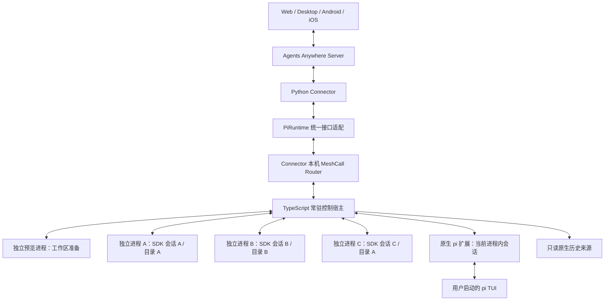
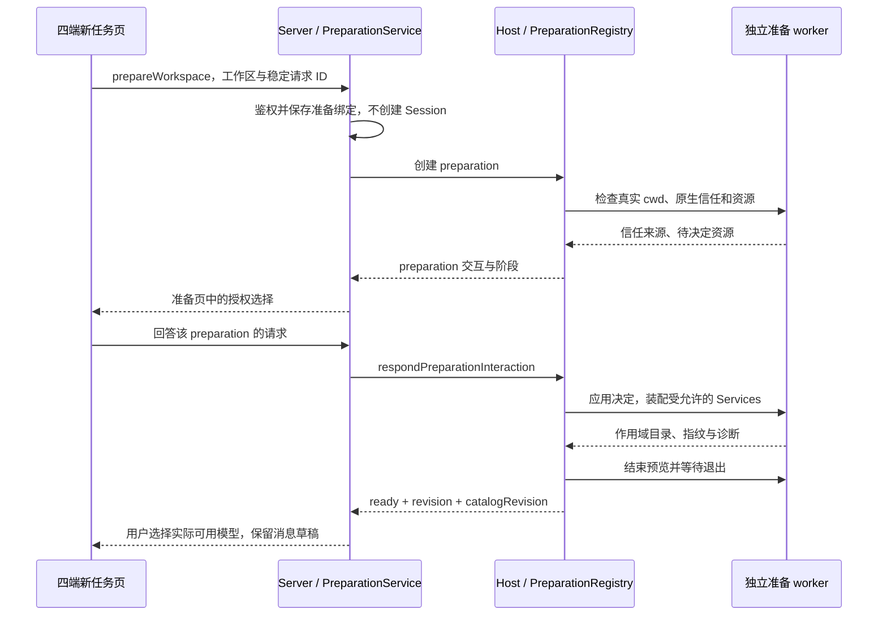
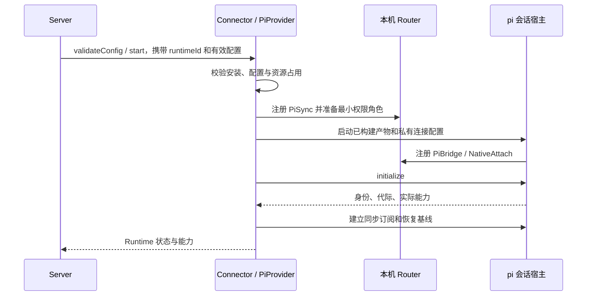
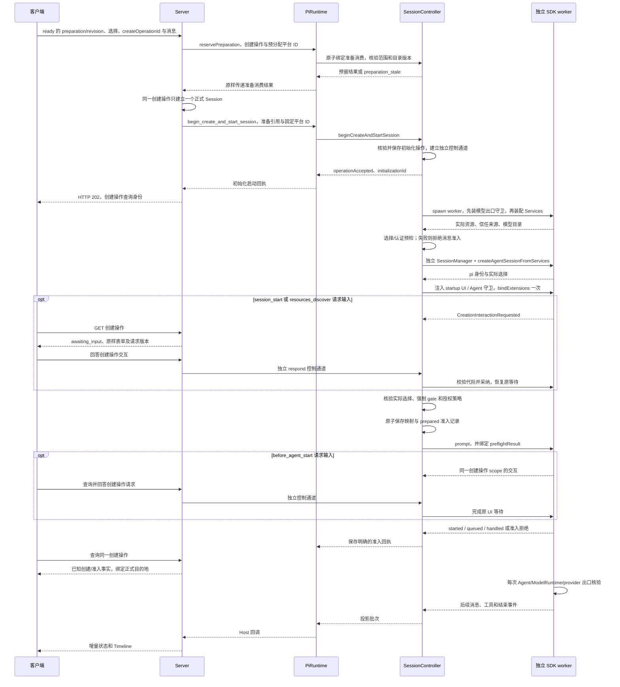
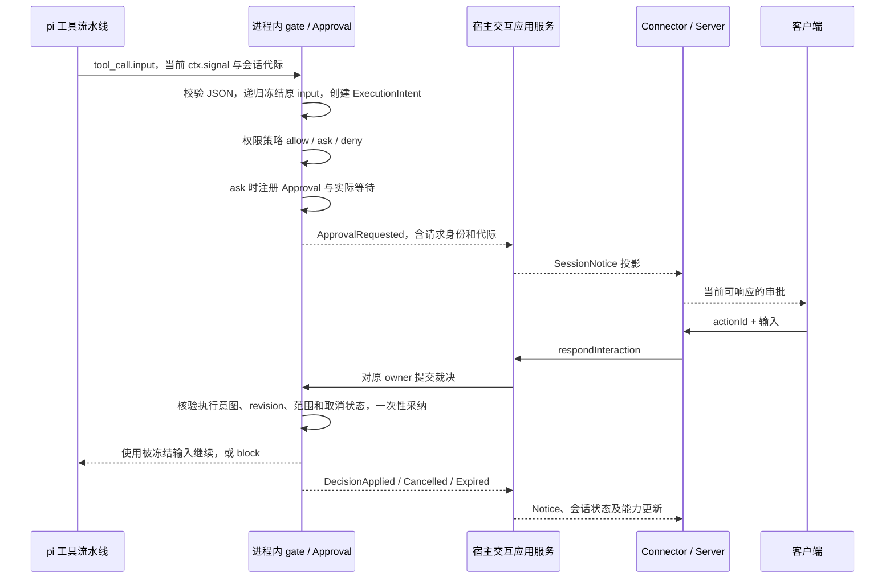
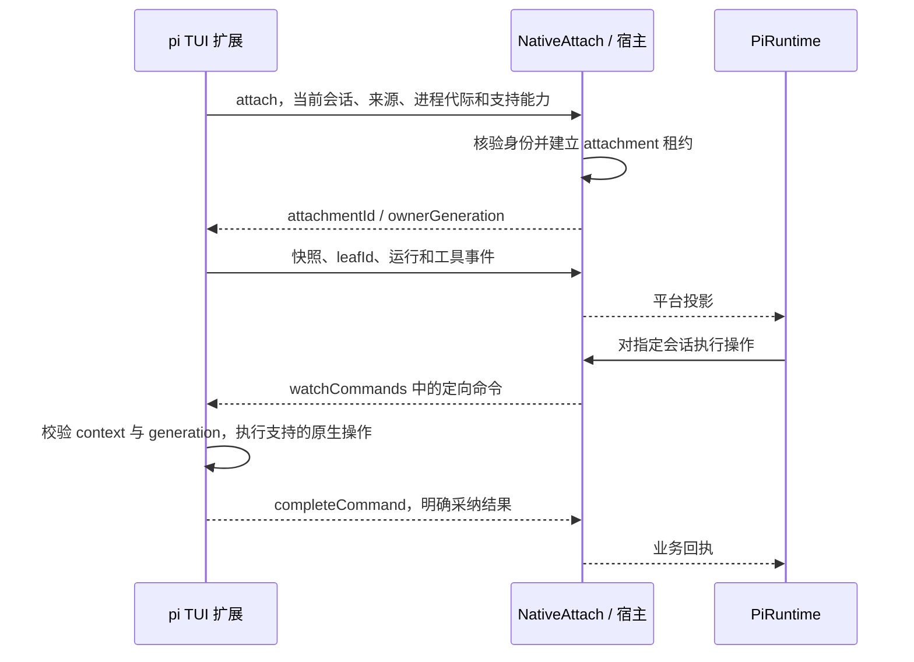
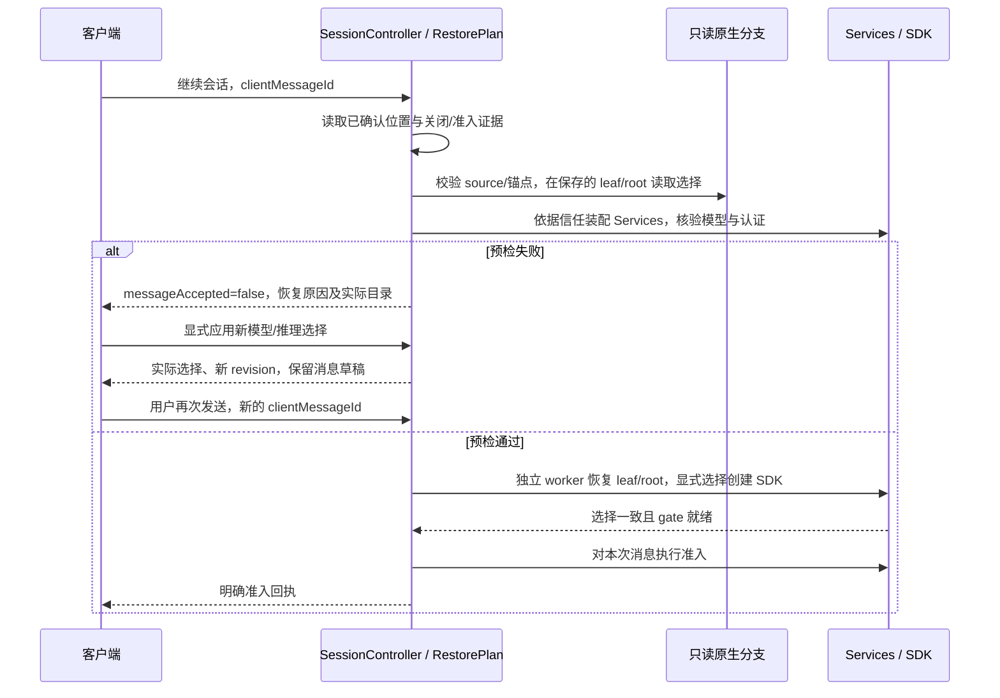

# pi Runtime 接入设计：架构、领域模块与数据流

> 当前代码范围、已执行检查与未启用能力见 [实现记录](pi-runtime-implementation.md)。本方案中的后续兼容目标不等于已经发布。


> 状态：设计方案，尚未实现。本文中的 `pi-runtime/`、`connector/connector/runtimes/pi/` 和 Pi Bridge 契约目录均为拟新增目录，不代表仓库已经支持 pi。
>
> 日期：2026-10-28，Asia/Singapore。仓库基线为正式远程 `upstream/main` 的 `34f7cbf5f11d14bdea394d4c432aa9a8fb6cc14e`；本次补充时，独立 worktree 已快进并核对 HEAD 与该远程提交一致。
>
> 上游能力依据：pi 正式版 `v1.4.0`。接入时应固定并验证 pi 依赖及桥接契约；本文不授权或实施任何产品版本变更。

客户端的目录、状态机、API、数据流及本轮源码 review 见 [Web、Android、iOS 与 Electron 补充方案](./pi-runtime-clients-plan.md)。本文负责执行侧事实和不变量，补充方案负责这些事实如何到达四端入口；均尚未实现。

## 1. 目标和结论

目标是让 pi 作为独立的 `runtime_type="pi"` 接入 Agents Anywhere，复用已有的 Server、Connector、会话、Timeline、Notice 和能力接口，扩展通用的创建前准备端口，并提供以下使用方式：

1. 用户从 Agents Anywhere 创建不同工作目录下的后台 pi 会话，多个会话可以独立运行。
2. 用户继续已有的受管会话，切换模型、推理强度，发送图片，执行受支持的命令和中断。
3. 工具需要审批或受支持的扩展需要用户输入时，在 Web、Desktop、Android、iOS 上完成交互；原生 TUI 中未采用 Bridge 协作接口的第三方弹窗保留本地交互。
4. 用户在原生 pi TUI 加载我们的扩展后，将当前会话的实时状态和控制接入平台。
5. 原生历史可以只读发现和同步；历史文件存在本身不代表当前可以向该会话写入。

推荐架构是：**Python Connector 薄适配器 + TypeScript 常驻控制宿主 + 每会话独立 SDK worker 进程 + 原生 pi 扩展 + 共享领域模块**。

pi 官方提供 `AgentSession`、`SessionManager`、模型和工具执行、扩展钩子；我们补充多会话注册、生命周期、身份映射、准入回执、审批规则、所有权和平台投影。一个安装在 TUI 内的扩展不能单独承担所有后台会话调度职责。

### 1.1 能力覆盖范围

| 能力 | 实现路径 | 边界 |
| --- | --- | --- |
| 多工作目录、多会话后台运行 | 常驻宿主管理每会话独立 SDK worker 进程 | 相同目录的两个会话也分进程；各自持有 cwd、会话管理器、扩展和运行状态 |
| 流式消息、工具执行、停止 | SDK 事件及操作适配 | 准入、运行结束和工具完成分开表达 |
| 模型、推理强度 | pi 原生目录和选择 API | 按具体模型声明实际能力 |
| 工具审批 | 自维护扩展中的工具 gate | 冻结真正传给工具的参数；后续扩展改参被阻止，具体约束见 7.9.2 |
| 确认、选择、输入、编辑 | SDK UIContext 或原生 Bridge 协作接口 | 保留取消、空字符串、前后空白、预填和多行语义；按 7.9.3 的来源矩阵声明能力 |
| 原生 TUI 实时控制 | 进程内扩展连接会话宿主 | 未加载扩展的现有进程没有这条控制通道 |
| 原生历史 | 只读历史读取和统一投影 | 不能从旧记录恢复一个仍有效的审批等待 |
| 命令、Skills、MCP | 原生资源装配和能力投影 | SDK 的内置扩展装配与 CLI 不完全相同 |
| 文件浏览、终端 | Connector 已有本机能力 | 不在 pi 中另建一套文件或 PTY 服务 |
| DSH Agent preset、权限预设 | 定义 pi 自己的模式和策略 | 不假设与 DSH 原生模式一一等价 |
| 任意终端组件跨端显示 | 逐项适配 | RPC 不完整转发 `custom()`、终端输入和定制编辑器 |

### 1.2 审批、信任与恢复的基本规则

1. 受管 SDK 会话在加载资源前判定 ProjectTrust；没有可信记录时保持项目资源禁用，并展示原因。用户可以显式授权后重新装配。
2. 工具审批绑定冻结后的原始参数对象、会话和策略代际。注册顺序用于兼容参数转换扩展，冻结机制保证后续 handler 不能改变已批准的输入。
3. SDK 通用 UI、原生 Bridge 自有/协作请求、未改造的第三方 TUI 弹窗分别声明支持范围；不通过终端注入或修改 pi 私有 UI 对象假装实现完整兼容。
4. 受管会话恢复采用严格模型策略：模型不可用、出现非预期 fallback 或推理强度不匹配时，先阻止消息准入，再要求显式选择；第一版不自动切换模型后运行。

规则的模块与接口见 7.9.1—7.9.4，阶段门槛见第 12 节；第 13.1 节保留对应的官方 npm 包探针。这些规则仍是拟实施设计。

### 1.3 本轮闭环修订的四项决定

1. 默认采用一个受管会话一个操作系统进程，控制宿主不加载 pi SDK 或第三方扩展；准备模型目录也使用独立、短生命周期的预览进程。
2. 新增 WorkspacePreparation 用例，在分配平台会话前完成目录确认、项目授权和该目录的模型选择。准备交互有独立身份与接口，不依赖 SessionNotice。
3. 集成账本保存当前分支位置。恢复时先校验并恢复该位置，再执行严格模型预检；失效或未确认的位置进入恢复流程，不采用文件最后节点兜底。
4. 回收使用异步 CloseSession：停止准入、取消与收敛运行、执行官方关闭钩子、保存最终位置、确认 worker 退出，再释放所有权。仅调用 AgentSession.dispose() 不构成完成。

四项决定分别见 7.10.1、8.5、7.11.1、7.10.2；新建/恢复数据流、四端范围及第 12 节完成条件均按这些决定组织。

### 1.4 初始化交互、模型请求边界与实施范围

1. 创建采用新协议的异步操作。SDK 初始化和首条准入期间的输入请求绑定 createOperationId，客户端立即取得可查询的操作身份；回答不等待 bindExtensions 或创建完成。
2. 创建/恢复预检之外，在 Agent 请求准备后、ModelRuntime 请求出口和已验证的 provider HTTP 出口核验模型/推理策略。SDK 已接收消息后发生的拒绝属于运行失败，不能倒写成未接收。
3. pi 本机环境失败只影响对应 Runtime。Electron 既有认证/所有权根门禁拆分列为独立后续改造，不作为 pi 首期硬前置。

具体规则见 8.6、7.9.5 和客户端补充方案第 6.3 节；公开接口机制的探针见 13.3。

## 2. 当前仓库可复用的边界

### 2.1 Codex 和 DSH 的实现参照

| 位置 | Codex | DSH | pi 的设计取舍 |
| --- | --- | --- | --- |
| Connector 入口 | `CodexRuntime` | `DshRuntime` | 实现 `PiRuntime(AgentRuntime)` |
| 原生集成 | SDK 与 IPC owner 路由 | DSH Host 内插件和官方服务 | SDK 受管会话与 TUI 原生连接共用领域逻辑 |
| 当前审批 | SDK 待处理回调或 IPC owner | 官方交互流和插件中的审批投影 | 在 pi 执行进程内持有工具等待和最终裁决 |
| 对平台发布 | `SessionNotice` 和 Host 回调 | 插件投影后通过 Connector Host 发布 | 使用同一北向契约 |
| 多会话 | Codex 原生会话能力 | Session Controller、Agent Registry、每 Agent 队列 | 在会话宿主中维护 Session Controller 和 Registry |

相关现有源码：

- [AgentRuntime](../../connector/connector/runtime_protocol/protocol.py)、[RuntimeProvider](../../connector/connector/runtime_protocol/provider.py)、[RuntimeHostClient](../../connector/connector/runtime_protocol/host.py)。
- [Codex 审批入口与 owner 路由](../../connector/connector/runtimes/codex/runtime.py)、[Codex 审批应用控制器](../../connector/connector/runtimes/codex/turns/interactions.py)。
- [DshRuntime](../../connector/connector/runtimes/dsh/runtime.py)、[DSH 原生服务整合](../../dsh-bridge-next/src/host/dsh-runtime/native.ts)。
- [DSH 审批](../../dsh-bridge-next/src/host/dsh-runtime/approvals.ts)、[官方交互流接入](../../dsh-bridge-next/src/host/dsh-runtime/interaction-stream.ts)。
- [DSH 本机 MeshCall 协议](../../contracts/dsh-bridge/2.0/README.md)。

DSH 已有的做法值得复用：按 `sessionId` 串行处理创建、配置、消息准入；锁不等待整轮模型执行结束；不同会话使用独立队列。pi 接入应保持这个行为。

### 2.2 统一接口及事实归属

```text
客户端读取 Notice / 能力
    ↓
Server：鉴权、会话归属、接管策略、Connector 路由
    ↓ interaction.respond
Connector：定位 runtime + runtimeId
    ↓
AgentRuntime.respond_interaction(session_id, notice_id, action_id, input_data)
    ↓
原生执行侧采纳裁决
    ↓
RuntimeHostClient.notice_upsert / session_state_update / session_capabilities_update
```

`AgentRuntime` 是应用端口，`SessionNotice` 是发布给平台的交互投影。它们不替代原生工具审批的领域对象。

当前审批、Notice、运行状态和能力的事实来源在 Runtime；Server 持久化平台会话和历史 Timeline，并转发当前状态。审批日志、历史条目和用量记录与“现在仍可回答的请求”是不同数据，见 [Server 状态归属](../server-architecture.md)。

上图只描述已有会话的交互。创建前信任请求绑定 preparationId，使用第 8.5 节新增的准备端口；它复用交互领域和组件，不走要求 sessionId 存在的响应入口。

### 2.3 不能直接跳过的协议条件

Runtime Control 2.0 接受规范化的 provider key，但当前 Connector 协议模型及平台 Protocol 1.0 的部分枚举没有 `pi`。已经用现有校验器确认：Runtime 类型描述和 Server 名称校验接受 `pi`，旧握手枚举拒绝它。

因此，注册 Provider 之前必须先完成契约扩展设计：

1. 遵守 [Runtime Control 2.0](../../contracts/runtime-control/2.0/README.md) 对 Protocol 1.0 冻结的要求。
2. 在新的平台协议修订中加入 pi、准备 scope/交互、作用域目录、创建操作身份及必要输入语义；本文暂以 `contracts/protocol/<next>/` 表示，不预定发布版本。
3. 同步 Server、Connector 的模型、导出器、schema、manifest、生成类型和客户端协议选择。
4. 未理解 pi 的旧协议路径继续使用原契约，不伪装成 `codex`、`dsh` 或其他 Runtime。
5. Pi Bridge 自己的本机契约与平台协议分别演进。

这是一项实施前置工作；本文只增加设计文档，不修改契约、产品版本或生成代码。

## 3. 进程架构、准备流程和两种会话来源



### 3.1 常驻会话宿主

这是我们新增的 TypeScript 控制进程，由 Connector 监督启动和退出。它负责注册、寻址和进程监督，通过 EnginePort 代理会话；官方 pi SDK、资源加载及第三方扩展只在受管 worker 内运行。一个 worker 在一次进程生命周期内只拥有一个受管会话，回收后不作为另一个会话的执行进程复用。

第一版 Provider 使用 `instancePolicy="single"`，一个已配置 pi Runtime 对应一个宿主。**单 Runtime 实例和多会话并不冲突**：一个实例内可以同时管理多个目录和会话。`runtimeId` 仍按现有契约传递，不写死为字符串 `pi`。

先限制为单实例，可以避免多个同名 Bridge 服务被 Router 分发到错误宿主。未来需要多个配置实例时，再明确服务寻址或共享宿主的多 scope 分区；不能仅增加 `maxInstances`。

宿主具备：

- `SessionRegistry`：按身份定位 ManagedWorkerProxy 或原生会话代理。
- `WorkspaceIndex`：由配置和会话事实提供目录与会话关联。
- `SessionController`：统一创建、恢复、提交、中断及配置操作。
- 调度器：独立会话 mailbox、全局资源额度、空闲回收。
- 原生连接管理：认证、attachment、租约和进程代际。
- 领域事件投影、历史读取、同步和恢复。
- `PreparationRegistry`：在没有平台会话时持有准备操作、资源授权请求及作用域模型目录。
- `WorkerSupervisor`：启动、认证私有 IPC、确认退出及回收额度；预览进程也计入有界资源预算。

worker 启动时固定 cwd 和环境快照，SDK 仍显式传 cwd。SDK 的模块 factory 缓存会让同进程同目录的扩展顶层状态共享，传入独立 SessionManager 不能解决这一点；第 13.2 节记录了反例与进程隔离后的结果。第一版不开放同进程多 SDK 模式，也不以 Node worker_threads 代替这里的操作系统进程隔离。

### 3.2 原生 pi 扩展

这是加载在用户 pi 进程内部的扩展。它使用 pi 的 `ExtensionAPI`，在 `session_start` 建立资源，在 `session_shutdown` 释放资源。

它负责：

- 上报当前 pi 会话、当前分支、运行、模型和工具事件。
- 在原生 `tool_call` 中执行共享权限策略及审批等待。
- 执行宿主发送且当前上下文支持的消息、中断、选择和交互指令。
- 通过明确的应用协议报告指令是否采纳。
- 会话切换、reload、fork 后更新代际并重新绑定。

扩展不是另一个后台多会话控制器。command-only 操作通过官方 command context 执行；不能缓存已经被 reload 或会话切换失效的 context。普通输入、原生命令和模型提示词的调用方式分别适配。

### 3.3 三种来源的能力差异

| 来源 | 可以读取 | 可以写入 | 所有者 |
| --- | --- | --- | --- |
| `managed-sdk` | 历史和实时状态 | 经宿主路由的会话操作 | 该会话的独立 SDK worker |
| `attached-native` | 扩展提供的实时状态与原生历史 | 扩展明确支持并确认的操作 | 原生 pi 进程 |
| `history-only` | 已落盘记录 | 默认只读 | 没有已确认的在线写入者 |

原生连接失联时不能自动降级为 `SessionManager.open()` 再写同一份文件。历史继续功能优先提供“从当前分支创建受管副本”；若要继续写原文件，必须先具备可验证的协作式所有权交接。

本方案只协调已接入的写入者，不宣称能阻止任意未加载扩展的 pi 进程打开同一个文件。

## 4. 领域边界、身份和聚合

### 4.1 三个领域边界

| 边界 | 拥有的事实和规则 | 对外接口 |
| --- | --- | --- |
| 平台工作台 | 用户、设备、平台会话绑定、配置意图、接管授权、持久化 Timeline | 现有 Server API、Runtime Control、客户端协议 |
| pi 会话执行 | 当前 SDK/TUI 会话、运行、分支、工具审批、用户输入、实际选择 | 宿主应用用例和原生扩展能力 |
| pi 集成与投影 | 平台与原生身份映射、消息准入、投递回执、同步游标、Notice/Timeline 转换 | Pi Bridge 和 `AgentRuntime` |

领域按业务事实划分。Python/TypeScript 和进程边界是部署选择；MeshCall、JSONL 和文件读取是基础设施。

### 4.2 身份

| 身份 | 含义 | 生命周期 |
| --- | --- | --- |
| `runtimeType` | 固定 provider key：`pi` | 不随模式、名称或 transport 变化 |
| `runtimeId` | Server 配置实例 ID | 复用现有 Runtime Control 身份 |
| `sessionNamespace` | Connector 提供的平台会话命名空间 | 使用现有绑定逻辑，不在 TS 中重新猜测 |
| `platformSessionId` | 平台会话 ID | 首次创建或发现后持久稳定 |
| `sourceId` | 某个原生持久化来源的稳定身份 | 与临时进程、端口、连接无关 |
| `piSessionId` | pi 原生会话 UUID | 来自 SessionManager/原生扩展 |
| `preparationId` | 创建前工作区准备操作 | 不冒充 platformSessionId；取消/过期后不能用于创建 |
| `initializationId` | 一个创建操作的执行侧初始化代际 | 与 createOperationId、workerGeneration 一起限定启动交互；不复用旧等待 |
| `workerGeneration` | 一个受管执行进程代际 | 一个进程只绑定一个会话；与临时 PID 分开 |
| `positionRevision` | 该会话已确认位置的单调序号 | 文件无字节变化的分支导航也推进；不复用云端投递 cursor |
| `operationId` / `clientMessageId` | 一次平台操作或消息的幂等身份 | 重试保持相同，内容变化必须使用新身份 |
| `ownerGeneration` | 当前执行者代际 | 重启、重新绑定、会话替换时变化 |
| `approvalId` / `interactionId` | 一个有效交互请求 | 限定到会话与请求代际 |
| `sourceEntryId` / `toolCallId` | 原生历史、工具调用身份 | 用于历史与实时统一投影 |

SDK 创建的 pi UUID 与平台预分配的会话 ID 不必相同，使用持久化映射。历史发现时，先查 `(sessionNamespace, sourceId, piSessionId)` 的映射，再决定是否创建新平台身份。

规范化路径复用 Connector 的 [filesystem resource key 规则](../../connector/connector/runtime_protocol/filesystem.py)。显示名称、PID、API key、临时端口和启动方式都不能进入稳定身份。

### 4.3 聚合及不变量

| 聚合或值对象 | 主要字段 | 不变量 |
| --- | --- | --- |
| `SessionBinding` | 平台/原生身份、cwd、source、owner 引用 | 绑定建立后，不把同一平台会话指向另一份原生历史 |
| `WorkspacePreparation` | preparationId、Runtime/cwd、信任状态、目录快照、期限、消费绑定 | 没有平台会话也能授权和选模型；一个准备最多绑定一次创建操作 |
| `SessionInitialization` | 创建操作、初始化代际、阶段、启动交互、期限、已知创建事实 | 初始化可等待输入，但其查询/回答/取消不等待 SDK 就绪或占用中的准入锁 |
| `ModelRequestIntent` / `ModelPolicy` | 明确选择、模型/推理及资源策略版本、允许的请求用途、执行代际 | 在请求出口核验；扩展的原生选择记录不自动构成用户授权 |
| `ExecutionPosition` | source/原生身份、leafId、分支代际、锚点证明、positionRevision | 位置在公开确认/干净回收前持久化；null 与无记录不同 |
| `SessionClose` | closeOperationId、ownerGeneration、阶段、最终位置和退出结果 | 先关闭并确认执行进程退出，再释放写入所有权；重复关闭复用回执 |
| `Run` | runId、准入消息、运行阶段、取消状态 | 同一会话的运行生命周期有序；不同会话独立 |
| `MessageAdmission` | messageId、内容指纹、创建参数、投递阶段 | 同身份不同内容拒绝；结果不确定时不盲目重发 |
| `Approval` | toolCallId、实际操作、可选动作、范围、代际、revision、状态 | 一个请求只接受一次有效裁决；过期请求不能再放行工具 |
| `ExecutionIntent` | 工具身份、冻结参数摘要、cwd、分支、owner/resource/policy revision | 展示、裁决和工具调用使用同一参数值；任一约束变化时旧裁决失效 |
| `ProjectTrustDecision` | 规范化 cwd、原生记录来源或一次授权、作用域 | 项目资源加载前完成判定；未知按不可信加载；一次授权不扩散到其他会话或重启 |
| `RestoreIntent` / `SelectionRecovery` | 原生分支选择、预期模型/推理、实际选择、恢复原因 | 恢复差异在消息准入前处理；确认选择不自动重发上一条消息 |
| `UserInteraction` | origin、kind、字段、原始文本、截止时间、状态 | 取消与空值不同；普通确认不自动获得工具权限语义；只发布实际持有回答端口的请求 |
| `PermissionPolicy` / `Grant` | 工具/参数/cwd 约束、授权范围、策略 revision | 只授予声明范围；历史授权不能自动覆盖另一分支或新策略 |
| `SourceObservation` | 来源可用性、扫描完成度、观测时间 | 扫描失败不等于源文件删除 |

一个审批是独立聚合，不把所有审批和完整历史塞进一个巨大的 Session 聚合。等待中的 `Promise`、SDK 实例、I/O 句柄、timer 和取消控制器均在基础设施层。

### 4.4 当前状态与历史

- pi 的 SessionManager 是原生会话内容的权威存储；集成账本不复制一份可独立修改的模型上下文。
- Registry 中的活跃实例和交互等待属于当前执行事实。
- 集成账本保存身份、准入和裁决证据；旧记录不能恢复一个已经消失的原生等待回调。
- 历史 Timeline 记录发生过什么，Notice 表达现在还能做什么。
- Server 的 `takeover` 是平台许可；原生 owner 是否可达由 Runtime 提供。
- 创建前准备的用户/设备/Runtime 绑定由 Server 鉴权并持久化，当前准备状态和回答端口由 Runtime 持有；不建立第二审批引擎。
- 当前分支位置属于集成元数据，允许持久化在位置账本中；消息内容和模型上下文仍只由 pi 原生历史保存。

## 5. 拟新增目录总览

下列文件是职责划分清单，不要求一次提交创建所有空目录。实现某个用例时创建相应文件，不为占位新增空模块。

```text
connector/connector/runtimes/pi/
├── __init__.py
├── provider.py
├── provider_config.py
├── discovery.py
├── environment.py
├── runtime.py
├── preparations.py
├── creations.py
├── lifecycle.py
└── bridge/
    ├── client.py
    ├── host.py
    ├── models.py
    ├── sync.py
    └── generated/
        └── pi_bridge.py

pi-runtime/
├── package.json
├── tsconfig.json
├── README.md
├── src/
│   ├── entrypoints/
│   │   ├── host.ts
│   │   ├── worker.ts
│   │   └── extension.ts
│   ├── composition/
│   │   ├── host.ts
│   │   ├── worker.ts
│   │   └── native.ts
│   ├── domain/
│   │   ├── shared/
│   │   ├── sessions/
│   │   ├── preparations/
│   │   ├── interactions/
│   │   ├── permissions/
│   │   └── sources/
│   ├── application/
│   ├── ports/
│   ├── infrastructure/
│   │   ├── pi/
│   │   ├── mesh/
│   │   ├── runtime/
│   │   ├── storage/
│   │   ├── history/
│   │   └── local/
│   ├── projections/
│   ├── sync/
│   ├── resources/
│   └── generated/
├── scripts/
└── distribution/

contracts/pi-bridge/1.0/
├── README.md
├── schemas/
├── fixtures/
└── manifest.json
```

`pi-runtime/` 是会话宿主与原生扩展的共同源码包，不是 pi 上游源码副本。共享的是纯领域规则、交互格式和投影逻辑，运行实例和待处理请求仍由各自实际执行进程持有。

### 5.1 依赖方向

```text
entrypoints → composition
                   ├─ application → domain
                   ├─ infrastructure → ports / domain
                   ├─ projections → domain / 契约模型
                   └─ sync → ports / projections

domain 不导入 application、infrastructure、SDK、MeshCall 或 Node I/O。
application 通过 ports 使用引擎、等待回调、存储和事件发布。
```

## 6. Connector：每个文件的设计

| 文件/目录 | 主要对象 | 代码职责 |
| --- | --- | --- |
| `provider.py` | `PiProvider` | 返回 `runtimeType=pi` 的 descriptor；校验配置；创建 Runtime；声明宿主和来源的资源 claim |
| `provider_config.py` | 配置 schema、规范化函数 | Host/worker 产物、agentDir、受管 root、来源配置、进程/运行额度、准备 TTL、关闭期限及日志选项；敏感值不进入日志 |
| `discovery.py` | 安装与能力探针 | 校验 Node/宿主产物、pi SDK 和 Bridge 兼容范围；发现不启动模型任务 |
| `environment.py` | Runtime 产物解析 | 核验独立 Node、Host/worker 和运行依赖的清单、平台/架构/ABI 与兼容性；不处理项目信任，不借用 Electron 后端的临时启动方式 |
| `runtime.py` | `PiRuntime(AgentRuntime)` | 实现会话、模型、命令、Notice、操作接口；将本机契约转换为公共模型；本身不维护另一套审批状态机 |
| `preparations.py` | 工作区准备适配 | 实现新增的通用准备端口及作用域目录查询；不伪造一个临时平台会话 |
| `creations.py` | 异步创建及启动交互适配 | begin/get/respond/cancel 初始化操作及回执；保留创建事实、消息准入与运行失败的区别 |
| `lifecycle.py` | 宿主监督器 | 启停、启动阶段、健康检查、重连退避、代际更新；只停止本次实例拥有的进程 |
| `bridge/client.py` | `PiBridgeClient` | 调用生成客户端，携带 scope；区分未发出、业务拒绝、调用结果未知；变更请求不自动重试 |
| `bridge/host.py` | `PiSyncService`、rendezvous | 在现有 Router 上注册 pi 同步接收服务；发布私有发现文件；转发到 Connector 正确的 event loop |
| `bridge/models.py` | DTO 转换与校验 | 检查 runtime/preparation/session/worker 绑定、revision、游标和结果字段；不解释原生工具策略 |
| `bridge/sync.py` | `PiSyncRelay` | 按序接收投影批次、调用 RuntimeHost、处理快照/ACK/checkpoint；单会话失败隔离 |
| `bridge/generated/` | 生成客户端 | 从契约生成并检查一致性；不手工添加业务逻辑 |

还需要在现有 `runtimes/providers.py` 注册 Provider，并在 `connector/mesh/hub.py` 增加 pi 角色与服务权限。不得借用 DSH 的服务名、凭据或全部权限。

AgentRuntime 当前没有创建前工作区准备端口，模型目录也没有 cwd/session 参数。需要按第 8.5 节在新契约中增加通用能力与端口，并同步 Server 调度；仅在 PiBridge 内增加方法，无法让四端走通首次授权。

配置的持久事实继续由 Server 管理。宿主读取启动时的有效配置；配置修改通过已有保存、校验、重建流程，不从本地缓存自行恢复一份不同的配置意图。

## 7. TypeScript：每个目录的代码设计

### 7.1 `entrypoints/` 和 `composition/`

| 文件 | 设计 |
| --- | --- |
| `entrypoints/host.ts` | 解析宿主参数、初始化日志、处理信号，调用 `composeHost()`；输出启动就绪事实，凭据走私有载体 |
| `entrypoints/worker.ts` | 以 preparation/session 角色启动独立进程，固定 cwd、scope 和代际；私有 IPC 驱动一个任务的完整生命周期 |
| `entrypoints/extension.ts` | 导出 pi 扩展 factory，注册会话事件、工具 gate、所需命令；长连接在会话生命周期中创建 |
| `composition/host.ts` | 装配 WorkerSupervisor、Engine 代理、准备/位置/准入存储、Registry、Bridge、投影和同步；只依赖纯领域和端口 |
| `composition/worker.ts` | 装配本进程 SDK factory、生命周期包装器、gate、等待对象、信任适配器和私有 IPC；不注册公共 Bridge 服务 |
| `composition/native.ts` | 装配本进程工具 gate、交互等待、原生上下文适配器和连接客户端 |

入口不写工具授权规则、身份算法或文件扫描逻辑。worker 与原生扩展使用同一个 PermissionPolicy、Approval 和输入模型；Host 只持有执行代理和投影。Host 的 pi SDK 引用只能是编译期 type import，不能因读取 ProjectTrustStore 而从包根入口加载整个 SDK；原生信任存储查询和写入在准备/session worker 内完成。

### 7.2 `domain/shared/`

| 文件 | 设计 |
| --- | --- |
| `identity.ts` | 受约束的 RuntimeScope、SessionRef、SourceId、OperationId、Generation 值对象；验证规范格式 |
| `errors.ts` | 领域错误，例如绑定冲突、裁决失效、动作非法、内容指纹冲突；不包含 HTTP 状态 |
| `events.ts` | 领域事件联合类型；事件携带会话、代际和 revision；不包含 MeshCall 类型 |

### 7.3 `domain/sessions/`

| 文件 | 设计 |
| --- | --- |
| `session.ts` | SessionBinding、cwd、来源种类、当前分支和生命周期；保存引用而非 SDK 对象 |
| `run.ts` | `idle/running/waiting/stopping/settled` 的有效迁移，取消原因及结束 outcome |
| `admission.ts` | MessageAdmission 和内容指纹规则，创建参数冲突检查及可安全重试的判定 |
| `ownership.ts` | owner、代际、可写状态及交接规则；不能仅凭 PID 推断归属 |
| `workspace.ts` | 规范化工作区身份和会话关联；一目录可有多个会话 |
| `restore.ts` | RestoreIntent、SelectionRecovery、预期/实际选择差异及严格恢复规则 |
| `position.ts` | ExecutionPosition、null 根位置、锚点核验、位置 revision 与脏位置的恢复条件 |
| `close.ts` | SessionClose 的 draining/settling/shutdown/checkpointed/exited 迁移和干净/异常关闭结果 |
| `initialization.ts` | SessionInitialization 状态与创建操作 scope；启动交互不依赖正式 SessionNotice |
| `model-policy.ts` | 明确模型/推理策略、请求意图与允许的路由；预期授权和原生实际选择分开保存 |

不把全量消息保存在 Session 聚合中。原生历史留给 SessionManager，平台历史通过投影输出。

`domain/preparations/` 另含 `preparation.ts`、`catalog.ts`、`consumption.ts`：分别管理准备状态与作用域、目录快照及选择验证、准备到创建操作的一次消费。它不把尚未存在的 SDK 会话塞进 SessionBinding，也不保存模型密钥或另一份上下文。

### 7.4 `domain/interactions/`

| 文件 | 设计 |
| --- | --- |
| `approval.ts` | 工具审批聚合，维护请求、可选动作、范围、代际、revision、有效裁决 |
| `user-input.ts` | confirm/select/input/editor 模型，区分 `cancelled`、空字符串、原样文本和选项身份 |
| `decision.ts` | 授权、拒绝、取消及响应校验值对象；校验动作来自原请求 |
| `events.ts` | Requested、DecisionApplied、Cancelled、Expired 等事实事件 |

建议内部生命周期：`pending → deciding → resolved`，另有 `cancelled/expired/outcome_unknown`。内部状态到现有 Notice 状态的映射由投影层负责，不直接给平台协议添加新枚举。

`resolved` 只表示交互裁决已被执行侧采纳。工具继续运行和最终成功属于工具生命周期。

### 7.5 `domain/permissions/`

| 文件 | 设计 |
| --- | --- |
| `policy.ts` | 对 RequestedOperation 返回 allow/ask/deny；覆盖实际工具和嵌套调用 |
| `grant.ts` | 一次、会话或显式规则范围的授权；保留 cwd、参数约束、策略 revision |
| `operation.ts` | RequestedOperation / ExecutionIntent；工具名、冻结参数快照/摘要、toolCallId、parentToolCallId、cwd、分支和执行代际 |
| `project-trust.ts` | 信任来源、一次/目录作用域、未知时禁用资源及撤销规则；不访问文件或执行扩展 |

先实现可证明的授权范围，再在目录中提供对应选项。MCP annotations 是提示，不能直接当成可信授权。`user_bash` 与模型工具调用分别适配；扩展直接 I/O 的行为不属于工具 gate 可完整隔离的范围。

### 7.6 `domain/sources/`

| 文件 | 设计 |
| --- | --- |
| `source.ts` | 原生来源身份、可用性、只读/受管属性 |
| `inventory.ts` | 完整与不完整扫描的语义；缺失、删除、暂不可读的判定规则 |

源观测不执行文件 I/O。一次不完整扫描不得触发批量“源已删除”。

### 7.7 `application/`

| 文件/服务 | 公开用例和处理顺序 |
| --- | --- |
| `sessions.ts` / `SessionController` | createAndStart、resolve、resume、list、getState；校验绑定和来源 → 确认 owner → 判定资源信任/恢复选择 → 获取 engine → 准入 |
| `turns.ts` / `TurnService` | start、steer、followUp、interrupt；查幂等记录 → 会话 mailbox → 引擎准入 → 发布回执与状态 |
| `interactions.ts` / `InteractionService` | request、listPending、respond、expire；从请求自身恢复上下文，裁决后调用原生等待端口 |
| `selections.ts` | 校验模型、推理和权限选择，调用原生适配器，发布实际生效状态 |
| `commands.ts` | 当前命令目录和执行，区分原生命令与模型提示词 |
| `native-sessions.ts` | attach、renew、detach、指令投递、代际变更和 owner 状态 |
| `lifecycle.ts` | 启动恢复、空闲回收、优雅关闭、在途操作收敛 |
| `catalogs.ts` | 读取实际模型/权限/扩展能力，组织规范化目录 |
| `project-trust.ts` | 读取有效信任、请求一次/目录授权、撤销；空闲时重建受影响的受管 engine 并更新资源能力 |
| `selection-recovery.ts` | 比较 RestoreIntent 与实际选择、生成恢复 Notice、应用显式选择；不重放被拒绝的消息 |
| `preparations.ts` | prepare/get/respond/cancel/consume；准备交互与会话交互分别定位，消费绑定到唯一创建操作 |
| `initializations.ts` | begin/get/respond/cancel；先注册创建操作和控制通道，再异步装配 SDK；等待 UI 时释放控制锁 |
| `model-requests.ts` | 为用户准入或明确辅助操作建立不可变 ModelRequestIntent；拒绝不匹配请求并按接收阶段发布结果 |
| `positions.ts` | 导航与关闭位置确认、恢复锚点校验；持久化成功后才公布导航完成或允许干净回收 |
| `close-session.ts` | 排空准入、取消等待、收敛运行、异步关闭、最终位置 ACK、确认进程退出、释放所有权 |

用例通过 ports 读写引擎、等待对象、账本和事件；不会在 HTTP、MeshCall decorator 或 React 回调里实现业务状态迁移。

### 7.8 `ports/`

| 端口文件 | 契约职责 |
| --- | --- |
| `engine.ts` | 创建/恢复 engine、消息准入、中断、选择、命令、事件订阅；操作始终携带 SessionRef |
| `interaction-waiter.ts` | 注册、应用、取消实际等待；返回已采纳、已处理、失效或结果未知 |
| `native-peer.ts` | 向特定 attachment 和 generation 投递指令，读取执行回执 |
| `repositories.ts` | 身份映射、准入/裁决证据和 source 记录；不暴露存储实现 |
| `history-reader.ts` | 只读 inventory、分支树及分页记录 |
| `event-sink.ts` | 发布可重放事件、批次和快照的接口 |
| `clock.ts` | 期限和租约需要的时钟，避免领域规则直接读取系统时间 |
| `project-trust.ts` | 查询原生信任及其命中路径，保存/移除目录决定；一次授权由应用层限定到具体操作 |
| `resources.ts` | 在确定信任状态下装配资源、核验强制 gate、返回资源代际和兼容性报告 |
| `model-requests.ts` | 明确模型请求策略、当前执行授权及请求拒绝事件；领域层不接触 provider JSON 或 fetch |
| `workers.ts` | 独立进程的 spawn/request/close/waitExit/terminate，受限 scope 与 generation；不暴露 child_process 对象 |
| `position-store.ts` | 按 owner 和 revision 比较并持久写入位置；writeAndFlush 返回后必须具备本机崩溃持久性 |
| `source-lock.ts` | worker 生命周期内的协作来源排他锁与代际证明；不能按心跳到期直接夺锁 |

这是共享领域和具体 SDK/RPC/文件实现之间的边界。端口是小接口，不把完整 pi SDK 对象透传给应用服务。

### 7.9 `infrastructure/pi/`

| 文件 | 设计 |
| --- | --- |
| `sdk-factory.ts` | 先创建带信任回调的 AgentSessionServices，再预检恢复选择，通过 createAgentSessionFromServices 显式传 model/thinkingLevel/sessionManager；核验实际选择及强制 gate 后才开放准入 |
| `sdk-engine.ts` | worker 内的实际引擎；封装 prompt、preflightResult、steer/followUp、abort、状态和最终事件 |
| `sdk-lifecycle.ts` | 用公开 AgentSessionRuntime 包装每个 worker 的 SDK 生命周期；显式 await abort，再 await runtime.dispose；保留 SessionManager 以捕获关闭后的最终位置 |
| `sdk-resources.ts` | 绑定扩展 UI、资源加载器、模型配置及所需内置扩展 |
| `hooks.ts` | 把 tool_call、session_start、session_tree、session_shutdown 等转换为受约束内部事件 |
| `native-engine.ts` | 用有效 ExtensionContext/command context 实现原生会话支持的操作 |
| `errors.ts` | 把原生异常、业务拒绝和不确定结果转换成应用错误 |
| `project-trust.ts` | 将应用服务给出的信任决定接入公开资源加载回调，适配原生可信状态；持久存储经 ports 注入 |
| `tool-gate.ts` | 校验普通 JSON 参数、递归冻结真实 input、创建执行意图、等待/采纳裁决；所有 allow 路径同样经过冻结 |
| `startup-ui.ts` | 在 bindExtensions 前装配创建操作 scope 的 UIContext；通过独立控制通道完成回答、取消和期限处理 |
| `model-request-guard.ts` | 包装公开 Agent.prepareRequest、ModelRuntime 请求方法及受支持 provider 的请求出口；按 7.9.5 核验，不靠扩展钩子抛错阻断 |
| `extension-ui.ts` | 受管 SDK 标准对话方法的 UIContext 适配及原生协作请求端口；不修改 TUI 私有 UI 对象 |
| `restore-plan.ts` | 从原生分支构建预期选择，预检可用模型/认证/推理，并核验 SDK 创建结果 |

SDK 的 `prompt()` Promise 等待运行结束；准入需要单独使用 `preflightResult` 和明确的 disposition。不能把调用了 `prompt()` 或创建了 Promise 当成消息已被接受。

SDK 不自动装配 CLI 的所有内置扩展。MCP、codemode、tool_search 是否加载、何时 bindExtensions、加载哪些目录都在 factory 中明确配置。两种来源返回各自的实际能力。

官方 RPC 可以作为将来的隔离执行适配器实现同一个 EnginePort，但不是另一套领域模型。RPC stdout 必须持续读取，按 LF 分帧，stderr 单独处理。

上述 SDK 文件都运行在独立 worker 内。AgentSessionRuntime 的身份变更命令不能绕过 Host SessionController；第一版未接入平台新建/绑定用例的 new/resume/fork 操作须明确拒绝并从目录隐藏，不能使用 SDK 默认空动作返回成功。

#### 7.9.1 项目信任：在资源加载前生效

上游 v1.4.0 的默认 SDK 路径使用 `SettingsManager.create(cwd, agentDir)`，其 `projectTrusted` 默认值为 true，随后调用没有 trust resolver 的 `resourceLoader.reload()`。CLI 则先以不可信状态创建 SettingsManager，再通过资源加载回调解析信任。原生 `ProjectTrustStore` 使用 `<agentDir>/trust.json`，以真实规范路径查询最近的目录或祖先记录。上述行为来自 [SDK](https://github.com/earendil-works/pi/blob/v1.4.0/packages/coding-agent/src/core/sdk.ts)、[CLI 装配](https://github.com/earendil-works/pi/blob/v1.4.0/packages/coding-agent/src/main.ts)、[TrustStore](https://github.com/earendil-works/pi/blob/v1.4.0/packages/coding-agent/src/core/trust-manager.ts)。

第一版受管 SDK 路径采用以下固定规则：

| 有效信任来源 | 加载行为 | 持久化与展示 |
| --- | --- | --- |
| 原生信任记录为 true，包括最近祖先记录 | 允许该 cwd 的受保护项目资源 | 展示命中的路径和继承来源 |
| 原生信任记录为 false | 跳过受保护项目资源 | 展示已拒绝及命中路径；不覆盖较近的目录决定 |
| 没有记录 | 准备页默认禁用项目资源；用户可继续基础能力或显式启用 | 按 8.5 提供不依赖 sessionId 的授权入口，不静默写 true |
| 用户显式选择「本次启用」 | 对当前准备及其唯一会话的本次 worker/resource 代际启用 | 不写 trust.json；按 8.5 原子转交；取消、过期、回收或重启后重新判定 |
| 用户显式选择「信任此目录」 | 保存当前真实 cwd 的 true，再装配资源 | UI 明示原生规则会作用于该目录及子目录；第一版不新增信任父目录快捷动作 |
| 用户选择「本次不启用」 | 当前代际跳过受保护项目资源 | 不写 trust.json，也不改变已有目录规则 |
| 用户选择「撤销此目录信任」 | 保存当前 cwd 的 false；停止向旧资源代际准入 | 删除记录只表示重新继承祖先，不能用删除记录代替撤销 |

这是受管 SDK 的明确策略：默认不自动采用全局 `defaultProjectTrust=always`，也不自动采纳第三方 `project_trust` handler 的授权。原生 TUI 保留自己的 CLI 策略。若以后支持完整 CLI 信任策略，应作为单独的兼容模式显式配置和验证，不能悄悄改变默认值。

资源加载顺序必须落实在 factory，而不是等 `session_start` 才补判定：

```text
在准备 worker 或正式 session worker 中固定真实 cwd、agentDir、Runtime 配置 revision
  → SettingsManager.create(cwd, agentDir, { projectTrusted: false })
  → createAgentSessionServices，传上述 settingsManager 与资源配置
  → 由 services 的 resourceLoaderReloadOptions 注入 resolveProjectTrust 回调
      callback 查询 ProjectTrustStore / 当前代际的一次授权
      返回 true 或 false，再由 loader 加载对应资源
  → services 应用扩展注册的 provider/虚拟模型并返回目录
  → 准备 worker 到此返回目录并退出，不创建 SessionManager
  → session worker 校验准备消费 / 从已确认位置构建恢复意图，完成选择预检
  → 在受管 root 中创建/打开 SessionManager，恢复保存的 leaf/root
  → createAgentSessionFromServices，传入同一 services、model 和 thinkingLevel
  → bindExtensions，核验强制 gate 与实际资源/选择
  → 发布能力和状态，开放消息准入
```

`ProjectTrustStore`、`hasTrustRequiringProjectResources`、`DefaultResourceLoader` 和 `SettingsManager` 均从 npm 包公开入口导出。CLI 使用的 `resolveProjectTrusted()` 没有从包根入口导出；我们的 adapter 通过公开的 `reload({resolveProjectTrust})` 回调实现上表规则，不深层导入私有文件或照搬 SDK 默认路径。

两阶段 factory 也是公开 API。采用 `createAgentSessionServices()` / `createAgentSessionFromServices()` 可以在创建 SDK 会话前应用扩展注册的 provider 和虚拟模型，再核验用户选择，避免把「provider 尚未绑定」误判为模型已消失。直接手动加载资源时必须等价完成这一步，不能拿未应用扩展的模型目录做严格恢复预检。[Services factory](https://github.com/earendil-works/pi/blob/v1.4.0/packages/coding-agent/src/core/agent-session-services.ts)

trust bootstrap 可以加载用户级和明确装配的集成扩展，这些已经属于本机扩展信任范围；在回调决定前不得执行项目扩展、安装项目包或装配项目 MCP。项目 `sessionDir` 在 CLI 中存在信任前读取的特殊行为；受管 SDK 始终显式传入配置 root 下的 SessionManager，不让该设置改写受管历史位置。`AGENTS.md` 等上下文仍遵循上游规则，ProjectTrust 不构成文件、进程或网络沙箱。[资源加载器](https://github.com/earendil-works/pi/blob/v1.4.0/packages/coding-agent/src/core/resource-loader.ts)、[安全边界](https://github.com/earendil-works/pi/blob/v1.4.0/packages/coding-agent/docs/security.md)

授权请求携带真实 cwd、preparationId 或已有平台会话、作用域及配置/资源代际；两种响应入口只接受各自原请求声明的动作。普通 confirm 或工具「允许一次」不能写入 trust.json。已有会话在调整信任后通过完整异步关闭重建 worker，关闭旧交互并更新能力，不重发上一条消息；重建前先保存当前分支。撤销先阻止旧代际准入并取消受管运行/等待，已开始的工具按中断结果报告。路径改变、保存失败、旧代际回答均返回明确业务失败。

attached-native 只报告原生 `ctx.isProjectTrusted()` 和实际已加载资源。扩展 attach 时，CLI 启动和信任选择可能早已完成，Bridge 不能将 attach 解释为已经替 CLI 执行了启动前判定。第一版原生信任调整留在 TUI；远程信任命令在有效 command context 与生命周期验证完成前不声明支持。

#### 7.9.2 工具 gate：冻结实际输入，再建立执行意图

v1.4.0 的工具流水线先做参数准备和 schema 校验，把 `validatedArgs` 交给 `beforeToolCall`，随后将同一对象传给 `tool.execute()`。AgentSession 将这个对象放进 `tool_call.input`；扩展 handler 串行执行，支持原地改参。嵌套 `ctx.executeTool()` 同样经过带 parentToolCallId 的工具钩子。[Agent core 流水线](https://github.com/earendil-works/pi/blob/v1.4.0/packages/agent/src/agent-loop.ts)、[AgentSession](https://github.com/earendil-works/pi/blob/v1.4.0/packages/coding-agent/src/core/agent-session.ts)、[嵌套调用](https://github.com/earendil-works/pi/blob/v1.4.0/packages/coding-agent/src/core/nested-tool-calls.ts)

本方案使用公开 `tool_call` 钩子冻结真实 input，SDK 和原生 TUI 都走同一 gate 算法：

1. 核验当前会话、运行及资源代际；参数必须是可确定编码的普通 JSON 数据。拒绝 getter、特殊原型、循环引用及无法稳定表示的值。
2. 递归冻结 **event.input 原对象及其嵌套对象/数组**。只冻结复制出来的展示快照无法保护实际调用。
3. 从被冻结的输入建立 ExecutionIntent，绑定工具/调用 ID、parentToolCallId、cwd、分支、owner/resource/policy revision；用稳定编码生成摘要。给用户展示的内容从该意图产生。
4. 对同一意图执行 allow/ask/deny。allow 也不能绕过冻结；ask 在原生执行进程内持有等待。
5. 原子采纳回答前再次核验意图、scope、revision 和取消状态。policy/resource 变更通过取消旧运行使旧执行信号失效，不能只删除 Notice 而留下可继续的工具等待。
6. gate 返回后，后续 handler 对被冻结字段的修改会失败或不生效；抛出的错误经原生工具流水线变成工具失败，该工具不进入 execute。不能捕获错误后使用一个可写副本重新执行。

执行意图示意如下；这是内部模型，不是新增的平台字段：

```typescript
type ExecutionIntent = Readonly<{
  session: SessionRef;
  toolCallId: string;
  parentToolCallId?: string;
  toolName: string;
  cwd: string;
  branchGeneration: string;
  branchAnchorEntryId?: string;
  ownerGeneration: string;
  resourceRevision: number;
  policyRevision: number;
  inputDigest: string;
}>;
```

摘要用于绑定和审计，真正维持执行参数不变的是对象冻结。实现必须冻结所有嵌套层级；SDK 升级后如果不再把同一对象传给执行端，必须重新验证或更换执行边界，不能仅比较摘要后继续使用旧结论。

branchGeneration 是集成层在 tree 导航、fork 或替换会话时更新的分支代际，不冒充 pi 原生 branchId，也不随每条正常消息追加而变化；branchAnchorEntryId 仅记录请求所在位置。这样同一分支上的并行工具结果不会因推进 leafId 而错误地使另一审批失效。

SDK 装配时通过 `extensionsOverride` 将强制 gate 排在允许的参数规范化 handler 后，并在绑定后核验 gate 确实存在。原生扩展没有任意调整其他扩展顺序的公开接口：排在 gate 后的改参扩展会触发兼容性失败，用户需要调整装载顺序或禁用该组合。顺序控制用于兼容，冻结机制保证已批准参数不被后续改写。需要修改输入对象的工具本身也应声明不兼容，不能为兼容而取消冻结。

每个嵌套子调用重新创建 ExecutionIntent 和裁决，父工具授权不自动覆盖子工具。reload、切换、dispose、策略更新均先使旧运行/交互失效，再绑定新 gate；缺少 gate 或兼容探针失败时，平台写入/审批能力不开放。该保证针对遵守公开工具流水线的参数变换；可信扩展自行 I/O、替换工具实现或破坏原生上下文仍属于扩展信任边界。

本次探针已复现「批准 A、后续 handler 改成 B、实际执行 B」；加入递归冻结后，普通及嵌套叶子工具均执行 0 次。提前完成的参数变换则显示 B 并执行 B。该结果支持冻结方案，不代表 reload、所有内置工具和任意第三方扩展组合已经验证，具体实施门槛见第 12 节。

#### 7.9.3 通用输入：按请求来源声明支持

原生 TUI 自己绑定 UIContext；`ui_prompt_start/end` 只有 kind/title 等活动信息，没有完整参数、稳定请求 ID 和回答端口。标准 `extension_ui_request` 来自 RPC 模式的 UI 实现，安装一个 TUI 扩展不会自动获得该通道。相关依据见 [API 类型](https://github.com/earendil-works/pi/blob/v1.4.0/packages/coding-agent/src/core/extensions/types.ts)、[TUI 装配](https://github.com/earendil-works/pi/blob/v1.4.0/packages/coding-agent/src/modes/interactive/interactive-mode.ts)、[RPC UI](https://github.com/earendil-works/pi/blob/v1.4.0/packages/coding-agent/src/modes/rpc/rpc-mode.ts)。

| 请求来源 | 取得完整请求/回答端口的方法 | 第一版支持范围 |
| --- | --- | --- |
| managed-sdk 中的扩展 | `session.bindExtensions({uiContext, ...})` 注入我们实现的 UIContext | confirm/select/input/editor，可远程回答 |
| attached-native 中 Bridge 自己发起的请求 | Bridge 自己创建 UserInteraction 和等待，并管理本地交互 | 工具审批及自有 confirm/select/input/editor |
| 明确采用协作接口的第三方原生扩展 | 通过我们导出的 requestInteraction 接口交付完整请求和取消信号 | 只声明其注册的 kind 和版本 |
| 未改造的第三方 TUI 扩展直接调用 ctx.ui | 只有活动通知，没有受支持的回答端口 | 显示等待本地输入；远程回答不可用 |
| 任意 custom 组件、终端输入、定制编辑器 | 需要针对组件单独适配 | 默认不声明支持 |

原生协作接口是拟新增的库接口，由合作扩展显式调用，不是声称 pi 已有该方法。它在同进程内提供 `requestInteraction(spec, {signal})`，通过原生 attachment 发布请求，等待该进程内 registry 采纳回答。协作库可基于公开 `pi.events` 做发现和消息交换，但请求必须有命名空间、版本、请求 ID 和取消通知；回调不通过 MeshCall 序列化，也不注册同名 Bridge 服务。

UIContext 和协作接口都将请求转换成带 origin 的 UserInteraction。正式会话发布 Notice；初始化/首条准入窗口按 8.6 投影到创建操作，不等待会话页订阅。已有会话路径如下：

```text
SDK UIContext / Bridge 自有请求 / 显式协作接口
  → 原执行进程内 waiter + 唯一 interactionId
  → NativeAttach（仅原生来源）/ InteractionService
  → Notice → Server → 四端
  → respondInteraction → 原进程按 ID 原子采纳
  → 返回原 API 值，并关闭该请求的其余本地/远程入口
```

| kind | 平台与内部模型的语义 | 返回 pi 调用方 |
| --- | --- | --- |
| confirm | 记录确认、否定和取消的内部区别 | boolean；取消/超时按原 API 返回 false |
| select | 每个选项有请求内 ID，回答按 ID 验证，不能按标题猜测 | 原始选项字符串；取消为 undefined；相同 label 仍遵循原 API 的字符串语义 |
| input | 空字符串是有效结果，保留前后空白；placeholder 不当作默认答案 | 原样 string 或取消时 undefined |
| editor | 保留 prefill、换行及前后空白；取消与空内容分开 | 原样 string 或取消时 undefined |

SDK adapter 接管 timeout/AbortSignal，退出、reload 和资源代际改变时主动完成取消。原生 Bridge 自有 select/confirm/input 可用独立 AbortController 关闭本地对话框；原生 editor 没有对应的取消 options，第一版应使用 Bridge 自己持有 `custom()` 的 done/dispose 句柄管理自有编辑器，或仅显示远程入口，不能让远程已回答后本地 editor 永久等待。合作扩展必须把取消传给协作接口。

并发请求分别索引 waiter；本地 UI 若只能同时打开一个弹窗，可串行展示本地入口，不能合并远程请求。先采纳的一方关闭另一入口，迟到回调只得到 already_applied/not_pending。普通 UI 返回值不会自动生成工具 Grant。

`resources/compatibility.ts` 输出来源/kind 支持矩阵，`capabilities.ts` 结合当前 owner、连接和实际 waiter 生成有效能力。只观测到第三方 `ui_prompt_start` 时发布状态/信息 Notice，不生成可回答的交互动作。不得 monkey-patch `ctx.ui`、访问 pi 私有 modal 回调或向终端注入按键作为兼容方案。

#### 7.9.4 恢复选择：严格核验后才接受消息

`createAgentSession()` 在无法恢复原模型时可能选择其他可用模型，只通过 `modelFallbackMessage` 返回警告；thinkingLevel 也可能被 clamp。返回一个 SDK 对象不代表已恢复用户原来的选择。本次探针用不可用的历史模型恢复，实际得到 `openai/gpt-4o-mini` 和 `off`，没有发送模型请求。[SDK 恢复逻辑](https://github.com/earendil-works/pi/blob/v1.4.0/packages/coding-agent/src/core/sdk.ts)

第一版采用严格恢复，不提供自动跨模型降级规则：

1. 先按 7.11.1 读取并验证最后确认的位置，再从该锚点只读解析 RestoreIntent：模型/推理选择、leafId、来源和配置 revision。虚拟模型按原生选择记录识别，不能取最后一条 assistant 的物理模型或文件最后节点作为用户选择。
2. 在打开可写 SessionManager / 创建 SDK 前，使用已按信任装配的模型目录核验模型存在、认证可用及推理支持；可以用 pi-ai 公开的 clampThinkingLevel 比较预期值，发生调整就进入显式选择流程。选择记录缺失或无法识别时要求显式选择，不从当前默认值猜测旧意图。
3. 预检通过后，显式向 SDK 传入该 model 和 thinkingLevel。核验返回的实际选择及 `modelFallbackMessage`，不解析英文警告字符串来决定业务分支。
4. 任一非预期差异都关闭消息准入，生成 SelectionRecovery 和实际状态/能力投影；不将 fallback 模型记录为用户已确认的新选择。
5. 用户通过模型/推理选择入口解决问题，adapter 调用原生选择 API 后再读取实际生效值。该确认只更新选择，不自动重放之前被拒绝的消息。

恢复页选择时若尚无 engine，先启动独立 worker，核验明确候选并记录 prepared 的选择操作；取得来源排他、恢复保存的 leaf/root 后，通过 SessionManager 的公开追加 API 写入模型/推理选择，再创建 engine。已有 engine 时使用会话选择 API，但仍核对原生分支记录和实际状态。两条记录不构成跨账本事务：选择账本保留操作身份及 entryId，位置随已确认记录推进，崩溃后先核验/收敛，不能直接 prompt。原生选择已写入但 engine 启动失败时需保留部分完成事实，不能显示整个恢复成功。

预检必须在 factory 前完成，因为旧会话缺少 thinking 记录时，SDK 创建过程还可能追加默认记录。显式选择和认证预检先完成，再允许这类原生初始化写入；创建后核验仍用于捕获装配变化。初始化记录变化不代表消息曾被接受。

| 情况 | 业务结果 | 客户端行为 |
| --- | --- | --- |
| 原模型不存在或无可用认证 | `pi_restore_model_unavailable`，messageAccepted=false | 保留草稿，展示原选择和原因，开放实际可用目录 |
| 推理强度不支持、记录缺失或选择无法解释 | `pi_restore_selection_required`，messageAccepted=false | 展示预期/实际差异，要求显式选择 |
| SDK 返回非预期 fallback/实际选择改变 | `pi_restore_selection_changed`，messageAccepted=false | 不显示发送成功，不开放旧消息自动重试 |
| 用户应用选择成功 | 返回实际选择和新 revision，更新状态/能力，关闭恢复 Notice | 保留此前草稿；用户再次发送时创建新的 clientMessageId |
| 回答时模型目录、认证、分支或 owner 已改变 | 返回 stale/conflict 并刷新恢复请求 | 不移除仍需处理的新 Notice，不继续旧操作 |

被严格恢复拒绝的消息保存确定的未准入回执；以同一 clientMessageId 重试仍返回原回执。用户重新选择后的发送是新操作，不能修改旧操作指纹来伪装重试。准入之后才发生的模型网络失败仍属于运行失败，不改写为 messageAccepted=false。

SessionState 展示实际模型与推理；尚无 engine 时实际值为不可用，不能把预期值或默认候选伪装成已生效状态。SelectionRecovery 另存预期值和恢复原因。`setModel()` 和 `setThinkingLevel()` 使用会话级默认行为，不传 `persist:true`，从而不改变共享 agentDir 的新会话默认选择。attached-native 直接报告在线 owner 的实际选择，第一版不另开 SDK 执行历史恢复；发送前仍核验平台请求所绑定的选择 revision。

上述预检不替代下面的最终请求守卫。原生 model_change/thinking 记录可能由扩展写入，不能一律当作用户已经确认；集成账本另存最后明确授权的选择及操作证据。恢复时原生记录与授权证据不一致，进入 SelectionRecovery，不把一次被拦截的扩展换模变成下次恢复的默认授权。

#### 7.9.5 最终模型请求守卫

v1.4.0 在 `_prepareRun()` 中运行 before_agent_start，扩展可以调用公开 setModel/setThinkingLevel；preflightResult("started") 随后发生，而实际模型请求准备更晚。before_provider_request 还可以修改 provider payload。因此，创建后读取一次 session.model 或依赖最后一个扩展 handler 都不足以保证选择一致。[AgentSession](https://github.com/earendil-works/pi/blob/v1.4.0/packages/coding-agent/src/core/agent-session.ts)、[SDK 请求装配](https://github.com/earendil-works/pi/blob/v1.4.0/packages/coding-agent/src/core/sdk.ts)

第一版受管模式采用 fixed-selection：用户明确选择的逻辑 provider/model、thinkingLevel、selectionRevision 及资源/配置版本构成授权策略。每次用户准入或明确的辅助操作建立不可变 ModelRequestIntent，包含 operation/run、ownerGeneration、policyRevision 和允许的目标；运行未收敛时不应用另一模型选择，选择入口按能力拒绝或明确延后。扩展修改实际状态不会修改这份授权。

| 边界 | 适配机制 | 必须核验 |
| --- | --- | --- |
| SDK 装配前 | 安装初始化 UI 和请求授权上下文；ModelRuntime 由受管 facade 提供 | 未有明确消息/辅助操作授权时不得发起推理；session_start 自行 sendUserMessage 不能提前消费首条任务 |
| Agent 请求准备后 | 保存并 await SDK 已安装的公开 agent.prepareRequest，再校验其返回值；不覆盖原生投影/路由逻辑 | 当前逻辑选择、返回的物理模型和 thinkingLevel、owner/策略/位置代际；每次 continuation/retry 都执行 |
| ModelRuntime 请求出口 | 注入同类型 facade，代理公开 stream/streamSimple/complete/completeSimple 等受支持方法，其余方法绑定原对象 receiver | 最终模型对象和有效推理参数必须符合当前请求授权；直接辅助调用也不能绕过；不访问私有 prepareRequest |
| provider payload 和实际 HTTP 出口 | 对已验证 API 包装公开 options.onPayload：先 await 原 callback，再核验完整最终结果；通过公开 options.fetch 在每次 HTTP 尝试前复核 | API 专用的 wire model/推理字段、目标配置及当前有效授权；不能只核验最初传入的 Model 对象 |

公开 onPayload 可替换请求内容，不能只检查 ModelRuntime 入参。API adapter 负责从最终 payload 读取模型和推理字段，并定义原生模型到 wire model 的明确映射及 off 等值语义；不按显示名称、未知字段或猜测的 JSON 路径放行。校验后采用受控快照，HTTP 出口重新检查，阻止后续异步状态变化绕过。complete/completeSimple 也经过同一受控入口，不可因绑定原 receiver 而漏掉它们内部的流式调用。基线只对经过出口验证的 HTTP transport/provider profile 发布 strict_selection_enforced；不能注入 fetch 的 transport、忽略这些公开回调的自定义 stream/provider、deferred/image/classify 等未适配路径明确不可用。

SDK 的 cache warmer 也使用 ModelRuntime。受管配置通过 SettingsManager.applyOverrides 仅在内存关闭 cacheWarming，不写用户全局默认；无活跃请求授权的后台调用仍由出口拒绝。自动压缩、摘要等辅助请求必须取得对应策略授权，不能把 SDK 内部调用视作无限许可：第一版默认只允许已明确配置的同模型辅助策略，跨模型 helper override 不开放，未知用途拒绝并给诊断。

虚拟模型和动态路由另需 ModelRouteGrant，至少限定逻辑选择、允许的物理 provider/model/effort 集合、路由实现指纹、用途和策略版本，并逐次验证实际 route。第一版未实现/验证该授权的动态选项显示 disabled 及原因，不静默展开为任意模型。attached-native 不能注入受管 SDK 的 facade；没有经验证的等效 adapter 时不声明相同严格能力，默认严格写入入口不可用，仍可提供独立的阅读/工具审批能力。

普通 before_agent_start/before_provider_request 的异常可能被扩展 runner 捕获，因此不能靠在该 handler 中 throw 实现守卫。拒绝从宿主安装的 Agent/ModelRuntime/HTTP 边界向上传播，绑定信号使后续请求失败；已发生的状态变化如实投影，不偷偷把 session.model 改回去并宣称扩展未换模。

这个保证约束经过受管 SDK/已验证 provider 的请求。已信任扩展另开第三方 SDK 或直接发网络请求仍属于扩展执行权限，不能宣称已由该守卫隔离；此类调用要纳入兼容适配或明确不在严格请求 profile 的支持范围。

| 拒绝发生阶段 | 消息与 UI 语义 |
| --- | --- |
| prompt 前的恢复/资源预检失败 | 确定 messageAccepted=false；保留草稿和原拒绝回执 |
| SDK 已给 started/queued/handled，最终请求守卫才拒绝 | messageAccepted=true，运行失败或 blocked，返回 pi_request_selection_changed / pi_request_effort_changed / pi_request_payload_changed；providerDispatched=false，不能倒写成未接收 |
| 某次 provider 请求已发出，后续 continuation/retry 被拒绝 | 保留已经执行的事实，拒绝新的请求并停止该运行；不能承诺整轮从未执行 |
| 选择在原生状态中已被扩展改写 | 同时显示实际选择和授权预期，要求显式修复；原生记录不是自动批准证据，不自动重发任何消息 |

准入、请求放行和运行成功是三个事实。SDK 已 intake 的用户消息可能已进入原生历史，客户端不得因 providerDispatched=false 再自动发送一条相同消息。守卫可在初始化/首条准入窗口失败，结果经 8.6 的创建操作通道发布；已有会话经运行状态和恢复面板发布。

### 7.10 `infrastructure/runtime/`

| 文件 | 设计 |
| --- | --- |
| `session-registry.ts` | 活跃 SessionRef 到 ManagedWorkerProxy/NativeSessionProxy 的映射；查找不切换另一会话的上下文 |
| `mailbox.ts` | 每个会话独立的准入队列；锁只覆盖准备和准入，不等待整轮结束 |
| `scheduler.ts` | 有界活跃运行和待处理操作；公平调度、配额及取消 |
| `waiters.ts` | Promise、计时器、AbortSignal 和原生回调句柄；按交互 ID 和 generation 索引 |
| `native-registry.ts` | attachment 连接和租约；原生控制只路由到已确认的那个连接 |
| `worker-supervisor.ts` | Host 侧进程额度、spawn、握手、退出确认、超时终止；一个会话的失败不关闭其他 worker |
| `worker-client.ts` | ManagedWorkerProxy；按 worker/session/generation 调用实际 engine，保留投递与业务结果区别 |
| `worker-server.ts` | worker 侧有类型的私有 IPC 分发；区分会话 worker 与准备 worker 的方法权限 |
| `worker-protocol.ts` | 私有 IPC DTO、请求 ID、执行回执、position ACK 和关闭回执；不注册另一组公共 MeshCall Bridge |
| `preparation-registry.ts` | 准备状态、请求端口、目录版本及一次消费，不要求平台 sessionId |

受管运行额度在 agent_settled 且无自动续跑后释放，不能在工具循环的 turn_end 上提前释放。进程额度与运行额度分开；原生 TUI 的本地运行不受 Host 进程调度器控制。交互响应和中断使用独立控制通道，避免“所有运行都在等待审批，审批请求却排在同一个满队列后面”的死锁。

空闲回收需要没有运行、准入操作及有效审批/输入，原生身份可从持久事实重建，最后位置已持久化，关键事实已交给 Host 的可靠同步路径，并且能执行下述完整关闭。仅有初始化对象、尚无可恢复原生持久事实的会话不能标记为可干净回收。回收释放整个 worker；历史、身份、准入账本与分支位置保留。未知附属任务由关闭钩子及受管进程退出共同收敛。

#### 7.10.1 默认进程隔离与私有通信

Host 使用独立 Node 子进程运行 worker（例如 child_process.fork 的私有 IPC 通道），每个进程固定一个角色、一个 cwd 和一个会话/准备 scope。相同 cwd 的两个会话也使用不同进程。预览进程完成后退出，正式会话从新进程加载资源；不把预览进程直接提升成会话 worker，也不把回收后的 worker 放回可承载其他会话的池。

```text
唯一 Host / PiBridge
  ├─ ManagedWorkerProxy A ↔ 私有 IPC ↔ 进程 A / SDK / gate / waiter
  ├─ ManagedWorkerProxy B ↔ 私有 IPC ↔ 进程 B / SDK / gate / waiter
  ├─ PreparationRegistry ↔ 私有 IPC ↔ 有期限的预览进程
  └─ NativeSessionProxy ↔ NativeAttach ↔ 用户的原生 pi 进程
```

IPC 握手绑定 runtimeId、workerId、workerGeneration、角色及 SessionRef 或 preparationId。请求携带 operationId；关键响应含业务结果和当前代际。worker 不持有 Server 凭据或 Connector Router 的完整密钥，不自行注册 aa.pi.v1.Bridge。Host 的队列和在途请求有界；模型流式投影可以合并，准入/裁决/最终位置等事实不能静默丢弃。

工具参数冻结、最终审批采纳和实际等待都在 worker 内完成。IPC 中的 Notice/参数展示数据是副本，不能把 Host 中对象被冻结当成执行参数已被保护。Host 对 managed 与 native 都使用执行代理，不维护另一套可以独立放行工具的 Approval。

同一原生来源的协作式排他由执行 worker 持有独立 lease 文件的操作系统锁，直到进程退出；锁文件不随原生历史重写，不通过删除文件或仅看 PID/心跳过期夺锁。Host 崩溃导致 IPC 断开时，worker 停止准入、尝试限时关闭并退出；新的 Host 必须取得排他锁并核验旧代际结束后才创建写入者。锁尚占用或关闭证据不足时返回 owner_unavailable，不启动第二个写入者。

POSIX 的进程组/文件锁及 Windows 的 Job/文件锁由 WorkersPort 和 SourceLockPort 的平台后端提供。SDK worker/预览进程属于本次启动的受管进程树，超时只终止该树；未实现可靠监督/锁后端的平台报告不可用，不能退回同进程模式。进程隔离解决模块状态共享，不把同一用户权限下的进程描述为文件或网络沙箱。

#### 7.10.2 异步关闭协议

`closeSession(closeOperationId, expectedOwnerGeneration, reason)` 是 Host 的幂等用例。重复请求查询/返回同一关闭回执；运行中断、取消交互、查询关闭状态使用独立控制通道，不能排在被关闭的准入队列后面。

| 阶段 | 执行者与操作 | 完成依据 |
| --- | --- | --- |
| draining | Host 封闭新 prompt/steer/命令准入，标记 closing | 新操作收到明确业务拒绝；旧 owner 仍保留 |
| settling | worker 取消自有 UI/审批等待，await session.abort() 并收敛在途调用 | 没有仍可放行的等待，取得运行结束事实；不把 abort 返回当作任意第三方 editor 已关闭 |
| shutdown | await AgentSessionRuntime.dispose()，执行 session_shutdown 后失效 context/清理 SDK | 关闭钩子已完成或有明确错误；生命周期包装器只调用一次 |
| checkpointed | 用保留的 SessionManager 引用读取最终 leaf 与原生记录，提交 PositionStore.writeAndFlush 及最终回执 | Host 返回本机持久化 ACK；关闭钩子追加的 metadata 也包含在位置中 |
| exited | worker 交付关闭回执、断开 IPC 并退出；Host await 实际退出 | SDK 对象 dispose、IPC 断开、发出终止信号都不能替代进程已退出 |
| released | Host 解除注册、释放进程/运行额度与协作写锁占用 | 已确认退出及关闭结果，可创建下一代 worker |

v1.4.0 的 AgentSession.dispose() 只负责取消/失效及 SDK 清理，不发出 session_shutdown；AgentSessionRuntime.dispose() 才发出该事件，且其本身也不替代先等待运行中断。应使用公开的 Runtime 包装器，不能深层导入私有 emit helper。[AgentSession](https://github.com/earendil-works/pi/blob/v1.4.0/packages/coding-agent/src/core/agent-session.ts)、[生命周期包装器](https://github.com/earendil-works/pi/blob/v1.4.0/packages/coding-agent/src/core/agent-session-runtime.ts)

最终位置必须在关闭钩子之后捕获，因为扩展可能在 shutdown 中追加原生元数据。SessionManager 引用仍可在 SDK context 失效后由本进程读取；IPC 的所有权归 worker 入口，不由 SDK 扩展的 shutdown 提前断开。云端暂时离线时可将最终事实交给 Host 的可靠恢复/投递路径，本机位置 ACK 与 Server 投递 ACK 分开记录。

abort、shutdown、最终持久化及进程退出各有配置期限。钩子报错时保留诊断并继续有界清理；超时由 Host 终止该受管进程树并等待退出，结果标记 forced/unclean。缺少最终位置 ACK 或处于未知副作用窗口时，不标记 clean，不从文件最后节点自动续跑。位置写入失败时，空闲回收不能报告成功；强制停止 Runtime 则留下异常关闭证据。已接入的原生 TUI 只撤销 attachment 和交互能力，不终止用户进程。

### 7.11 `infrastructure/storage/` 和 `infrastructure/history/`

| 文件 | 设计 |
| --- | --- |
| `storage/identity-store.ts` | 平台/原生映射和来源身份，原子写入 |
| `storage/admission-store.ts` | prepared、engineAccepted、nativeCommitted、settled、unknown 的证据 |
| `storage/decision-store.ts` | 已采纳裁决及幂等证据；与仍有效的等待对象分开 |
| `storage/selection-store.ts` | 显式恢复选择操作的 prepared/applied/unknown 证据及原生 entryId；不替代原生分支选择 |
| `storage/source-lock.ts` | 已接入写入者的资源排他和代际核验 |
| `storage/project-trust.ts` | worker 内的 ProjectTrustStore 适配器；持久决定复用 trust.json，一次授权经准备消费转交后只留在唯一会话的当前代际 |
| `storage/preparation-store.ts` | 准备意图、目录快照摘要、期限及唯一消费绑定；当前回答端口不从旧记录复活 |
| `storage/position-store.ts` | 每会话位置 revision、锚点与干净关闭证明；原子写入并落盘后才返回 ACK |
| `storage/close-store.ts` | 关闭阶段及幂等回执、强制退出/异常证据；不在只发出 kill 时就释放 owner |
| `history/reader.ts` | 只读打开原生文件，处理未完成尾行、文件替换/截断；不修复源文件 |
| `history/inventory.ts` | 默认及显式来源目录的扫描、分页和完成状态 |
| `history/format.ts` | 固定 pi 格式版本的内存解析；识别不支持的格式并报告来源异常 |

集成账本存放在私有本机状态目录，仅保存集成元数据，不保存第二份可写原生历史。实际存储方案可复用原子文件设施；若选择事务存储，必须明确单写入者和崩溃一致性。

v1.4.0 的 `loadEntriesFromFile()` 会在有效文件缺少末尾换行时补写换行，`SessionManager.open()` 也经过该路径。它们不能直接充当只读扫描器。只有完成所有权校验后的真正恢复操作可以调用可写 SessionManager。

#### 7.11.1 当前分支位置的持久化与恢复

`SessionManager.branch()` 只修改内存 leaf；重新打开时，索引重建会把 leaf 设为最后一个落盘 entry。一次没有摘要/新消息的导航可以不改变文件任何字节，因此正常空闲回收也不能单靠 SessionManager.open() 恢复当前分支。[SessionManager](https://github.com/earendil-works/pi/blob/v1.4.0/packages/coding-agent/src/core/session-manager.ts)

```typescript
type ExecutionPosition = Readonly<{
  sourceId: string;
  piSessionId: string;
  sourceEpoch: string;
  leafId: string | null; // null 表示明确选择了根之前；字段缺失表示未知
  anchorDigest: string;
  branchGeneration: string;
  positionRevision: number;
  ownerGeneration: string;
}>;
```

sourceEpoch 识别来源替换/截断，anchorDigest 校验目标记录及祖先链；不能以 inode 或整个文件 hash 相等作为唯一判据，因为合法重写可能换 inode，正常追加也会改变文件 hash。分支导航推进 branchGeneration 和 positionRevision，正常追加仅推进位置 revision，不把同分支的其他审批误判为跨分支。

worker 在 tree 导航完成、稳定记录提交边界及关闭时报告位置。导航结果必须先由 Host 原子写入并落盘，才能发布「切换完成」并恢复新消息准入；存储失败时保持位置 dirty。Host 封闭准入，worker 的强制运行钩子同时阻止 dirty/closing 状态进入新运行，避免扩展经公开 sendUserMessage 绕过 Host 准入；导航命令只在运行收敛后执行。流式 message_end 可能先于落盘，不能直接以它作为位置已提交的依据，应使用已确认的原生 entry 或运行收敛后读取的 SessionManager 状态。

恢复顺序固定为：

1. 取得来源排他，读取最后确认的位置、关闭/准入证据和原生 header；只读解析目标分支。
2. 核验 source/UUID/epoch、锚点存在性及祖先证明，再从该分支构建 RestoreIntent；此时才做 7.9.4 的模型/推理预检。
3. 预检通过后打开可写 SessionManager，leafId 非 null 时调用公开 branch(savedLeafId)，为 null 时调用 resetLeaf()；校验恢复上下文，再创建 SDK。
4. 保存 SDK 初始化后实际有效的新位置，绑定 gate/UI，并按正常准入处理用户的新操作。初始化元数据可以推进 leaf，但不能引入另一分支的消息。

干净回收后可恢复到明确锚点。崩溃、强制退出、文件截断/替换、锚点丢失或出现无法归属的后续记录时，返回 pi_position_reconciliation_required，并提供原生树供显式选择；不能自动改用文件尾部，也不能因消息正文相同就合并。第一次发现的 history-only 来源没有受管位置记录时，先让用户选择继续位置/创建副本；已有记录为 null 时不能误当成「无记录」。

位置账本只保存导航/恢复元数据，不成为第二份消息存储。SDK 空闲回收要取得最终位置的持久化 ACK 和 clean close 回执；原生 TUI 上报的位置仅是该 owner 的观测，不授权 Host 在其失联后另开写入者。

位置恢复通过有能力声明的 getSessionTree / selectExecutionPosition 用例提供分页原生树和明确选择；Server 对已有会话鉴权，PiRuntime 用只读历史端口提供树，即使当前没有 engine 也能读取。选择请求携带 positionRevision/sourceEpoch，冲突则刷新树；选定位置持久化并确认后才做模型恢复。该接口需要随新协议同步四端，不依赖一个先成功启动的 SDK 命令来解除恢复阻塞。

### 7.12 `infrastructure/mesh/` 和 `infrastructure/local/`

| 文件 | 设计 |
| --- | --- |
| `mesh/bridge-service.ts` | 暴露平台用例，校验 DTO/scope，调用 application，映射业务回执 |
| `mesh/native-attach-service.ts` | 原生扩展注册、租约、命令流、事件和命令回执 |
| `mesh/sync-client.ts` | 调用 Connector 的投影批次、快照和 checkpoint 服务 |
| `mesh/rendezvous.ts` | 私有连接信息读取、代际变化和重新连接 |
| `local/attachments.ts` | 校验附件引用、暂存、摘要和原生输入交付；维护幂等引用 |
| `local/diagnostics.ts` | 结构化日志、脱敏、关联 operation/session/generation |

网络/流断开是投递事实，不能直接决定领域动作是否执行。附件暂存和临时清理不改变用户原文件。

### 7.13 `projections/`

| 文件 | 设计 |
| --- | --- |
| `identity.ts` | 统一 item ID、原生 entry/tool 身份和平台命名空间映射 |
| `timeline.ts` | 实时与历史共用的转换器，处理消息、工具、嵌套调用、压缩和分支标记 |
| `notices.ts` | Approval/UserInteraction、项目资源授权和 SelectionRecovery 到 SessionNotice；动作与输入 schema 来自原请求，不为不可回答的 TUI 弹窗伪造动作 |
| `state.ts` | 由活跃运行、阻塞交互、选择和 owner 状态生成 SessionState |
| `capabilities.ts` | 结合强制 gate、来源/kind UI 矩阵、资源信任与恢复状态生成 supported/available；平台 allowed 继续由 Server 策略组合 |
| `catalogs.ts` | 模型、推理变体、权限和命令选择身份；不暴露不具备的原生能力 |

投影是读模型，不执行工具、不放行审批、不从旧 Timeline 猜运行状态。

### 7.14 `sync/`、`resources/` 和生成目录

| 文件/目录 | 设计 |
| --- | --- |
| `sync/feed.ts` | 按订阅顺序合并领域事实和投影变化 |
| `sync/snapshot.ts` | 捕获有边界的完整会话快照，分页输出，提交或放弃捕获 |
| `sync/replay.ts` | 断线后的重放和基线校准，检测 gap |
| `sync/checkpoint.ts` | 记录已被 Connector 接受的投影位置；事实游标与投递游标分开 |
| `sync/backpressure.ts` | 字节/条数有界缓存、流式节流、溢出后重新捕获；不无限积压 |
| `resources/compatibility.ts` | 按 SDK/TUI/RPC 模式声明扩展兼容范围 |
| `resources/commands.ts` | 扩展命令、模板与 Skills 的发现和调用适配 |
| `resources/mcp.ts` | 所需 MCP 内置扩展装配和状态；凭据留在执行机器 |
| `generated/` | Connector 同步/日志等服务的生成客户端 |
| `scripts/` | 本地构建、契约导出、生成一致性和依赖检查脚本；不实现领域规则 |

## 8. Pi Bridge 本机契约

本节服务名和目录是提案。Bridge 协议号与产品版本独立；不复用 DSH 的原生 DTO、服务身份或凭据。

### 8.1 服务与注册关系

| 服务 | 提供者 | 调用者 | 用途 |
| --- | --- | --- | --- |
| `aa.pi.v1.Bridge` | 会话宿主 | Connector PiRuntime | 公共会话、目录、消息、交互、状态和恢复 |
| `aa.pi.v1.Sync` | Connector | 会话宿主 | 投影事件批次、分页快照、checkpoint |
| `aa.pi.v1.NativeAttach` | 会话宿主 | 原生 pi 扩展 | 注册、租约、命令订阅、原生事件及执行回执 |

多个原生 pi 扩展不各自注册同一个 `Bridge` 服务，否则 Router 可能把一次操作分发到错误进程。所有 native attachment 由唯一宿主显式寻址。

`NativeAttach` 可先用 unary + server stream 组合：`attach`、`watchCommands`、`publishEvents`、`completeCommand`、`renewLease`、`detach`。每个调用绑定 attachmentId、原生会话和 generation；长流取消与重连的实现需要在 MeshCall 原型中验证。

### 8.2 Bridge 方法

| 分组 | 方法 | 语义 |
| --- | --- | --- |
| 生命周期 | initialize、ping | 兼容范围、实际能力、宿主代际 |
| 创建前准备 | prepareWorkspace、getPreparation、refreshPreparation、respondPreparationInteraction、cancelPreparation | 以 preparationId 定位，无需已有 session；返回准备阶段、作用域目录和消费回执 |
| 准备消费 | reservePreparation、getCreationOperation | 绑定唯一创建操作/预分配 ID，查询拒绝、已创建、已准入或未知结果；查询不重新执行 |
| 异步初始化 | beginCreateAndStartSession、respondCreationInteraction、getCreationInteractionResponse、cancelInitialization | 先取得创建操作回执，再执行 SDK 绑定/首条准入；控制请求不等待 SDK 就绪 |
| 目录 | listWorkspaces、listModels、listPermissions、listCommands | 当前事实，不触发模型执行 |
| 作用域模型目录 | getScopedModelCatalog | 绑定 preparationId 或 SessionRef，不能把两个 cwd 的目录混成 Runtime 全局目录 |
| 会话查询 | listSessions、getSessionSnapshot、getSessionState、getSessionNotices、getSessionCapabilities | 查询和明确分页边界 |
| 位置恢复 | getSessionTree、selectExecutionPosition | 无 engine 时也可读取分页树；按来源/位置 revision 核验并保存用户选择 |
| 会话写入 | createAndStartSession、startTurn、steerTurn、interruptSession、updateSelections | 精确定位原生 owner 和准入身份 |
| 交互 | respondInteraction、getInteractionResponse | 绑定请求/回答操作身份裁决；关闭请求后仍能查询保留期内回执，查询不重新回答 |
| 命令 | executeCommand | 仅执行当前目录声明支持的命令 |
| 同步 | sync、refreshSync | 建立订阅、重新校准或捕获 |

方法完整 typed schema 优先，避免新协议从宽松 `Record<string, unknown>` 开始后再补字段定义。

创建前资源授权通过第 8.5 节的准备交互发起/回答；会话建立后的资源调整可以通过会话命令和 respondInteraction。两者共用纯领域规则，但不是复用一个依赖 sessionId 的 HTTP 入口。模型恢复通过作用域目录与现有选择用例提交，恢复 Notice 以实际选择更新成功为准；所有交互均核验其声明的 scope、purpose 和动作。

Bridge schema 需明确：交互 origin/purpose、输入的取消/空文本区别、项目资源信任来源、恢复预期/实际选择、资源/选择 revision。平台新修订只发布客户端需要的投影；真实参数对象、等待回调和认证内容留在执行进程。旧协议客户端无法表达这些交互时，不提供对应操作能力。

### 8.3 回执与错误语义

```typescript
// 仅为拟议本机契约示意，不是现有平台 API。
type AdmissionReceipt = {
  operationId: string;
  platformSessionId: string;
  disposition: "started" | "queued" | "handled" | "rejected" | "outcome_unknown";
  created: boolean;
  messageAccepted: boolean;
  ownerGeneration: string;
  code?: string;
};

type DecisionReceipt = {
  responseOperationId: string;
  interactionId: string;
  requestRevision: number;
  disposition: "applied" | "already_applied" | "not_pending" | "outcome_unknown";
  ownerGeneration: string;
  revision: number;
};
```

`PiRuntime` 把这些回执映射到现有 `RuntimeOperationResult` 的 `ok/code/message/result`。业务失败不能只作为成功 envelope 内一个无人检查的 `ok:false`。

新平台修订还要扩展通用 respond_interaction 请求上下文，贯穿 ownerGeneration、请求内容版本和 responseOperationId；这些字段不占用用户输入。状态投影 revision 与请求内容版本分开。回答回包丢失时查询 getInteractionResponse，执行者重启且不能证明结果时保留 unknown，不自动重新批准。平台 noticeId 与原生 interactionId 的映射留在投影/适配侧，四端只使用平台公共身份。具体 API、原样输入组件和草稿规则见[客户端补充方案](./pi-runtime-clients-plan.md)。

恢复失败按 7.9.4 返回确定的未准入回执；项目资源未启用以资源状态和实际目录表达，不谎报已加载。旧代际授权、保存失败、gate 不可用等均返回业务失败。交互裁决成功只代表对应决定已被采纳；资源重建/模型应用和消息执行分别报告结果，客户端不能因一个通用 RPC 成功就清空消息草稿。

当前代码存在需要单独处理的共用链路问题：Server 在 Runtime 返回业务结果后包装 `RpcResponsePayload(ok=True, result=result)`，Web/Desktop 只按外层 `response.ok` 移除 Notice；本轮也确认 Android 解析丢弃 result，iOS requireSuccess 只校验外层 ok。已用现有模型确认可能得到外层成功、内层失败。参见 [Server 交互入口](../../server/agent_server/api/sessions.py)和[Web 交互响应处理](../../web-next/src/components/session-detail.tsx)，移动端源码依据见[客户端 review C3](./pi-runtime-clients-plan.md)。实现 pi 前应明确统一业务失败映射，修复作为独立范围处理，不在本文文档任务中顺手改代码。

### 8.4 本机鉴权和日志

- Router 继续由 Connector 进程持有，使用现有 Unix socket/Windows named pipe。
- 新增最小权限角色：宿主仅注册 pi 服务并调用 pi 同步/必要日志方法；原生扩展只能调用 NativeAttach。
- 连接信息和密钥使用私有文件/受保护传递，随 Connector 代际轮换，不进入 URL、Timeline、模型上下文或日志。
- attachment 应用层再核验会话和代际，不能只相信调用方提交的 PID 或 `noticeId`。
- 结构化日志保留 operation、message、session、generation、错误分类和耗时；凭据和完整附件内容脱敏。

### 8.5 创建前的 WorkspacePreparation 契约

当前 Server 在 SDK 创建前收到 `created=false, messageAccepted=false` 时可以删除空的预分配会话；会话命令和 Notice API 又要求该会话存在。因此，首次项目 provider 被信任策略禁用时，不能靠在这个会话里弹授权 Notice 完成修复。[创建拒绝处理](../../server/agent_server/services/session_run.py)、[会话交互入口](../../server/agent_server/api/sessions.py)

第一版新增通用的 workspace.prepare 能力；只有声明支持的 Runtime 走准备流程，其他 Runtime 保持其现有创建入口。该能力及下列接口属于拟议的新平台契约，不是当前 Server 已存在的 API。

| 入口示意 | Server 用例 / Connector 端口 | 作用 |
| --- | --- | --- |
| POST `/api/v2/connectors/{connectorId}/runtimes/{runtimeId}/preparations` | WorkspacePreparationService.prepare / AgentRuntime.prepare_workspace | 以稳定 clientPreparationId、cwd/project 和 Runtime scope 创建准备绑定 |
| GET 同一路径，按 clientPreparationId 精确查询 | WorkspacePreparationService.get_by_client_id | 首次 POST 丢回包后查固定 preparationId，不重复启动预览 |
| GET 同一路径下 `/{preparationId}` | get_workspace_preparation | 读取准备状态、当前交互、目录 revision 及关联创建操作的回执 |
| POST `/{preparationId}/refresh` | refresh_workspace_preparation | 核验 expectedRevision，重新准备或显式请求调整信任；已在消费中的准备不能被改写 |
| POST `/{preparationId}/interactions/{interactionId}/respond` | respond_workspace_preparation | 回答该准备中的请求，校验请求/代际/动作；无需平台 session |
| DELETE `/{preparationId}` | cancel_workspace_preparation | 取消等待、停止预览进程，撤销未转交的一次授权 |
| 创建请求携带 preparationId/revision、catalogRevision、createOperationId | reservePreparation → 原有 create-and-start 用例 | 核验并一次绑定准备结果，再分配/创建正式会话 |
| GET 同 Runtime 下 `/creation-operations/{createOperationId}` | WorkspacePreparationService.get_creation_operation | 独立于准备期限和空 Session 存活期查询已知创建/准入事实，不重新执行 |

Server 的准备 API 层只做协议转换和鉴权。core 增加准备 scope/请求模型，services 增加 WorkspacePreparationService 与仓储/Runtime 端口，infra 持久化轻量绑定及创建幂等记录，api 暴露入口；不让 services 导入具体 Store。当前交互事实与决策仍归 Host/执行进程，不把审批等待持久化在 Server。

准备绑定至少包含 userId、connectorId、runtimeId、客户端请求身份和指纹、Runtime 返回的真实 cwd、期限及消费关联。Host 持有准备阶段、信任决定和目录快照；所有读写均先由 Server 按绑定确认用户权限，再经 Connector 核验实际目录与 scope。preparationId 不是授权本身，不能仅凭一个随机 ID 操作其他用户/设备的目录。

Server 在首次请求 Host 前保存唯一的账号/Runtime/clientPreparationId 绑定和固定 preparationId，Host 按该身份幂等执行。准备 POST 超时后可精确查询；尚不能确认时报告 unknown，不通过重新分配准备 ID 解决。创建结果中的 platformSessionCreated 由 Server 补齐，不能把本机回执的 created 当成平台记录是否存在；操作记录期限及 tombstone 规则与客户端查询/重试窗口共同定义。

准备流程如下：

1. 客户端先选择工作区，创建 preparation；此时不创建平台 Session、原生 SessionManager 或附件持久文件。
2. Host 启动 preparation worker，使用公开原生信任 API 检查资源和信任来源。未知的受保护资源保持禁用，在准备页提供「继续基础能力」「本次启用」「信任此目录」「取消」。已有明确记录按 7.9.1 执行，用户仍可显式调整。
3. 用户决定由准备专用响应入口提交；目录持久授权经 worker 写入原生 trust.json 并确认，本次授权只绑定该准备。保存失败/旧回答不推进阶段。
4. worker 按决定调用 createAgentSessionServices，取得该 cwd 的模型/权限目录与诊断；不发送 prompt，不打开正式历史，也不触发模型执行。只依赖 session_start 才注册的资源不宣称已准备好，须有明确兼容适配或报告不支持。
5. Host 捕获准备结果并确认预览进程退出后，返回 ready、preparationRevision、resourceFingerprint、catalogRevision 和选择范围。客户端在该目录快照上选择模型；基础能力下没有可用模型时继续停在准备页，可重新授权或修改配置。
6. 创建时重新核验期限、cwd、配置/资源指纹和选择；正式 session worker 重新装配并核验实际状态，不沿用预览进程内对象。发生变化返回 preparation_stale，刷新准备页并保留草稿，不自动信任、换模型或开始运行。

作用域目录的模型身份包含 Runtime、工作区稳定身份和原生 provider/model 身份；revision 另行约束本次目录内容。会话内的模型恢复/选择读取该会话的作用域目录。原有 Runtime 全局模型目录只表达全局事实，不能反复用 A/B 工作区目录覆盖同一个 revision 的全局 catalog；本轮 main 的 catalog 升级兼容修复也不能替代工作区 scope。[现有模型目录端口](../../connector/connector/runtime_protocol/protocol.py)、[目录领域校验](../../server/agent_server/core/catalogs.py)

| 准备阶段 | 可执行的下一步 | 失败/恢复语义 |
| --- | --- | --- |
| inspecting / awaiting_trust | 查询、回答、取消 | 连接恢复按 preparationId 查询；失效的等待重新生成代际，不复活旧回调 |
| previewing | 查询、取消 | 有期限、进程额度与有界输出；失败有诊断，不创建会话 |
| ready | 选择、刷新、预留创建、取消 | scope/资源或目录变化使 revision 失效 |
| consuming | 查询创建结果、明确中止尚未提交的操作 | 不并发生成第二个会话；未知结果先查询，不能重发副作用 |
| consumed | 查询正式会话和准入回执 | 不再次消费；原生已创建但首条失败时继续该已绑定会话 |
| cancelled / expired / failed | 查看结果、显式新建准备 | 不沿用一次授权或旧回答；持久目录信任按原生记录重新读取 |

Server 以 createOperationId 建立唯一创建记录，保存输入指纹和预分配平台 ID，先由 Host reservePreparation 绑定准备与该操作，再用固定 ID 创建平台会话和调度 Runtime；网络等待不放在数据库事务内。重复 HTTP 请求查询/继续同一个创建操作，不能每次分配新平台 ID。模型、文本或附件变化使用新操作，已消费的准备不能被另一操作接管。

资源在预留后变化、worker 启动失败或正式 SDK 预检失败时，依旧如实返回 created/messageAccepted。原有空会话回滚规则可以继续删除空 Session，但 preparation 和创建回执独立存在；客户端依照回执回到准备页或打开已创建会话，授权入口不会随空 Session 消失。结果未知时通过 getCreationOperation 查询；缺少可证明结果时保持 unknown，不把查询变成重新执行。

「本次启用」授权覆盖这一次准备的预览，以及消费它创建出的唯一会话的当前 worker 代际；Host 通过消费记录原子转交授权引用，不授予另一会话。准备取消/过期或 Host 重启失去有效一次授权时重新询问；会话 worker 回收/重启后也不自动复用。授权允许加载资源，并不保证扩展初始化只有一次副作用，预览与正式进程会分别装配。

### 8.6 异步创建和初始化交互

前一节解决资源加载前的信任请求；本节解决正式 SDK 的 session_start、resources_discover，以及首条 prompt 的 before_agent_start 仍可能请求输入的问题。v1.4.0 的 bindExtensions 会 await session_start，不能让首次 HTTP 响应和回答入口都等它完成。[公开绑定实现](https://github.com/earendil-works/pi/blob/v1.4.0/packages/coding-agent/src/core/agent-session.ts#L3318)

第一版选择创建操作通道，不提前把本地临时目的地当成一个已可发送的会话。新 profile 的 create-and-start 接受稳定 createOperationId，Server 完成准备预留、固定平台 Session 的建立与创建操作绑定后，经新通用端口 begin_create_and_start_session 取得短时启动回执，返回 HTTP 202 和 CreationOperationSnapshot。既有 Runtime/旧 profile 保持原同步接口；不能用现有 AdmissionReceipt 或一个假的 started 表示“初始化任务已建立”。

```typescript
// 新平台契约提案；pending 字段明确为 null，不默认为 false。
type CreationOperationSnapshot = {
  createOperationId: string;
  platformSessionId: string;
  revision: number;
  phase: "reserved" | "initializing" | "awaiting_input" | "starting"
       | "accepted" | "rejected" | "failed" | "cancelled" | "outcome_unknown";
  initializationId?: string;
  workerGeneration?: string;
  platformSessionCreated: boolean;
  created: boolean | null;
  messageAccepted: boolean | null;
  interactions: readonly CreationInteraction[];
  canRespond: boolean;
  canCancelInitialization: boolean;
  admissionReceipt?: AdmissionReceipt;
  failure?: { code: string; message: string };
};
```

`operationAccepted` 仅表示操作被接管，不能和 messageAccepted 混用。phase=failed 可以同时带 created=true/messageAccepted=true，表示首条准入后守卫/运行失败；最终字段逐项按事实填充。部分状态未知时保留 null/unknown，不因超时清空已经证明的创建或准入事实。

| 拟议平台入口（均在同 Runtime 的 creation-operations/{createOperationId} 下） | 用例 |
| --- | --- |
| GET 操作本身 | 读取阶段、当前初始化交互、已知创建事实、最终回执；不等待 bindExtensions |
| POST /interactions/{interactionId}/respond | 回答创建中的 confirm/select/input/editor；携带 initializationId、workerGeneration、requestRevision 和 responseOperationId |
| GET /interactions/{interactionId}/responses/{responseOperationId} | 即使原等待已关闭，也查询保留期内的决定回执；不重做回答 |
| POST /cancel-initialization | 稳定取消操作身份，只有尚未越过准入边界且 canCancelInitialization=true 时执行；与并发准入原子竞争 |

Server 按持久创建绑定核验用户、设备、Runtime 和 scope。准备授权不能代答一般扩展输入，一般确认也不能取得 ProjectTrust 或工具 Grant。独立控制端口在 engine 不可用/初始化中仍能响应，不依赖 session.send_message、命令目录或当前 SessionNotice；初始化等待保存在 worker，Server 只保存绑定和可查询的已知操作事实。

新异步用例不把 HTTP 202 当作 active run 已开始；运行登记按后续 Runtime 准入事实更新。操作非终态时不执行空 Session 回滚或释放已交付的首条附件。收到最终拒绝/取消后，才按真实 created/messageAccepted 和附件引用处理清理；SDK 生成身份但文件未落盘也视作已有原生绑定。

执行顺序：

1. Host 在开始 SDK 装配前持久记录创建操作和已分配身份，建立 SessionInitialization、私有 worker 控制收件箱、UI waiter registry 及取消控制器。begin 回执及时返回，生命周期由 Host Supervisor/账本接管，不依赖 HTTP 请求协程一直存活。
2. worker 在 Services/SDK 装配前注入 ModelRuntime 出口守卫，创建原生对象后立即报告原生身份/created 事实；在 await bindExtensions 前注入 startup-ui 和 Agent 请求守卫。同一初始化只绑定一次，查询/回答不会重复调用 bindExtensions 或重跑 session_start。没有明确消息授权的 session_start 自动推理被拒绝，初始化交互本身不赋予模型执行许可。
3. SDK hook 请求 UI 时，发布 scope=creation 的请求到创建操作快照；客户端持续查询并展示。await 用户输入只等待 waiter，不持有会阻塞 get/respond/cancel 的 SessionController/mailbox 锁。回答走独立 IPC 控制通道，不能排到本次 createAndStart 后面。
4. bindExtensions、资源发现和实际选择检查完成后进入 starting，建立首条消息的请求授权并调用 prompt。before_agent_start 此时产生的输入仍走创建操作通道，直到首条准入有最终回执；不是只有 session_start 才能使用该通道。
5. started/queued/handled 或明确拒绝写入创建账本，并返回查询结果。客户端据真实 Session 和准入事实绑定正式目的地；后续新交互走 session 通道。已打开的 creation 请求保持原 scope 到终结，决定回执仍从原操作查询，不能通过“迁移 Notice”复制第二个等待。

初始化总期限、单交互期限、用户取消、worker 退出和 Host 重启分别记录。超时按原 UI API 的取消语义完成等待，并标记初始化失败/取消；无法收敛则按异步关闭协议终止受管 worker、确认退出。跨过消息准入后取消初始化返回 not_cancellable 和当前事实，用户若要停止运行走正常 interrupt；已执行副作用不宣称回滚。

初始化时若已创建原生对象，取消/失败保留原生与平台绑定和位置证据，不套用“created=false 的空 Session 可删除”规则。崩溃或启动回执丢失后先查询账本及 owner，不重新发起 SDK factory、回答或首条消息。旧 initializationId/workerGeneration 的回答返回 stale，不能应用于重建后的等待。

平台快照/回执需要把 SDK intake、模型请求放行和运行结果分开。最终守卫在 SDK 已 intake 后拒绝的，保持 messageAccepted=true 并显示具体运行失败；不能因 create POST/操作 phase 失败就退回一个可自动重发的空草稿。

## 9. 主要数据流

### 9.0 创建前工作区准备



第一版可使用按 preparationId 查询的有界轮询更新准备页；请求/回包按用户、页面 generation 和 revision 合并，旧回包不能覆盖新工作区。离开页面不会自动创建会话；过期前可恢复查询，取消则明确停止准备。无需为了准备状态先注册一个虚假的 SessionNotice。

### 9.1 启动与发现



发现仅确认当前安装和接入条件。状态细分为启动、连接、扫描、同步及运行；配置存在不等于可写会话已经就绪。

### 9.2 新建会话并提交首条消息



约束：

1. 校验失败发生在创建原生对象前时，返回 `created=false, messageAccepted=false`。
2. 原生会话已创建而首条消息失败时，保留该身份并明确返回创建事实；重试继续原操作。
3. SDK 的 `preflightResult` 是 intake 证据，不是最终模型请求放行。`handled` 可能没有新运行，不等待不存在的 `agent_settled`；started 后守卫拒绝仍保留已接收事实。
4. 模型或工具在接受后的失败通过运行事件表达，不倒置成“消息从未接受”。
5. SDK 队列不等同于平台持久准入账本。重启时区分尚未提交、已准入未落盘、已进入原生历史和结果未知；未知操作不自动重发。
6. pi 新会话仅有初始化记录时可能还没有创建历史文件。集成账本需要保存已分配的原生身份和目标路径，重试沿用该身份；不能仅凭文件暂不存在将刚创建的会话判成删除或再次创建另一会话。
7. 创建前已在准备页处理未知信任与模型选择；正式 worker 再发现被禁用资源或目录变化时返回未准入结果，并保留独立的准备/创建回执。空 Session 被回滚也不会删除准备授权入口。
8. factory 必须覆盖每次创建、恢复、空闲回收后的重建和 reload；这些入口不能绕过同一信任/选择规则。
9. 初始化/首条准入的交互用创建操作通道，不能等待同步 create-and-start 返回后才显示；所有读/回答/取消通过独立控制通道处理，不持有被本次创建占用的锁。

### 9.3 多会话并发和排队

```text
Session A 的 mailbox → 短准入事务 → AgentSession A 的运行
Session B 的 mailbox → 短准入事务 → AgentSession B 的运行
Session C 的 mailbox → 短准入事务 → AgentSession C 的运行
```

各会话独立。全局运行限额控制资源使用，同一会话不启动互相争夺历史的第二个 engine。

同一会话运行中收到输入时，应用服务按明确操作选择 steer 或 followUp，并返回 queued/handled；不能静默改变用户意图。中断时也明确是否清空队列，避免 stop 后队列立即唤醒运行。

### 9.4 工具审批



受管 SDK 会话的 gate 在该会话 worker 内；原生 TUI 的 gate 和等待在 TUI 进程内。Host 对两者都只维护代理与投影，不能在本地先标记成功后猜测执行进程是否放行。

客户端和本地终端可回答同一个请求，但最终由持有原生等待的进程原子裁决。超时、运行取消、reload 和退出均关闭等待；迟到响应不能用于新请求。

通用 confirm/select/input/editor 的桥接与工具审批分开。标准 `extension_ui_request` 不含完整权限上下文；`hasUI=true` 也不保证任意终端组件受支持。普通确认不能根据标题升级成工具授权。

`tool_call` 事件自身没有 signal 字段；gate 从当前执行上下文取得取消信号。后续 handler 的改参抛错导致该工具失败，不能表现为用户拒绝。原生第三方通用弹窗按 7.9.3 声明能力，只有 Bridge 实际持有回答端口时才生成可回答的 Notice。

### 9.5 原生会话接入与控制



TUI 切换会话或 reload：撤销旧 attachment，关闭旧请求，生成新代际。失联导致“暂不可控”，不会触发对原文件的第二写入者。命令流只重放可证明未执行的操作；失去回执时先查询，不把重连当成重发授权。

### 9.6 原生历史和实时消息统一

1. 只读 inventory 返回来源、原生身份、cwd、历史位置和扫描完整度。
2. 读取有稳定 `id/parentId` 的原生记录；保留分支和压缩事实。
3. 历史和实时事件进入同一个 Timeline projector。
4. 当前运行、审批和真实 leafId 取自活跃 engine/原生扩展；仅文件来源显示为历史快照。
5. 已接受事件批次或完整快照后提交投递 checkpoint。

特别注意：pi 的流式 `message_start` 不直接给出最终落盘 entryId。适配器需要在首次对外发布前持久化一个投影 reservation，消息落盘后把真实 entryId 绑定到同一个平台 itemId。历史回放复用该映射，不能更换 ID 再生成第二条消息。

当 SDK/扩展事件无法确认最终 entryId 时，保持该 reservation 未收敛并重新校准，不推进跨越该记录的已确认 checkpoint。原型阶段必须验证消息完成、崩溃窗口、重放和同正文重复消息的身份匹配；不能用正文 hash 猜测等价关系。

v1.4.0 探针还确认：不带摘要的分支切换可以只改变内存 leafId，文件字节完全不变。因此纯文件监听无法给出原生 TUI 的完整实时分支状态。

### 9.7 事件批次、快照和背压

```text
原生事件 / SDK 状态
  → 领域事件与统一投影
  → 有界 SyncFeed
  → PiSync.ingestBatch / 分页 snapshot
  → Connector RuntimeHost
  → 现有 Server ingest
  → ACK
  → 提交投递 cursor / checkpoint
```

checkpoint 至少区分来源身份、投影版本、原生捕获位置和已投递位置。当前 leafId 是投影状态，不是只能递增的日志游标；切换到旧分支也要触发投影更新。

pi 投影的 orderSeq 使用非负 int32 范围，不直接写入毫秒时间戳或无界计数；原生 entryId、执行位置、排序值和云端事件游标分别建模。按当前主线处理通知批次的逐项拒绝、timeline.sync 整条拒绝及 session.refetch_required / snapshotRequired 重置边界，失败时不推进相应 checkpoint。四端恢复规则见[客户端补充方案](./pi-runtime-clients-plan.md)和[实时 API](../api/realtime.md)。

缓存溢出时中止该订阅并重新捕获，不无限增长。单会话内容被永久拒绝时隔离该会话，保留诊断和显式重试入口，其他会话继续同步。当前状态事件可合并，审批裁决和关键完成事实不可静默丢弃。

### 9.8 中断、断线和重启

| 事件 | 应有行为 |
| --- | --- |
| 用户中断 | 定向取消目标运行；按明确语义清队列；取消工具审批等待；等待结束事实 |
| 客户端离开页面 | Host 继续拥有后台运行；UI 订阅生命周期不决定 Agent 生命周期 |
| Server/Connector 暂时断线 | 有界保留/重校准同步；权限策略决定审批等待是否继续及截止时间 |
| 原生 TUI 失联 | 原生写入和交互能力变为不可用，旧代际回复失效 |
| 宿主崩溃 | worker 因 IPC 断开进入关闭；新宿主核验旧进程退出/来源锁，恢复位置和账本；未知副作用不重放 |
| SDK 空闲回收 | 按 7.10.2 异步关闭整个 worker，取得最终位置 ACK 和退出确认；恢复按 7.11.1 重建分支 |
| Runtime 停止 | 禁止新准备/准入，取消预览，对受管 worker 分别执行有界关闭；保留最终位置/回执。原生 TUI 只撤销连接，不终止进程 |
| 来源不可读 | 标记 unknown/unavailable 和具体原因，不当作删除 |
| 完整 inventory 确认不存在 | 按现有 source availability 机制处理，保留平台历史 |

### 9.9 严格恢复与重新选择



SDK 创建后发现意外差异也走恢复失败路径，禁止 prompt。确认恢复不意味着消息发送成功；客户端和 Server 必须保留内层业务失败语义，并显示 Runtime 的实际状态。

### 9.10 空闲回收与再次唤醒

```text
worker 已 idle
  → Host 关闭准入并建立 closeOperationId
  → worker 取消自有等待、await session.abort()
  → await AgentSessionRuntime.dispose()，执行 shutdown hooks
  → 捕获最终原生位置/关闭证据，Host 持久化并 ACK
  → worker 退出，Host 确认退出并释放 owner/额度
  → 用户再次发送
  → 取得来源排他，校验位置/原生树
  → 在该分支预检模型，新的 worker 恢复 leaf/root
  → 准入新的消息
```

任一步骤超时/失败均保留具体关闭阶段；缺少最终位置或出现来源不一致时进入位置恢复，不能把异常关闭当作普通空闲回收。

## 10. Server、契约及四端的改动范围

逐端目录、模块设计、状态机、数据流、源码 review C1—C10 和验证矩阵见 [Web、Android、iOS 与 Electron 补充方案](./pi-runtime-clients-plan.md)。以下仅保留整体范围。

| 层 | 需要的改动 | 保留的边界 |
| --- | --- | --- |
| 本机 Router | pi 服务和最小角色、生成客户端、连接生命周期 | 同一个 Connector Router，不另建公开远程执行端口 |
| Connector | 新 Provider/Runtime、准备/作用域目录通用端口、Host/worker 监督、同步 | 复用 RuntimeHost、公共本机文件/终端能力 |
| Bridge 契约 | 准备/消费/查询、worker IPC、位置 ACK、关闭回执、native attachment、同步 schema | 与 DSH 契约独立；worker 不注册同名公共服务 |
| 平台协议 | 新修订识别 pi、workspace.prepare、准备交互/目录、创建操作身份和输入组件 | 冻结 Protocol 1.0，不手改旧生成物 |
| Server | 准备 Service/端口、绑定与创建幂等仓储、作用域目录 API、业务结果传播 | 当前审批归 Runtime；空 Session 回滚不删除准备；仓储变化新增后续 Alembic 迁移 |
| Web/Desktop | 新任务准备页、首次资源授权、作用域模型目录、准备/消费恢复和既有会话交互 | 文件/草稿留在客户端；准备完成后才创建 Session；未知创建结果先查询 |
| Electron main/backend 与分发 | 独立 Node/Host/worker/SDK 产物清单、本机 pi 环境状态和退出协议 | pi 依赖失败不新增全局门禁；既有根门禁拆分独立推进；本机写操作仍校验所有权 |
| Android/iOS | 同步准备 DTO/页面、取消/期限/版本、原样文本和恢复差异、有效能力 | 按通用能力选择流程；首次授权不依赖已有 Session；旧回包不覆盖另一工作区 |

现有 inputRequest v1 是问答模型，四端的回答构造会裁剪文本并拒绝空值。pi editor 使用补充方案中的 runtimeDialog v1，保留原样文本、预填、多行和显式取消；不直接改变所有已有问答的语义。回答业务回执、请求内容版本和状态版本分别处理，状态推送不能重置正在编辑的草稿。

四端都需要区分「工具授权」「启用项目资源」「修复模型选择」三种目的，显示原请求声明的作用域与动作；通用确认不提升授权等级。选择目录迟到、代际过期、资源保存失败和 SDK 恢复拒绝均不能被页面成功提示覆盖。SDK/Bridge 的内部细节不进入产品文案，用户看到实际模型、资源是否启用和可执行的恢复动作。

新任务页的通用输入组件可以复用展示逻辑，但 preparation 响应使用准备 API，会话响应使用 session API。附件在准备期间只保留客户端草稿和预览；确认创建后再走现有附件持久化路径。用户切换 cwd/Runtime 时取消或失效旧准备，重新取得目录，不能把上一个目录的模型 ID 直接发送到新目录。

普通附件应区分“文件已上传平台”“已暂存本机”“已被 pi 工具/模型实际消费”。不支持的格式不宣称已送达模型。MCP OAuth 和模型凭据保留执行机器上的原生流程；远端管理需要单独的授权交互设计。

## 11. 本机数据和持久化归属

以下是目录职责提案，最终配置键在 Bridge 契约落地时定义：

```text
<agentDir>/
  auth.json / models.json / settings.json  # pi 原生配置及凭据
  trust.json                             # pi 原生目录信任，复用最近祖先规则
  sessions/                              # pi 原生会话文件

<Agents Anywhere 私有状态根>/pi/
  rendezvous/                            # 当前连接代际和私有本机信息
  state/                                 # 身份、准备/消费、准入、裁决、位置与关闭证据
  staging/                               # 平台附件暂存
  logs/                                  # 经脱敏的诊断
```

- Server 保存 Runtime 配置意图；本地账本不成为另一配置来源。
- Connector 通过 RuntimeHost 持久化已确认的同步 checkpoint；宿主缓存需要与 ACK 保持一致。
- pi 保存原生会话内容；历史读取器只读访问。
- 审批等待在原生执行进程内；审计记录不能让旧请求重新有效。
- 目录信任只写原生 trust.json；一次授权从准备原子转交到唯一会话的当前 worker 代际。Server 保存绑定和配置意图，不持久化另一份可独立裁决的信任表。
- 模型恢复记录区分预期值、实际值与确定未准入的消息；不把 SDK fallback 写成用户已确认的选择。
- ExecutionPosition 是持久化的选中位置，不复制消息；正常导航和最终关闭位置分别有 revision 与落盘 ACK。异步 KV set 或普通通知返回不能充当 writeAndFlush。
- Server 的 preparation/createOperation 绑定独立于 Session 行；删除未启动 Session 不级联删除仍需查询的准备/创建回执，取消和过期按自己的生命周期清理。
- 临时 staging 文件按实际交付/运行生命周期清理，不删除用户原文件。

目录和 API key 使用私有权限，客户端构建变量不包含模型凭据。工作目录是执行上下文，不能作为文件、进程或网络隔离边界；需要隔离时应配置独立运行环境。

## 12. 实施顺序与完成标准

本节是未来实现的拆分，不表示本次文档任务已经执行这些检查。

| 阶段 | 交付 | 直接验证重点 |
| --- | --- | --- |
| A：契约与关键原型 | 新协议、同/不同目录多进程、准备/消费与异步初始化、最终请求守卫、位置/关闭协议、native 定向通道及消息身份 | 初始化输入独立可回答；晚换模/改推理和 payload 改写被阻断；已接收与模型放行分开；ACK/entryId 可证明 |
| B：受管会话闭环 | Provider、Host/worker、准备页和作用域目录、HTTP 202 创建操作/严格恢复/流式/中断、异步回收 | 一次消费；SDK 启动等待可回答/取消；超时不双建；正确分支唤醒；运行与关闭失败分开表达 |
| C：交互与权限 | 工具 gate、资源信任、Notice、裁决、通用输入和四端支持 | 一次有效裁决；后续改参无效；一次/目录信任不混用；取消/超时/重启；空值、多行和预填 |
| D：历史和可靠同步 | 原生 inventory、统一投影、位置账本、ACK/checkpoint、重连 | 同消息不重复；分支位置与投递游标独立；异常关闭/截断进入恢复；单会话失败隔离 |
| E：原生 TUI 接入 | attach、代际、owner、原生控制、共同审批、自有/协作 UI | 多 TUI 精确路由；reload/switch 后旧指令失效；远程回答关闭本地入口；未改造弹窗不伪造远程能力 |
| F：资源和运维 | 独立 Node/Host/worker/SDK 本地产物、平台监督/锁后端、Electron 本机 pi 环境、MCP/命令、附件、日志诊断 | 无系统 node 的实包启动与关闭；受管进程树清理；pi 依赖失败只影响该 Runtime；共用根门禁重构不阻塞首期 |

各阶段的四端交付按[客户端补充方案第 9 节](./pi-runtime-clients-plan.md)同步安排。新的协议 profile、scope/代际、准备/决定/创建回执查询及无 engine 恢复入口必须贯通，不能用单端页面或统一类型声明代替完成。

第一阶段关键原型需要先回答：

1. 已复现同进程扩展状态共享，默认方案已确定为独立进程；验证同/不同目录、多 worker 故障、进程额度和共享文件约束，不再以同进程通用隔离为前提。
2. 当前固定 pi 版本能否稳定关联流式消息和落盘 entryId，覆盖崩溃窗口。
3. 原生扩展的 command-only 操作如何在有效上下文内执行，哪些操作应声明不支持。
4. NativeAttach 的 server stream、重连和定向回执在当前 MeshCall 版本下是否满足契约。
5. 7.9.1—7.9.4 的四项规则是否在装配、取消和恢复入口真正生效；SDK 级探针通过后，才能继续声明对应 Bridge/平台能力。
6. 无 Session 的首次授权、目录刷新、原子消费及 HTTP 丢回执后的查询能否跨 Server/Connector/Host 收敛。
7. 位置持久化失败、null 根位置、锚点失效、关闭钩子追加记录、关闭超时和进程被迫退出是否按约定阻止错误续跑。
8. 初始化与首条 prompt 的 UI 是否无需已完成的 Session 即可经创建操作回答；新请求守卫是否在各已声明 provider/transport 上覆盖实际出口，拒绝后是否保留正确 intake/历史事实。

历次 review 缺口的方案与退出条件如下，不能用「已有设计」代替实际检查：

| 缺口 | 本文已确定的方案 | 实施阶段必须验证的结果 |
| --- | --- | --- |
| R1：项目资源先于信任执行 | 原生 trust.json、未知禁用、公开 trust callback、两阶段 factory | create/resume/reload/空闲重建均先判定；父子/符号链接路径正确；保存失败和撤销不产生隐式授权；未授权项目扩展/包/MCP 不运行 |
| R2：批准后参数仍可变 | 冻结真实 input，绑定 ExecutionIntent，强制 gate | 普通与嵌套调用、数组/深层对象、后续抛错或吞错都不能执行变更后的参数；运行取消、reload 和策略变更后旧裁决不再放行；所支持内置工具能消费冻结输入 |
| R3：原生 TUI 输入入口不明确 | SDK UIContext、自有/协作接口、未改造第三方仅本地输入 | 四端保留空值/空白/预填/取消；并发按 ID 路由；本地/远程竞争只采纳一次；editor 的本地句柄能关闭；未改造弹窗没有远程回答动作 |
| R4：恢复时自动模型降级 | 严格预检、显式 model/thinking、创建后核验、选择与重发分开 | 模型移除、认证失效、推理 clamp、虚拟模型、资源禁用导致的 provider 缺失均不错误准入；确认选择落盘后可再次恢复；部分写入/目录变化/崩溃不重发消息 |
| R5：同进程扩展状态共享 | 唯一控制 Host，每会话独立进程，预览不转为会话进程 | 同 cwd 顶层状态反例在隔离后消失；异常 worker 不污染其他会话；Host 不加载 SDK/第三方代码 |
| R6：首次授权依赖已存在的会话 | WorkspacePreparation、专用交互、作用域目录、独立创建幂等记录 | 只有项目 provider 时也能先授权再创建；删除空 Session 后仍可查询/修复准备；跨用户访问拒绝；重复消费不双建 |
| R7：回收后选错分支 | 持久位置、锚点核验、branch/resetLeaf 后构建 SDK | 文件字节不变的导航可恢复；模型预检来自保存分支；null/无记录分开；锚点丢失/位置未 ACK 不用文件尾兜底 |
| R8：dispose 未触发关闭钩子 | await abort + AgentSessionRuntime.dispose + 最终位置 ACK + waitExit | 钩子执行一次；追加元数据纳入位置；重复关闭复用回执；超时有界终止；实际退出前不释放 owner |
| R9：初始化输入阻塞创建 | 异步 begin、HTTP 202、创建操作 UI scope、独立控制通道 | session_start/before_agent_start 的输入可答；空值/取消/期限保留；响应不被创建锁阻塞；崩溃不重建第二份会话 |
| R10：预检后模型仍变化 | Agent.prepareRequest + ModelRuntime facade + 已验证 payload/HTTP 出口，独立授权策略 | 晚换模型/推理、payload 改目标均不发请求；不支持 profile 不开放；SDK intake 后拒绝不倒写未接收或自动重发 |
| R11：Electron 首期范围过大 | 新增 pi 环境只挂对应 Runtime；根门禁重构独立跟踪 | pi 产物损坏不影响已有其他 Runtime；本机写操作仍守所有权；首期不依赖认证/自动绑定重构 |

R1—R4 的上游行为和机制见第 13.1 节；R5/R7/R8 的反例与修正顺序见第 13.2 节；R9/R10 的公开接口机制见第 13.3 节。R6/R9 的平台 API、持久操作执行与四端联动仍由上述阶段门槛验收，SDK 机制探针不替代端到端实现。

EnginePort 隐藏独立 SDK worker 或未来 RPC 引擎的差异；第一版默认已经选择进程隔离。后续同进程优化需要独立提出兼容范围和证据，不能在资源紧张时静默降级。

未来实现遵守仓库规则：不新增或修改 `tests/` 内文件；可以运行现有检查，使用临时目录做直接功能探针。若要求必须新增测试文件，另行解决该规则冲突。构建产物在本地生成，服务器只运行产物；不因实现、打包或部署自行修改产品版本。

## 13. 已有调研证据和准确性边界

此前调研记录了以下隔离探针，使用官方 v1.4.0 Darwin arm64 发行包、独立配置和本地模拟模型服务；后续 review 的 npm 包探针分别列在 13.1—13.3 节：

| 验证 | 观察结果 |
| --- | --- |
| 工具 gate 批准/拒绝 | 批准执行 1 次，拒绝执行 0 次 |
| 审批等待绑定运行 signal 后中断 | 工具执行 0 次，运行以 aborted 结束 |
| 并发 confirm | 按不同请求 ID 逆序回复后归属正确 |
| input 空字符串 | pi 接受；现有问答解析器拒绝或裁剪文本 |
| confirm 超时 | 返回默认 false；标准 RPC 未给出通用弹窗关闭事件 |
| 扩展命令等待 editor 时 abort | abort 返回后 editor 仍等待，显式 cancelled 才结束；不能推广为所有运行中审批的行为 |
| RPC 自定义终端组件 | `ctx.hasUI=true`，但 `custom()` 返回 undefined |
| 无摘要分支切换 | live leafId 改变，文件 hash 不变；重新打开文件按已落盘记录恢复 |
| 当前平台 Runtime 枚举 | descriptor 接受 pi，旧握手 schema 拒绝 pi |
| 当前操作结果包装 | 可构造外层 ok=true、业务 ok=false，需明确传播规则 |

官方发行包校验值：`79d9979d76a2a5adb7c28e27e9b44629928ccd0dc9fbb6ae7217860bd5e8be5d`。

这些证据验证了具体接口行为，不代表会话宿主、原生 Bridge、四端和可靠同步已完成。多 worker 故障隔离、首次准备/创建消费及崩溃后身份收敛仍按阶段 A 验证。

### 13.1 四项 review 缺口的补充调研与隔离探针

2026-10-28 使用官方 npm 包 `@earendil-works/pi-coding-agent@1.4.0`，在临时目录安装依赖并执行[探针源码](./probes/pi-v1.4-review.mjs)。环境为 Node v22.23.2、Darwin arm64；安装使用 `--ignore-scripts`。配置、信任文件和扩展 marker 写入临时目录，历史在内存中构造，未使用用户的 pi 配置或历史。探针中的工具只记录内存结果；模型请求方法被替换为计数并抛错的 guard，最终计数为 0。

| 直接验证 | 观察结果 | 支持的设计判断 |
| --- | --- | --- |
| 默认 createAgentSession 加载项目扩展 | 扩展 marker 被写入 | SDK 默认路径需要显式信任前置 |
| projectTrusted=false + trust callback 返回 false | marker 未增加；回调发生在项目扩展执行前 | 可以通过公开加载回调禁用受保护资源 |
| trust callback 返回 true 再 reload | marker 增加一次 | 授权后可以重新装配资源 |
| 原生 ProjectTrustStore 目录/祖先记录 | 最近目录决定覆盖祖先；删除子记录后继承祖先 | 复用原生存储，撤销不能简单等于删除记录 |
| Services 两阶段装配扩展 provider | SDK 创建前已能查到扩展模型；显式选择创建无 fallback | 严格恢复应在应用扩展注册后预检 |
| gate 记录 A，后续 handler 将深层参数改成 B | 工具收到 B，且对象与 gate 所见 input 相同 | 原问题可复现，只存展示快照无效 |
| 递归冻结 input 后执行相同后续修改 | 工具执行 0 次，返回工具失败 | 修改不能穿过冻结边界 |
| 变换 handler 先运行，gate 后冻结 | 审批观察 B，工具执行 B | 正常参数变换应安排在 gate 前 |
| 后续 handler 吞掉修改异常 | 工具仍收到 A | 吞掉异常也不能改变被冻结输入 |
| parent 通过真实 ctx.executeTool 调用子工具 | 子 gate 带 parentToolCallId；后续改参使叶子工具执行 0 次 | 嵌套调用可以复用同一机制 |
| gate 返回前取消运行 signal | 叶子工具执行 0 次 | 原生流水线在执行前核验取消 |
| 历史模型不可用、历史推理 high | SDK 返回 fallback 警告，实际 openai/gpt-4o-mini、off | 默认恢复会改变选择，需严格预检和结果核验 |
| SDK bindExtensions 注入 UIContext，执行扩展命令 | 空字符串、多行前后空白、editor prefill 均保留，准入为 handled | SDK 通用输入可用公开 UI 接口适配 |

上表是官方 SDK/Agent core 的直接探针。原生 TUI 透明接管入口不足来自公开类型和交互模式源码核对；自有 editor、第三方协作库、完整 reload 和四端链路尚属于第 12 节的实施验证范围，不把 SDK 探针结果扩大成原生 TUI 已兼容。

在仓库根目录按下面步骤复现；依赖和探针输出都留在新建的临时目录，不生成仓库 lockfile，也不写入 tests/：

```sh
pi_probe_dir="$(mktemp -d)"
cp docs/runtime-protocol/probes/pi-v1.4-review.mjs "$pi_probe_dir/probe.mjs"
(
  cd "$pi_probe_dir"
  npm install --ignore-scripts --package-lock=false --no-audit --no-fund --save-exact @earendil-works/pi-coding-agent@1.4.0
  node probe.mjs
)
```

本次命令退出码为 0；输出包括 result.json 和探针 SHA-256：`a8436a857e20c3941364f39e8d7f2cdb48e2142c4d17bbcd83caec3d9250bb52`。这是调研脚本及输出格式，生产适配器仍需实现参数数据类型约束、授权状态机和生命周期收敛。

### 13.2 多进程、分支恢复和关闭生命周期的验证

本轮使用相同的官方 npm 1.4.0、Node v22.23.2、Darwin arm64，执行[独立 worker / 生命周期探针](./probes/pi-v1.4-worker-lifecycle.mjs)。配置、会话文件、位置记录和扩展均在临时目录；模型请求方法设置为计数并抛错，父进程及两个子进程的总调用数为 0。

| 验证 | 实际结果 | 方案依据 |
| --- | --- | --- |
| 同进程同 cwd 的两个 SDK，扩展使用顶层 owner 变量 | 第一个会话读到第二个会话的 owner，反例复现 | 不能以独立 SessionManager 证明扩展状态隔离 |
| 同 cwd 的两个独立 Node 进程，都已初始化后再查询 | 各自读取自己的会话 owner | 默认每会话独立进程解决该模块共享反例 |
| 对两个进程分别执行 abort + Runtime.dispose 并等待退出 | 两个进程的 shutdown hook 均执行 1 次，退出码均为 0 | 关闭包含执行侧清理与真实退出确认 |
| 旧分支被选中后重新打开文件 | 默认 leaf 为文件尾部的另一节点 | 不能仅凭文件重建当前分支 |
| 从临时位置文件取出已保存锚点，branch 后创建 SDK | 当前 leaf 正确，模型上下文只含选中分支的用户消息 | 先恢复位置再构建 SDK 可排除另一分支 |
| resetLeaf 恢复明确的 null 根位置 | leaf 为 null，上下文没有用户消息 | null 是有效位置，不能作为缺失处理 |
| 直接 AgentSession.dispose | shutdown hook 执行 0 次 | 原始 dispose 不是完整异步关闭 |
| Runtime.dispose 的 shutdown hook 追加原生 custom entry，再捕获位置 | hook 执行 1 次，最终位置包含追加记录，重新打开可定位该记录 | 最终位置必须在 shutdown hooks 后捕获 |

上述结果验证了上游 API 和正常进程退出机制。位置探针使用临时 JSON 记录验证恢复顺序，没有实现生产 PositionStore 的 fsync/CAS、来源锁和崩溃恢复；这些按第 12 节验收。WorkspacePreparation 则是依据现有 Server 删除空会话/会话 API 依赖的源码冲突，新增的正式平台用例；本次不把它写成已完成端到端运行。

在仓库根目录复现：

```sh
pi_lifecycle_dir="$(mktemp -d)"
cp docs/runtime-protocol/probes/pi-v1.4-worker-lifecycle.mjs "$pi_lifecycle_dir/probe.mjs"
(
  cd "$pi_lifecycle_dir"
  npm install --ignore-scripts --package-lock=false --no-audit --no-fund --save-exact @earendil-works/pi-coding-agent@1.4.0
  node probe.mjs
)
```

本次退出码为 0，结果写入 worker-lifecycle-result.json；探针 SHA-256 为 `70ab102c25a84bc251efd7eeb2de98f716a7ce039e7e29d157d515d576564871`。探针仅启动并清理自己创建的子进程，不启动本仓库服务或调用真实模型。

### 13.3 初始化交互和最终模型请求边界探针

2026-10-28 在相同固定 SDK v1.4.0、Node v22.23.2、Darwin arm64 环境执行[探针源码](./probes/pi-v1.4-initialization-selection.mjs)。配置、假凭据和内存历史使用临时目录；创建操作控制存储是进程内 fixture，provider HTTP 使用公开 fetch 注入的 SSE mock，global fetch 另设拒绝 guard。没有调用外部模型。

| 机制 | 直接观察 | 支持的方案 |
| --- | --- | --- |
| session_start 顺序等待 confirm/input/editor，绑定尚未完成时按请求 ID 回答 | 最终返回 true、空字符串、多行原样文本；editor 预填保留；旧代际拒绝，同回答身份只采纳一次 | bindExtensions 可以暂停；startup UI 可以在绑定完成前经独立 dispatcher 完成等待 |
| before_agent_start 从模型 A 切 B，ModelRuntime facade 核验 | 请求出口拒绝 1 次，mock HTTP 0 次 | 创建后核验不够；请求出口能阻止实际发送 |
| 同样换模，先包装公开 agent.prepareRequest 并 await 原生链 | prepare 拒绝 1 次，mock HTTP 0 次 | 可在保留原生请求准备逻辑后校验，不靠扩展 handler 排序 |
| before_agent_start 把推理强度从 off 改为 high | 出口拒绝 1 次，mock HTTP 0 次 | 推理强度与模型一起核验 |
| before_provider_request 改最终 payload 的 model 或 reasoning_effort | 两个用例分别被末端 onPayload 核验拒绝，mock HTTP 均 0 次 | facade 需要链式包装原 callback；只检查模型对象不足够 |
| 选择与 payload 均保持原值 | mock provider 请求 1 次，正常消费 mock SSE | 守卫不会一律拒绝所有请求 |
| 六个 prompt 的 preflightResult | 六个都已返回 started，其中五个随后被请求守卫拒绝 | SDK intake 不是请求已发出；拒绝后必须保留接收事实，不能自动重发 |

源码 SHA-256：`77ce21e2e757e9d03e5029e7adac2974dfe8c5e6c30f77a9de9878e76d75646f`。

复现方式与前两份探针相同，在临时目录安装固定依赖并复制本文件：

```sh
pi_initialization_dir="$(mktemp -d)"
cp docs/runtime-protocol/probes/pi-v1.4-initialization-selection.mjs "$pi_initialization_dir/probe.mjs"
(
  cd "$pi_initialization_dir"
  npm install --ignore-scripts --package-lock=false --no-audit --no-fund --save-exact @earendil-works/pi-coding-agent@1.4.0
  node probe.mjs
)
```

探针验证的是公开接口机制：startup scope/幂等记录是本地 fixture，尚未验证新 Server API、跨进程初始化取消与持久操作恢复；模型守卫覆盖物理 openai-completions mock，未代表其他 API、真实网络、WebSocket、自定义 provider 或虚拟路由已兼容。完整 facade、用途授权、代际变化、重试、辅助请求与四端联动仍按 R9/R10 门槛实现和验证。

## 14. 参考资料

### pi 上游固定版本

- [v1.4.0 release](https://github.com/earendil-works/pi/releases/tag/v1.4.0)。
- [SDK](https://github.com/earendil-works/pi/blob/v1.4.0/packages/coding-agent/docs/sdk.md)、[SDK 会话示例](https://github.com/earendil-works/pi/blob/v1.4.0/packages/coding-agent/examples/sdk/11-sessions.ts)。
- [AgentSessionRuntime](https://github.com/earendil-works/pi/blob/v1.4.0/packages/coding-agent/src/core/agent-session-runtime.ts)、[AgentSession](https://github.com/earendil-works/pi/blob/v1.4.0/packages/coding-agent/src/core/agent-session.ts)。
- [RPC](https://github.com/earendil-works/pi/blob/v1.4.0/packages/coding-agent/docs/rpc.md)、[RPC 命令](https://github.com/earendil-works/pi/blob/v1.4.0/packages/coding-agent/docs/rpc-commands.md)、[JSON 事件](https://github.com/earendil-works/pi/blob/v1.4.0/packages/coding-agent/docs/json.md)。
- [扩展](https://github.com/earendil-works/pi/blob/v1.4.0/packages/coding-agent/docs/extensions.md)、[扩展 API 类型](https://github.com/earendil-works/pi/blob/v1.4.0/packages/coding-agent/src/core/extensions/types.ts)、[RPC UI 边界](https://github.com/earendil-works/pi/blob/v1.4.0/packages/coding-agent/docs/rpc-extension-ui.md)。
- [会话格式](https://github.com/earendil-works/pi/blob/v1.4.0/packages/coding-agent/docs/session-format.md)、[SessionManager](https://github.com/earendil-works/pi/blob/v1.4.0/packages/coding-agent/src/core/session-manager.ts)。
- [MCP](https://github.com/earendil-works/pi/blob/v1.4.0/packages/coding-agent/docs/mcp.md)、[安全边界](https://github.com/earendil-works/pi/blob/v1.4.0/packages/coding-agent/docs/security.md)。
- [信任判定](https://github.com/earendil-works/pi/blob/v1.4.0/packages/coding-agent/src/core/project-trust.ts)、[信任存储](https://github.com/earendil-works/pi/blob/v1.4.0/packages/coding-agent/src/core/trust-manager.ts)、[CLI 装配顺序](https://github.com/earendil-works/pi/blob/v1.4.0/packages/coding-agent/src/main.ts)、[SettingsManager](https://github.com/earendil-works/pi/blob/v1.4.0/packages/coding-agent/src/core/settings-manager.ts)。
- [公开导出](https://github.com/earendil-works/pi/blob/v1.4.0/packages/coding-agent/src/index.ts)、[Services 两阶段 factory](https://github.com/earendil-works/pi/blob/v1.4.0/packages/coding-agent/src/core/agent-session-services.ts)、[资源加载器](https://github.com/earendil-works/pi/blob/v1.4.0/packages/coding-agent/src/core/resource-loader.ts)。
- [Agent core 工具流水线](https://github.com/earendil-works/pi/blob/v1.4.0/packages/agent/src/agent-loop.ts)、[扩展 handler 调度](https://github.com/earendil-works/pi/blob/v1.4.0/packages/coding-agent/src/core/extensions/runner.ts)、[嵌套工具](https://github.com/earendil-works/pi/blob/v1.4.0/packages/coding-agent/src/core/nested-tool-calls.ts)、[TUI UIContext](https://github.com/earendil-works/pi/blob/v1.4.0/packages/coding-agent/src/modes/interactive/interactive-mode.ts)。

### Agents Anywhere 现有实现

- [Runtime 类型、实例和资源身份](../../connector/connector/runtime_protocol/instance_models.py)、[实例绑定](../../connector/connector/runtime_protocol/instance_binding.py)。
- [Connector 本机 Router](../../connector/connector/mesh/hub.py)、[DSH Bridge 发现与同步服务](../../connector/connector/runtimes/dsh/bridge/host.py)。
- [DSH 插件 Bridge](../../dsh-bridge-next/src/host/dsh-runtime/bridge-service.ts)、[DSH 同步](../../dsh-bridge-next/src/host/dsh-runtime/sync.ts)、[Connector DSH 同步 relay](../../connector/connector/runtimes/dsh/bridge/sync.py)。
- [通用输入模型](../../connector/connector/runtime_protocol/interactions.py)、[Web 输入请求](../../web-next/src/components/session/input-request.ts)。
- [平台契约](../../contracts/protocol/1.0/README.md)、[能力接口](../api/capabilities.md)、[Runtime Control](../../contracts/runtime-control/2.0/README.md)。
