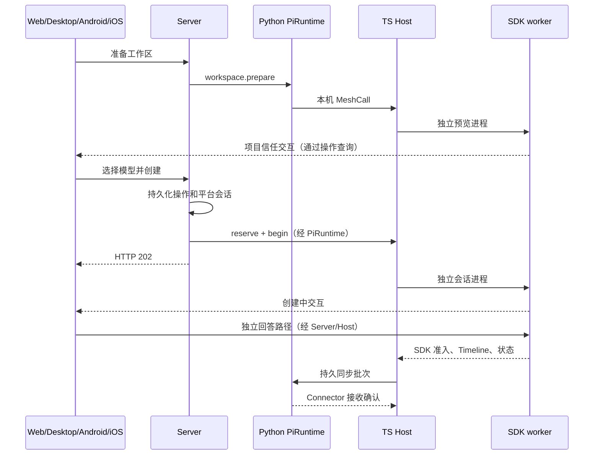

# pi Runtime

此包是 Agents Anywhere 的 pi SDK 执行端。Connector 的 Python 适配器负责实例生命周期和通用 Runtime 接口；TypeScript Host 负责准备、创建操作、配额及可靠同步；每个 SDK 会话使用独立 worker。Host 本身不加载 SDK。

固定依赖 `@earendil-works/pi-coding-agent` 1.4.0，使用原生 Node 22.18 及以上的 22.x。产物包含 Node，不能使用 Electron 可执行文件或版本管理器脚本。当前启用 macOS、Linux；Windows 的进程监督后端尚未启用，环境检查会给出对应 Runtime 的不可用原因。

## 本地准备

在仓库根目录执行：

```sh
npm --prefix pi-runtime install --ignore-scripts --package-lock=false
npm --prefix pi-runtime run build
node pi-runtime/scripts/package-artifact.mjs
```

`artifact/manifest.json` 记录 SDK、平台、CPU 架构、Node ABI、入口及每个文件的 SHA-256。产物只适用于生成它的平台和架构；部署时整体分发，不能在服务器构建。Electron 的 `extraResources` 会复制已生成的产物。

Connector 中新增 pi 实例后，`runtimeDirectory` 指向该产物目录；默认使用仓库或 Electron 资源目录内的 `pi-runtime/artifact`。`agentDir` 默认 `~/.pi/agent`，沿用 pi 的模型和认证配置。没有产物、原生 Node 不符或校验失败，只会使该实例启动失败。

## 已接通的流程

1. 在新建页面选择设备、Runtime 和工作目录，点击「准备工作区并加载模型」。此时没有平台会话，也没有模型请求。
2. 有受保护的项目资源时，先选择基础模式、本次启用或信任目录，再装配 SDK 资源并返回工作区模型目录。
3. 发送消息先预留准备，再持久化平台会话和创建操作。Server 返回 HTTP 202；创建中的扩展提问可独立查询和回答。
4. 工具审批冻结原始参数对象，回答携带请求版本、所有者代际和幂等身份。通用对话保留空字符串、预填内容和多行文本。
5. 固定模型策略在 `Agent.prepareRequest`、ModelRuntime、最终 payload 和 HTTP 发送处检查模型与推理强度。扩展换模后阻止请求；SDK 已准入的消息保持已准入事实。
6. Timeline 使用原生 reservation 标记关联流式条目和 JSONL entry；SDK 复制的助手事件沿同一响应流关联，增量合并和结束落盘保持同一条目身份，来源 entry 更新也参与内容指纹；同步写入磁盘，收到 Connector ACK 后删除。单个会话的失败不会阻塞其他会话的批次。
7. 关闭依次取消交互、abort、等待回合、执行 shutdown、同步原生文件和位置，再退出 worker。写锁由独立 helper 持有至 worker 实际退出。
8. 创建操作保存消息身份、请求指纹和原生会话身份。Host 重启和后续查询核验 worker 已持久化的准入回执；证据不足或身份冲突保持结果未知，不重新投递消息。单个历史文件无法读取或解析时返回诊断，其他会话继续发现与回填。
9. 预留决定由领域策略计算；明确拒绝在 Server 保存为未创建、未接纳终态并原子释放准备占用，超时和缺失所有者元数据保持未知。SDK worker 异常退出作为带身份与代际的事实进入会话事件队列，关闭旧交互、发布阻塞和恢复能力。
10. 重启时清理旧执行者的状态和能力观察；回填与实时事件共用持久 outbox，只有接收确认后才完成同步。模型目录的内容指纹与平台 revision 分离：SDK 提供定义，唯一 Host 按工作区保存递增版本，并兼容旧缓存的版本下限。

严格请求 profile 支持标准 OpenAI Completions、OpenRouter Completions 的嵌套推理字段及 OpenAI Responses；目录和发送守卫共用格式判定，并按固定的 pi-ai 1.4.0 兼容规则解析配置。其他推理编码、API 或自定义请求实现显示为不可用。附件、steer、任意原生命令及动态模型路由未发布能力。普通 pi TUI 历史以只读方式发现，第三方原生 TUI 提问和写入接管不冒充 SDK 支持。

## 代码与数据流

| 目录 | 职责 |
| --- | --- |
| `src/contracts` | Bridge 输入验证、对话结果、同步批次契约 |
| `src/domain` | 交互状态机、审批回执、JSON 冻结和短状态锁 |
| `src/application` | 工作区准备、创建准入、配额、恢复授权、事件归一化 |
| `src/infrastructure` | SDK 边界、模型守卫、OS worker、原生历史、投影、原子存储和 outbox |
| `src/entrypoints` | Host 的 MeshCall 服务和 worker 私有 IPC |
| `scripts` | 产物打包、源码契约导出与直接功能检查 |



## 直接检查

```sh
node pi-runtime/scripts/verify-runtime.mjs
node pi-runtime/scripts/verify-recovery.mjs
node pi-runtime/scripts/verify-admission-recovery.mjs
node pi-runtime/scripts/verify-catalog-revisions.mjs
node pi-runtime/scripts/verify-model-boundary.mjs
node pi-runtime/scripts/verify-tool-boundary.mjs
node pi-runtime/scripts/verify-workers.mjs
PYTHONPATH=connector connector/.venv/bin/python pi-runtime/scripts/verify-connector.py
bash ios/scripts/verify-runtime-workflows.sh
python3 android/scripts/verify-runtime-workflows.py
```

`verify-server-startup.py` 和 `verify-server.py` 另需 Server 环境已安装本仓库 Connector，并提供独立测试 PostgreSQL：`AGENT_SERVER_TEST_DB_URL` 的数据库名必须包含 `test`。前者迁移后执行正式 `create_app()` lifespan；后者通过真实 Connector 分发器和 Server 通知处理验证预留拒绝的终态与释放、丢失预留 ACK 后查询恢复，以及 HTTP 创建、创建中回答、工具审批后实际写文件、继续对话、HTTP 关闭及恢复、符号链接项目归属、重连回填、数据库身份、幂等和账号隔离。Server 到 Connector 的控制传输使用进程内适配器，模型端点使用本机受控 HTTP 服务。

准备阶段保留项目登记路径，SDK 执行和项目信任使用真实目录；符号链接不会把会话移动到另一个项目。基础能力决定在正式创建和恢复时保持禁用项目资源。异常退出后的继续位置选择会在校验通过后发布空闲状态及能力。Runtime 使用 `events` 同步模式，在启动和重连时回填元数据、部分历史、状态、Notice 和能力；外部原生 TUI 的持续写入仍通过显式同步读取。

会话关闭期间拒绝新消息、恢复和选择操作，收尾核验 worker 身份后才释放绑定，避免旧关闭操作清掉新的执行者。普通供应商请求失败进入可重试的 `error`，模型授权违规保持 `blocked`。Web/Electron 的回答、取消与查询按账号和服务范围隔离迟到响应，历史弹窗按会话和 owner generation 重建；Android 的对应操作固定捕获认证目标，并在发布结果时核验代际与操作身份。

iOS 的确定失败保留完整工作流事实：只有终态明确 `messageAccepted=false` 才解除创建阻塞并移除对应操作引用；结果未知或已接纳但元数据尚不可读时继续保留引用和草稿。工作流 DTO 与失败判定放在 Domain，API 只负责资源调用。

Android 在接纳后保留恢复引用，直到读取并核验正式会话身份；读取失败可以从创建操作重试打开，账号变化后旧绑定结果失效。JVM 探针编译实际 Coordinator，并为 HTTP、存储和会话端口提供受控实现；需先完成一次 Android 依赖安装。应用入口、恢复按钮和 Controller 的实际接线另通过 Kotlin 编译检查。
